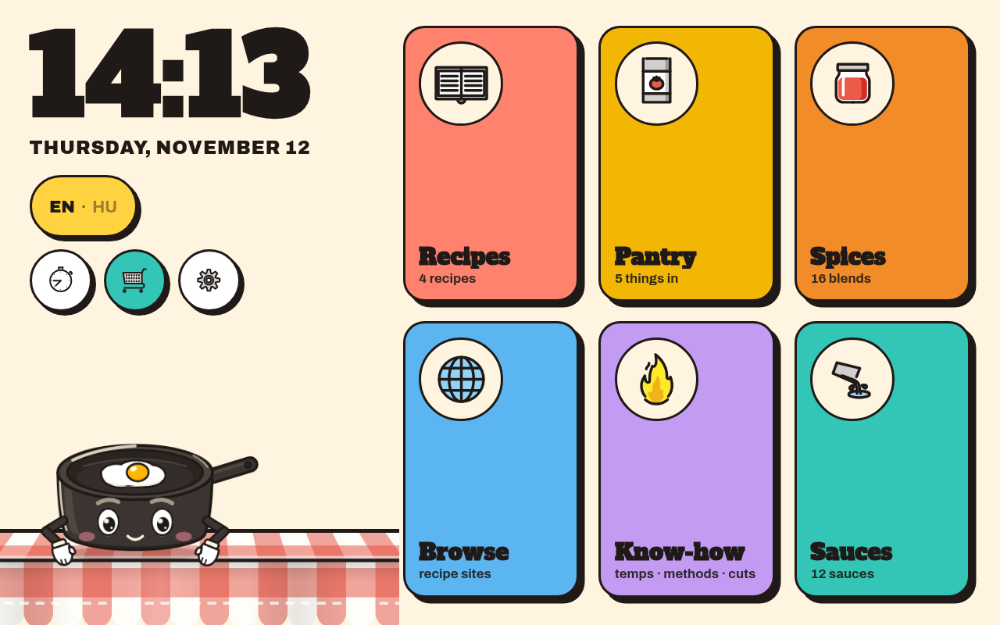
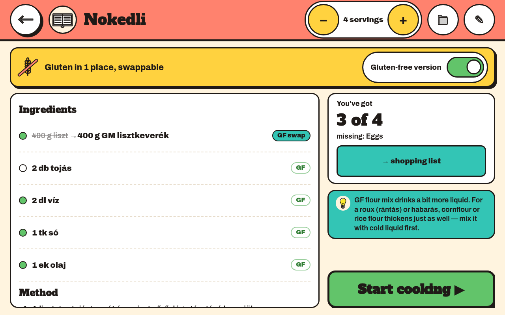
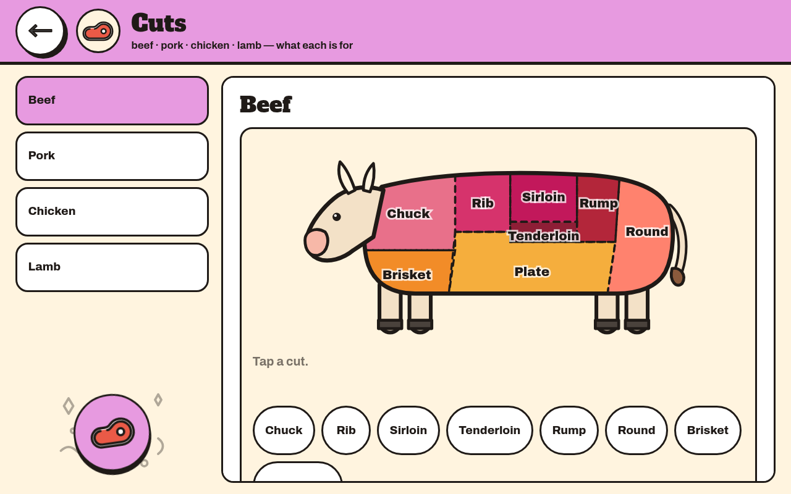
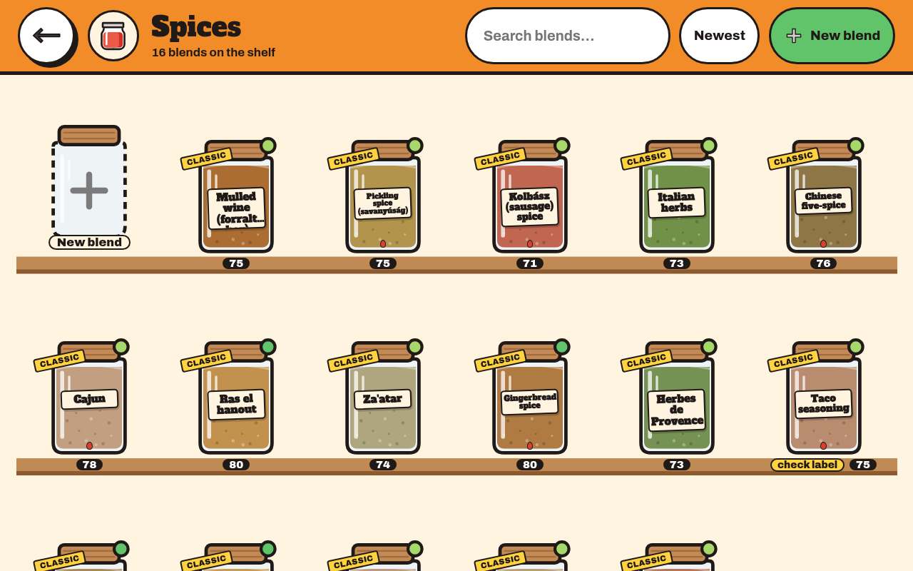
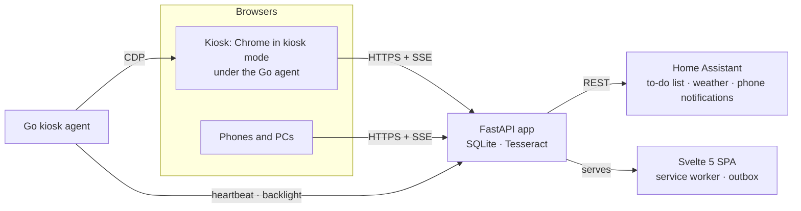

# JXN Kitchen

[](https://www.python.org/)
[](https://fastapi.tiangolo.com/)
[](https://svelte.dev/)
[](kiosk/agent)
[](LICENSE)

A touch-first kitchen companion for a **fully gluten-free kitchen**: recipes, pantry, shopping list, timers, a spice-blend
and a sauce engine, and a bilingual know-how library — served by one small FastAPI app, shown 24/7 on a wall-mounted
kiosk and usable from any phone or PC on the home network. Hungarian and English throughout.

<p align="center">
  
  
</p>
<p align="center">
  
  
</p>

## What it does

- **Recipes** — import from a link (schema.org JSON-LD with a per-site scraper first, behind an SSRF guard), or digitise
  a scanned page with Tesseract OCR; scale servings, cook step by step with timers started from the step text, file
  recipes into folders. Every ingredient line is parsed and matched to the catalogue, and every recipe gets a
  **gluten verdict** that errs on the safe side.
- **Pantry and shopping list** — a catalogue of 450+ tiles where the tiles *are* the gluten-free products; the shopping
  list syncs both ways with Home Assistant's to-do list, so a phone sees the same list in the shop.
- **Spice blends and sauces** — two engines built on exhaustive, hand-judged knowledge matrices (every cell has a
  reason): build a blend or a sauce, get a ledger of what works, what clashes and how to fix it.
- **Know-how library** — nineteen sections of kitchen knowledge (temperatures, cuts, methods, storage, appliances,
  gluten-free baking, eating out) with interactive infographics, in both languages.
- **Kitchen timers** — any number, labelled, kept on the server so the kiosk, the phone and Home Assistant agree; a
  phone notification when one ends.
- **The kiosk** — a small Windows 10 PC on the wall runs a Go agent as its shell: Chrome in kiosk mode under a
  watchdog that probes the page itself, backlight on a day/night schedule, a Wi-Fi link that heals itself, and an
  overlay that keeps any recipe site usable by touch — with a **Save recipe** button that imports what is on screen.
- **Works offline** — a service worker keeps the shell, every recipe, blend and photo; timers run, ring and change
  without the server, and edits queue in an outbox that replays in order at the next reconnect.
- **Phones are first-class** — a mobile layout from 375 px up, installable as a home-screen app.

## Architecture



| Part | Stack |
|---|---|
| Server (`server/kitchen/`) | Python 3.13, FastAPI, SQLite with migrations, Server-Sent Events, httpx, recipe-scrapers, rapidfuzz, Pillow, Tesseract + poppler for OCR |
| Web app (`web/`) | Svelte 5, Vite, TypeScript; a service worker with a warm-up cache and an outbox for offline writes; vitest |
| Knowledge (`catalogue/`, `knowhow/`, `engine/`) | YAML, bilingual, validated at start-up — one bad cell and the server refuses to start |
| Kiosk agent (`kiosk/agent/`) | Go, `windows/386`, Chrome DevTools Protocol, WLAN API, Winlogon shell |
| Deploy (`deploy/`) | One Docker image (a node stage builds and tests the SPA, a slim Python stage serves it), compose, health-gated |

## Quick start

Needs Python 3.13, Node 22 with npm, rsync and Go (only for the kiosk agent). The web app is built **outside the
repo** — `scripts/build-web.sh` copies `web/` to `~/.cache/jxn-kitchen/web` and builds there (the repo grew up on a
drive two operating systems share, and a guard test keeps `node_modules` out of the tree):

```bash
python3.13 -m venv ~/.local/share/venvs/jxn-kitchen
~/.local/share/venvs/jxn-kitchen/bin/pip install -e './server[test]'
scripts/build-web.sh                                    # → ~/.cache/jxn-kitchen/web/dist
KITCHEN_DATA_DIR=/tmp/kitchen-data KITCHEN_STATIC_DIR=~/.cache/jxn-kitchen/web/dist KITCHEN_SHOPPING_SYNC_SECONDS=0 \
  PYTHONPATH=server ~/.local/share/venvs/jxn-kitchen/bin/uvicorn kitchen.main:app --port 8765
```

Open `http://localhost:8765` (add `?kiosk=1` for the kiosk layout). Home Assistant is optional: without `HA_URL` and
`HA_TOKEN` the weather chip, the shopping-list sync and phone notifications simply stay off. To seed the four demo
recipes: `~/.local/share/venvs/jxn-kitchen/bin/python scripts/demo-recipes.py > recipes.json`, then `POST` each body
to `/api/recipes`.

Tests: `~/.local/share/venvs/jxn-kitchen/bin/python -m pytest` (repo guards + server, from the repo root),
`scripts/build-web.sh --test-only` (vitest + svelte-check), `(cd kiosk/agent && go test ./...)`.

## About this copy

This is a public snapshot of a private repository, made for showing the work. Home-network specifics are replaced by
placeholders (`kitchen.example.com`, `192.168.1.x`), the scripts that harden the kiosk's Windows and the design notes
are not included, and the scraped recipe pages the importer was tested against are replaced by hand-written ones. The
rest — every source file, test and line of the reference below — is the real thing.

---

# Reference

The full documentation, held to the code by `server/tests/test_readme.py`: every endpoint, setting, component, engine
finding and reason code must be named here, or the build fails.

## Layout

| Path | What |
|---|---|
| `server/kitchen/` | FastAPI app (`app.py` routes, `config.py`, `db.py` migrations, `settings.py`, `night.py`, `events.py` SSE, `ha.py`, `weather.py`, `kiosk.py`, `catalogue.py`, `pantry.py`, `shopping.py` + HA sync, recipes: `ingredients.py` parser, `matcher.py`, `gluten.py` engine, `timers.py`, `recipes.py`, `images.py`, `importer.py`; spices: `spice_data.py` (knowledge loader/validator), `spice_engine.py`, `blends.py`; sauces: `sauce_data.py`, `sauce_engine.py`, `sauces.py`; `main.py` ASGI entry) |
| `server/tests/` | pytest suite (+ `fixtures/`) |
| `web/` | Svelte 5 + Vite + TS single-page app (`src/screens`, `src/components`, `src/lib`, `src/i18n/{en,hu}.json`, `public/` = sprite, fonts, service worker) |
| `knowhow/` | the know-how library (YAML, bilingual) — see *Know-how library* |
| `engine/spices/` | the spice engine's hand-judged knowledge (YAML, bilingual) — see *Spice engine* |
| `engine/sauces/` | the sauce engine's hand-judged knowledge and physics (YAML, bilingual) — see *Sauce engine* |
| `catalogue/` | the pantry/ingredient catalogue (YAML, the source of truth) — see *Catalogue* |
| `icons/` | `manifest.yaml`, `build_sprite.py`, OpenMoji sources (`openmoji/`), our drawn icons (`custom/`) |
| `kiosk/agent/` | the Go kiosk agent (the kiosk's Windows shell) |
| `deploy/` | `Dockerfile`, `compose.yaml`, `kitchen.env.example` |
| `scripts/` | `build-web.sh`, `screens.sh` (+ `demo-recipes.py` seeding), `touch-audit.py`, `clip-audit.py`, `cdp.py` + `chrome-flags.txt` (shared by every script that drives Chrome), `anim-sheet.py` (filmstrips, character sheet, infographic states), `knowhow-fixture.sh`, `spice-check.py` (the spice knowledge, block by block), `offline-e2e.py` (offline mode end to end against a local throwaway server) |
| `docs/mascot/` | `character-sheet.png` — the mascot's expressions, props and night look (made by `anim-sheet.py --sheet`) |
| `tests/` | repo guards: secrets/venv hygiene, deploy file set, icons, fonts |

## Running the tests

```bash
~/.local/share/venvs/jxn-kitchen/bin/python -m pytest      # repo guards + server (run from the repo root)
scripts/build-web.sh --test-only                              # web unit tests (vitest), in the scratch copy
(cd kiosk/agent && ./build.sh)                                # agent tests + the windows/386 build
~/.local/share/venvs/jxn-kitchen/bin/python scripts/touch-audit.py   # every touch target >= 64 px (needs a build)
~/.local/share/venvs/jxn-kitchen/bin/python scripts/clip-audit.py    # no text cut off, 5 sizes x EN/HU (needs a build)
```

The venv lives **outside** the repo (`~/.local/share/venvs/jxn-kitchen`, Python 3.13): this tree is on the Shared
NTFS drive, and a Linux venv inside it would be wrong for Windows. For the same reason **the web app is never
installed or built inside `~/Projects`** — `scripts/build-web.sh` rsyncs `web/` to `~/.cache/jxn-kitchen/web` and
builds there (the first run writes `web/package-lock.json` back). Go's caches: `~/.cache/go`.

## Server

### Environment (`config.py`)

| Variable | Default | Meaning |
|---|---|---|
| `KITCHEN_DATA_DIR` | `/data` | SQLite DB (`kitchen.db`) and uploads |
| `KITCHEN_STATIC_DIR` | `/app/static` | the built web app (served at `/` when the directory exists) |
| `HA_URL` | — | Home Assistant base URL, `http://192.168.1.2:8123` |
| `HA_TOKEN` | — | long-lived HA token (the one named **"JXN Kitchen"**); **only** in `/etc/kitchen/kitchen.env` (root 0600) |
| `KITCHEN_WEATHER_ENTITY` | `weather.forecast_home` | the HA weather entity for the home/idle screens |
| `KITCHEN_TZ` | `Europe/Budapest` | time zone for the night window |
| `TZ` | `Europe/Budapest` | container time zone (set in the env file) |
| `KITCHEN_CATALOGUE_DIR` | `/app/catalogue` in the image, else the repo's `catalogue/` | the catalogue the app loads (and validates — it refuses to start on any error) |
| `KITCHEN_SHOPPING_SYNC_SECONDS` | `20` | period of the two-way mirror with HA's `todo.shopping_list`; **`0` disables it** (`scripts/screens.sh` sets 0 so demo data never reaches the real list) |
| `KITCHEN_SCANS_DIR` | — (compose: `/scans`) | the scan inbox: the share's `scans/` folder, mounted read-only (`/srv/share/scans:/scans:ro`); unset = no inbox |
| `KITCHEN_BUILD` | `dev` | the build id (git describe), baked into the image; the web app reloads itself when it differs from its own |

Without `HA_URL`/`HA_TOKEN` everything works except weather and the shopping-list mirror (and, later, phone
notifications), which degrade silently.

**Threading rule:** every route is `async def`, so SQLite is only ever touched from the event loop; the connection
keeps `check_same_thread` on and a guard test rejects any sync route (sync routes run in a thread pool and corrupted
the shared connection's cursors under concurrent writes).

### Settings (`GET`/`PUT /api/settings`, stored in SQLite)

| Key | Type / allowed values | Default | Meaning |
|---|---|---|---|
| `language` | `"en"` \| `"hu"` | `"en"` | UI language everywhere (recipes keep their own) |
| `night_start` | int 0–23 | `23` | hour (Budapest) the night window starts |
| `night_end` | int 0–23 | `6` | hour it ends; may wrap midnight; `start == end` = never night |
| `idle_minutes` | 1 \| 2 \| 5 \| 10 | `2` | minutes without a touch before the kiosk shows the idle scene (also on Browse sites: the overlay goes back to the app's idle scene) |
| `sounds` | bool | `true` | taps/timers make sounds on the kiosk |
| `night_brightness` | int 5–100 | `20` | backlight % at night (never 0 — the display is never turned off) |
| `day_brightness` | int 5–100 | `80` | backlight % by day |
| `browse_sites` | list of built-in site ids, no repeats: `nosalty` `streetkitchen` `mindmegette` `receptneked` | all four | which built-in sites Browse shows, in this order |
| `browse_custom` | up to 8 × `{"name": 1–40 chars, "url": http(s) ≤ 300 chars}`, no other keys | `[]` | the owner's own Browse sites (GF blogs…) |

A `PUT` takes any subset; an unknown key or a bad value is `422` and nothing is applied. Every change is broadcast as
the SSE event `settings`.

### Endpoints

| Method + path | Request | Response |
|---|---|---|
| `GET /api/health` | — | `{"ok": true, "version": "<x.y.z>", "build": "<git describe>"}` (Gatus, the container healthcheck, the app's self-reload — which reads `build` from any status). **`503`** `{"ok": false, …, "dangling": ["pantry: <id>", "shopping #<n>: <id>", "recipe <r> line <p>: <id>", "blend <b> part <p>: <id>"]}` when stored ids are missing from the catalogue (see *Catalogue → Removed ids*); the app keeps serving. Never cached by the service worker |
| `GET /api/settings` | — | the settings object above |
| `PUT /api/settings` | partial settings object | the full settings, or `422 {"detail": ...}` |
| `GET /api/events` | — | `text/event-stream`: `retry: 3000`, then `event: <type>` + `data: <json>` frames. Types: `settings` (the full settings), `pantry` (`{node, have, state}`), `shopping` (`{items}`), `recipes` (`{id}` — a recipe was created, changed or deleted), `blends` (`{id}` — a blend was created, changed or deleted), `timers` (`{timers}` — the list as GET returns it), `ping` (`{}`, every 20 s of silence — a real event, so the page's watchdog sees it) |
| `GET /api/catalogue` | `If-None-Match` optional | the catalogue tree for the UI (`{categories:[{id,en,hu,icon,color,kind,groups:[{id,en,hu,icon,items:[{id,en,hu,icon,gluten,aliases?,staple?}]}]}]}`, hidden wheat items left out), with an `ETag`; `304` when unchanged |
| `GET /api/knowhow` | `If-None-Match` optional | the know-how library: `[{id, icon (sprite id), color, en/hu: {title, sub}, pages: [{id, illustration, en/hu: {title, body}}]}]`, with an `ETag`; `304` when unchanged |
| `GET /api/pantry` | — | `{"have": [item ids in, staples included unless off], "groups_some": [group ids], "staples_off": [ids]}` |
| `PUT /api/pantry/{node}` | `{"have": bool}` (strict) — `node` = an item id, or `group:<group id>` for "I've got some … somewhere" | the new state (as above); SSE `pantry`. `404` unknown node, `422` a hidden (wheat) item or a bad body |
| `GET /api/shopping` | — | `[{"id", "text", "item_id", "done", "ha_linked"}]` (open first, then done) |
| `POST /api/shopping` | `{"text": str ≤ 200}` or `{"item_id": str}` | the item. `item_id` writes the catalogue name in the UI language; a hidden wheat item becomes its GF version (and that id is stored). **Typed text** keeps the owner's words but is linked to the catalogue item it names (exact name/alias, a typed `GF`/`GM` ignored for the lookup) so "into the pantry?" works. **GF marker** (celiac safety, spec §7): a `label` item or the GF version of a wheat product ("Hosszú tészta", "Zsemlemorzsa") goes on the list as `GF …`/`GM …` — whoever shops from the phone must not buy the wheat one — never twice. An open item with the same `item_id` or (accent-folded) text is returned instead of a duplicate. `404` unknown item, `422` empty/blank |
| `PATCH /api/shopping/{id}` | `{"done"?: bool, "text"?: str ≤ 200, not blank}` | the item; `404` if gone, `422` blank text |
| `DELETE /api/shopping/{id}` | — | `204` |
| `POST /api/shopping/clear-done` | — | the remaining list |
| `GET /api/weather` | — | `{"condition": <icon id>, "temp": <float>, "unit": "°C"}` or `{"condition": null}` when HA is unknown/unreachable. Cached 10 min; keeps the last good reading through an HA outage of up to 1 h, then `{"condition": null}` (the chip hides; spec §9). Conditions: `sunny clear-night partlycloudy cloudy rainy pouring snowy fog lightning windy hail exceptional` (HA's `snowy-rainy`→`snowy`, `lightning-rainy`→`lightning`, `windy-variant`→`windy`, anything else→`cloudy`) |
| `POST /api/kiosk/heartbeat` | `{"agent": str, "chrome_ok": bool, "free_mb": int, "overlay_ok"?: bool}` (strict types; `overlay_ok` optional for older agents) | `204`; `422` on a bad body |
| `GET /api/kiosk/health` | — | `200 {"age_s", "agent", "chrome_ok", "free_mb", "overlay_ok"}` while the last heartbeat is < 180 s old, else `503` (Gatus "Kitchen kiosk (agent heartbeat)"). `chrome_ok` = the page evaluates script; `overlay_ok` = the Browse overlay's session is up (null from an older agent) |
| `GET /overlay.js` | — | the Browse overlay (static, built by `npm run build`); with `/fonts/*` the only files served with `Access-Control-Allow-Origin: *` |
| `GET /api/kiosk/display` | — | `{"night": bool, "brightness": int}` for *now* in Budapest (the agent polls it) |
| `GET /api/recipes` | `?q=` (accent-folded title/tag search) `&tag=` | summaries, newest change first: `[{id, title, image, minutes (total, else prep+cook), servings, tags, source_site, verdict, have, total, missing (count), missing_names (the first four, UI language), origin, created_at, folder_id (null = the top level)}]`, from every folder |
| `GET /api/cookable` | — | the summaries that have food lines, sorted fewest missing first, then the larger share in stock, then verdict `gf` < `check` < `swaps` < `unknown` < `empty` |
| `GET /api/recipes/{id}` | `?servings=1..100` (scales every quantity) | `{id, title, lang, source_url, source_site, image, servings, base_servings, prep_min, cook_min, total_min, notes, origin, tags, created_at, folder_id, verdict, have, total, missing:[{item_id, name}], lines:[…], steps:[{pos, text, timers:[{start, end, seconds}]}]}`; a line is `{pos, raw, qty_text, name, note, item_id, item_name, how, gluten, ok_gf, gf_text, tip, have}` — `qty_text`/`item_name`/`gf_text` in the **recipe's** language, `tip` in the UI language, `have` null for non-food lines. `404`, `422` bad servings |
| `POST /api/recipes` | `RecipeIn`: `{title 1–200, servings 1–50 (4), prep_min?/cook_min?/total_min? 0–10000, ingredients: [≤ 200 lines ≤ 400 chars], steps: [≤ 100, ≤ 4000 chars], tags: [≤ 20, ≤ 40 chars], notes? ≤ 10000, source_url? ≤ 2000, lang? "hu"\|"en" (guessed from accents when absent), folder_id? (the folder to file it in; an unknown one = the top level)}` | `{id}`; SSE `recipes` |
| `PUT /api/recipes/{id}` | `RecipeIn` (replaces it; lines whose raw text is unchanged keep the owner's hand corrections; `folder_id` is ignored — the recipe stays in its folder) | the recipe; `404` |
| `POST /api/recipes/move` | `{"ids": [1–500 recipe ids], "folder_id": int \| null}` — file recipes into a folder (null = the top level); all or nothing | `{"moved": n}`; SSE `recipes` `{"folders": true}`; `404` an unknown folder or recipe (nothing moved), `422` an empty list |
| `GET /api/folders` | — | every recipe folder, flat, siblings in accent-folded name order: `[{id, name, parent_id (null = top level), recipes (directly inside), folders (directly inside), created_at, updated_at}]` |
| `POST /api/folders` | `{"name": 1–60 chars, "parent_id": int \| null}` (the name is trimmed, inner spaces collapsed) | the folder; SSE `recipes` `{"folders": true}`; `404` unknown parent, `409 {"code": "taken"}` (a sibling has that name, accent- and case-folded) or `{"code": "depth"}` (deeper than 8 levels), `422` a bad name |
| `PATCH /api/folders/{id}` | `{"name"?: 1–60 chars, "parent_id"?: int \| null}` — rename and/or move; `parent_id` only counts when sent (null = the top level, absent = stays put) | the folder; SSE `recipes` `{"folders": true}`; `404`, `409 {"code": "taken" \| "cycle" (into itself or below itself) \| "depth"}`, `422` |
| `DELETE /api/folders/{id}` | — | `{"recipes": n, "folders": n}` = what moved up into its parent (**no recipe is ever deleted**; a subfolder whose name is taken there becomes `Name (2)`, …); SSE `recipes` `{"folders": true}`; `404` |
| `DELETE /api/recipes/{id}` | — | `204` (its photo file goes too); `404` |
| `PUT /api/recipes/{id}/lines/{pos}` | `{"item_id": str \| null, "ok_gf": bool}` — `item_id` = "this line is that catalogue item" (a hand correction, kept across edits and re-matching); `ok_gf` = "this unmatched line is gluten-free" | the recipe; `404` unknown recipe/line/item |
| `POST /api/recipes/{id}/missing-to-shopping` | — | the shopping items added for every missing food item (same rules as `POST /api/shopping` with `item_id`) |
| `PUT /api/recipes/{id}/image` | raw image bytes (JPEG/PNG/WebP/GIF; streamed with a hard 15 MB cap) | `{"image": "/api/images/<name>"}`; `413` over 15 MB, `422` not a usable image (other formats, > 40 Mpx — refused from the header, before decoding) |
| `GET /api/images/{name}` | — | the stored JPEG (≤ 1024 px long side), `Cache-Control: immutable`; names are `<recipe id>-<ms>.jpg`, anything else `404` |
| `POST /api/import` | `{"url": str ≤ 2000}` | `{"id", "draft": false}` — or `{"id", "draft": true, "reason"}` when the page had no recipe, the site was unreachable or the scraper failed (the link is saved as a draft, never lost). `422` when the URL is refused (see *Recipes → Import*) |
| `GET /api/timers` | — | the timers not dismissed, done first: `[{id, label, seconds, state: running\|paused\|done, remaining (s, computed now), ends_at (running only), recipe_id, step_pos}]` |
| `POST /api/timers` | `{"label": ≤ 60 chars, no control characters (default ""), "seconds": 1–86400, "recipe_id"?, "step_pos"? 0–1000}` | the timer; SSE `timers`. `422` on a bad body |
| `PATCH /api/timers/{id}` | `{"action": "pause"\|"resume"\|"add"\|"dismiss", "seconds"?: 1–3600 (for add, default 60)}` — `add` on a done timer restarts it for that long | the timer (`{id, state: "dismissed"}` for dismiss); SSE `timers`; `404` |
| `DELETE /api/timers/{id}` | — | `204`; SSE `timers`; `404` |
| `POST /api/scan` | raw bytes: a photo (JPEG/PNG/WebP/GIF/TIFF/BMP, ≤ 40 Mpx) or a PDF; ≤ 80 MB, streamed | `{"ids": [recipe ids]}` — one draft per page (see *Digitising*); `413` too large, `422` not an image/PDF |
| `GET /api/scans` | — | `{"inbox": bool (the scans folder is mounted), "imported": n (files imported so far)}` |
| `GET /api/spices` | `If-None-Match` optional | the rack: `{shelves: [{id, en, hu, jars: [{id, label {en,hu} (the jar's short name), name {en,hu} (catalogue), fill, tag {en,hu}, heat, role, timing, form, fragile, gluten (catalogue flag), g_per_tsp, note {en,hu}\|null, page ("spices/<page>" on the know-how rack)\|null}]}], foods: [{id, icon (sprite id), en, hu}], axes, cuisines, roles, timings, words, heat, classics: [{id, en, hu, source}], max_spices}`, with an `ETag`; `304` when unchanged |
| `POST /api/blends/evaluate` | `{"parts": [{"spice", "parts" > 0 ≤ 1000}] (1–16), "batch_tbsp"?: > 0 ≤ 1000, "seq"?: int}` | the evaluation (see *Spice engine*) + `gluten` `{status ok\|check\|yours, about, en, hu}` + `seq` echoed (the editor drops an answer older than its last request); `422` on an unknown or doubled jar, zero parts, > 16 jars |
| `GET /api/blends` | `?q=` (accent-folded name/tag search) | summaries, last changed first: `[{id, names {en,hu}, origin, classic_id, tags, parts, score, word, jar_fill, heat (word), gluten, created_at, updated_at, missing_jars}]` |
| `GET /api/blends/{id}` | `?batch_tbsp=` (> 0 ≤ 1000) | the summary + `{name, lang, notes, method {en,hu}\|null, evaluation, used_by: [{id, name}]}`; `404` |
| `POST /api/blends` | `BlendIn`: `{name 1–80 (no control characters), notes? ≤ 4000, tags: [≤ 20, ≤ 40 chars] (lower-cased, de-duplicated), parts: [1–16 {spice, parts}], lang? hu\|en (guessed when absent)}` | `{id}`; SSE `blends`; `422` as for evaluate |
| `PUT /api/blends/{id}` | `BlendIn` (replaces it) | the blend; `404` |
| `DELETE /api/blends/{id}` | — | `204`; `409 {message, sauces}` when a sauce uses it; `404` |
| `POST /api/blends/{id}/riff` | — | `{id}` of the copy; `404` |
| `GET /api/sauces/shelves` | `If-None-Match` optional | the sauce editor's shelves: `{shelves: [{id, en, hu, items: [{id, name {en,hu}, role, driver, unit, default, step, alt, g_per_ml, g_per_pc, fill, gluten (catalogue flag), body (method), keeps}]}], families: [{id, en, hu, parent, vessel, chip, kind, body, note}], foods, roles, taste, units, keeps, chips, body: [{id, en, hu, below}] (the body gauge's bands — the engine's own `BODY_CLASSES` limits, the last open-ended sent as 99), stability, levels, words, heat, max_lines}` with an `ETag` (typed-only items are not listed; the owner's blends and the rack come from `/api/blends` and `/api/spices`); `304` when unchanged |
| `POST /api/sauces/evaluate` | `{"lines": [1–24 SauceLine], "steps"?: [≤ 30 strings ≤ 2000], "family"?: a family id, "seq"?: int}` — a `SauceLine` is `{shelf \| spice \| blend \| item, raw?, qty? (0, 5000], unit? tbsp\|tsp\|ml\|dl\|g\|pcs, ok_gf?, match_how?}` or `{raw}` | the evaluation (see *Sauce engine*) + `gluten` `{lines: [{pos, status, swap_id, tip_en, tip_hu, about}], verdict}` + `seq` echoed; `422` on an unknown item, jar, blend or family, a wrong unit, more than 24 lines |
| `POST /api/sauces/line` | `{"text": ≤ 200 chars}` | the typed line resolved: `{shelf, qty, unit, raw, match_how}` · `{spice, qty, unit: tsp, raw, match_how}` · `{item, raw, match_how}` · `{raw}`; `422` when there is nothing to read |
| `GET /api/sauces` | `?q=` (accent-folded name/tag search) | summaries, last changed first: `[{id, names {en,hu}, origin, classic_id, tags, family, family_user, vessel, fill, score, word, keeps {class, days}, heat (word), gluten (verdict), yield_ml, created_at, updated_at}]` |
| `GET /api/sauces/{id}` | — | the summary + `{name, lang, notes, method {en,hu}\|null, lines: [{pos, kind shelf\|spice\|blend\|off-shelf\|raw, shelf_id, spice_id, blend_id, item_id, raw, qty, unit, ok_gf, match_how, gluten}] (everything the editor sent comes back — `test_a_saved_line_gives_back_everything_the_editor_sent`), steps {en, hu}, timers {en, hu: per step [{seconds, start, end}]}, evaluation \| null}`; `404` |
| `POST /api/sauces` | `SauceIn`: `{name 1–80 (no control characters), notes? ≤ 4000, tags: [≤ 20, ≤ 40 chars], yield_ml? 10–5000, family? (override), lines: [1–24 SauceLine], steps: [≤ 30], lang?}` | `{id}`; SSE `sauces`; `422` as for evaluate |
| `PUT /api/sauces/{id}` | `SauceIn` (replaces it) | the sauce; `404` |
| `DELETE /api/sauces/{id}` | — | `204`; SSE `sauces`; `404` |
| `POST /api/sauces/{id}/riff` | — | `{id}` of the copy; SSE `sauces`; `404` |
| `POST /api/parse` | `{"lines": [≤ 200 strings ≤ 400]}` | the editor's live preview, per parsed line: `{raw, name, qty_text, item_id, how, item_name, gluten, gf_name}` in the recipe's guessed language |

## Web app

- **Routes** (hash router): `#/` home · `#/idle` idle scene · `#/settings` · `#/pantry` (categories + search) ·
  `#/pantry/<category>[/<group>]` · `#/pantry-have` (What I've got) · `#/shopping` · `#/recipes` (the top level) · `#/recipes/<folder id>` · `#/recipe/<id>` ·
  `#/recipe/<id>/edit` · `#/recipe/new[?folder=<id>]` (a new recipe filed in that folder) · `#/cook/<id>[?servings=n]` · `#/cook/sauce/<id>` · `#/timers` · `#/spices` ·
  `#/spices/new` · `#/spices/<id>` · `#/spices/<id>/edit` · `#/sauces` · `#/sauces/new` · `#/sauces/<id>` ·
  `#/sauces/<id>/edit` · `#/knowhow` ·
  `#/knowhow/<section>[/<page>]` · `#/browse` · `#/add?url=<link>` · `#/lab/mascot` (every move of the mascot;
  query `size=` `night=1` `still=1` — no blinks/breathing, for frame sampling — `expr=` `prop=cap|chef`, and the measuring
  knobs `tap=1` (tappable, as on home), `loop=<action>` (repeat forever), `pulse=<action>` (once every 3 s, as on the timer card))
  (the phone's share target) · `#/soon/<section>` (sections still being built). Anything else is home. No screen uses `history.back()` (a guard test): Back buttons go to a fixed
  route, so Back can never land on the idle scene. Query `?kiosk=1` (set by the agent; remembered in `localStorage`) marks the kiosk: idle detection and the
  on-screen keyboard are kiosk-only. `?shot=1` = screenshot mode (no SSE — an endless stream keeps headless Chrome
  waiting). `?demo=acts,day` (measurements only): `acts` fires the ambient acts back to back (300–700 ms rests — the
  worst case for the CPU budget), `day` shows the day look at any hour, `nobreathe` switches the mascot's breath off, `layers` puts every rig part on a
  permanent compositor layer (both to weigh a cost; `layers` measured worse — see *The kiosk*).
- **Kiosk viewport:** 1024×640 CSS px at DPR 1.25. **Touch targets ≥ 64 px on both sides** — one token, `--touch`
  (`lib/tokens.css`), and `scripts/touch-audit.py` measures it: every screen and overlay (keyboard, match picker,
  toasts) in headless Chrome at 1024×640 as the kiosk, probing each button/link/input's real **hit area** with
  `elementFromPoint` (an invisible `::after` tap zone counts; targets partly under an overlay are skipped); a target out
  of view or clipped — below the fold, past the end of a scrolling row — is **measured where scrolling brings it**
  (until 2026-10-20 a target wholly out of view was skipped, so nothing past a scroll edge was ever measured; the first
  thing the wider audit found was the recipe editor's 50 px photo input); a miss names the probe point and what it met.
  Exit 1 on any target under 64 px, or when a step meant to open an overlay opened none. `--selftest` runs its positive
  control (a row of 64 px pills running off a scroller's edge must pass, a 40 px button visible and one past the edge
  must both be flagged). A target that truly cannot be 64 px
  would carry `data-touch="<reason>"` and be listed (none do).
  **No text is cut off** — `scripts/clip-audit.py` (2026-11-11) opens the same screens (without the overlay steps)
  at five sizes — kiosk 1024×640 @1.25 (`?kiosk=1`), 720p, `iphone-app` 393×759 @3 (the home-screen app: the notch
  and home bar take 59 + 34 px), `se` 375×667 @2, `land` 844×390 @3 — in EN and HU, and measures every visible text
  node's line boxes against each ancestor whose overflow is `hidden` or `clip` (an ancestor that scrolls in that axis
  makes the text reachable, so it does not count). Tolerance 2 px across, 0.3 em up/down (a display font's glyph box
  is taller than a tight `line-height` without anything being cut; a missing line is a whole line). `text-overflow:
  ellipsis` and `-webkit-line-clamp` are deliberate: listed as `TRUNC`, not a failure; `data-clip="<reason>"` on a box
  exempts its text (listed as `EXEMPT`). Exit 1 on any `CLIPPED`. `--sizes a,b` and `--langs en|hu` narrow a run,
  routes as arguments; `--selftest` is its positive control (a cut second line and a nowrap label cut on the right
  must be flagged, a scroller and a tight big font must not, an ellipsis is TRUNC, a `data-clip` box EXEMPT). Proven
  on the build before the fix: 26 clipped texts on Home at `iphone-app`/`se`/`land`. `scripts/screens.sh` has the
  same three phone sizes. A full run (56 screens × 5 sizes × 2 languages) takes **~2½ minutes** with one process per size
  side by side (`CLIP_PORT=<port>` moves a run's ports: `--sizes kiosk` on 8800, `--sizes 720p` on 8810, …), ~1 minute
  per size and language alone.
  **Every script that drives Chrome** shares two things (2026-11-11): **`scripts/chrome-flags.txt`** — the flags every
  headless Chrome starts with (Puppeteer's automation baseline; Python reads it as `cdp.CHROME_FLAGS`, `screens.sh` with
  `mapfile`): without `--password-store=basic` Chrome hangs forever on the locked GNOME keyring while nobody is logged in,
  and without the background-work switches a fresh profile's first-run machinery runs on the browser's main thread — the
  one that serves every DevTools call — which made one 9-screen walk take 3m27s instead of 43.6 s; and **`scripts/cdp.py`**
  — the one DevTools client (`Page.call`, `Page.js`, `Page.exc`), which reads the socket continuously on its own task.
  `tests/test_hygiene.py` fails when a launch skips the shared flags, when the flag file loses those two, or when a
  script reads a DevTools socket itself (`kiosk-measure.py` is allowed: one call per connection). Portrait (phone) layouts stack; the page header drops
  its icon plate there and long titles shrink to fit (`lib/fit.ts`), then ellipsis (other `fit` labels wrap instead). On a phone `--touch` is 48 px —
  *Phones* below.
- **Phones — the mobile-first layer (2026-10-26; the owner's iPhone in Safari, or the app on its home screen).** The
  kiosk view does not move: every phone rule sits under `@media (max-aspect-ratio: 1/1)` (portrait; the kiosk is
  1024×640 landscape) or uses `env(safe-area-inset-*)`, which is 0 there. Proven by screenshots of both builds with
  animations off (`SCREENS_STILL=1`): 24 routes × EN/HU × kiosk/720p, 93 of 96 pixel-identical, the other three under
  20 pixels of graph anti-aliasing. `tests/mobile.test.ts` holds it: every media query must be one that cannot match
  1024×640 landscape, every fixed element offset from the top or bottom must add the safe-area inset, and no touch
  target is a hard-coded 64 px (the allow list names the four non-targets that are).
  - **Global** (`lib/base.css`): `#app` padded by the four safe-area insets (`viewport-fit=cover` lets the page run
    under the notch / Dynamic Island and the home indicator); `#app` height `100dvh` (Safari's toolbars hide the bottom
    of a `100%` page); `--touch: 48px` (Apple's 44 pt; everything sized by the token follows), smaller shadows, and
    `--kb-h: 0` (screens pad their bottom for the kiosk's on-screen keyboard, which never opens on a phone: that was
    312 px of empty scroll under every form). `index.html`: `maximum-scale=1` stops Safari zooming into any input under
    16 px on a tap (iOS still allows pinch-zoom; desktop Chrome ignores the tag).
  - **Header** (`PageHeader`): 64 px (`--touch` + 16), 22 px title, no icon plate or subtitle, buttons never wrap;
    `RoundButton` follows `--touch` (26 px icons on a phone).
  - **Screens:** Recipes — a row per recipe with the picture as a 96 px square (three or four recipes per screen instead
    of two mostly empty cards); Cook — the ingredients button shows its icon only, a smaller title and counter, 60 px
    Back/Next; Browse — `minmax(0, 1fr)` columns (a long site name pushed the second column off the screen); Know-how —
    the search gets its own row under the header (in the header it showed "Search the kn"); Timers — the stacked grid
    starts at the top (its rows stretched and left a gap above the running timers); Settings and Shopping — their
    steppers and inputs follow `--touch`; the recipe editor's Delete/Save compact; the blend and sauce editors — the
    tray is a list (a sideways strip showed two lines of sixteen) and **`ScoreDock`** docks the live score and its word
    at the bottom (tap: scroll to the full panel; hidden while the panel is on screen); the mascot lab — a
    `minmax(0, 1fr)` column (a plain `1fr` grew to the stage's width, wrapped the button rows past the screen's edge and
    cut "snore" & co off; found by `clip-audit.py`, 2026-11-11).
  - **Overlays clear of the safe areas:** `Toast`, `OfflineBadge`, `TimerDone`, Cook's ingredients drawer,
    `LinePicker` (and its height in `dvh`), `ScoreDock`.
  - **Home screen:** `apple-touch-icon.png` (180 px, full-bleed — iOS rounds it; it ignores the SVG and would screenshot
    the page), `icon-192.png`, `icon-512.png` (maskable) in the manifest, `apple-mobile-web-app-title` *Kitchen*.
    Opens standalone (the manifest's `display`).
  - **Home tiles never cut their text** (2026-11-11). The tile's plate and text never shrink (`flex: none`); the
    plate is `--plate` square, **86 px**, **60 px** on a phone (portrait, or any screen under 500 px tall), its icon 72 %
    of it. Home's rows are `minmax(min-content, 1fr)`: they share the height but never go below their content, and
    where the content cannot fit the **page scrolls** (`.home` `overflow-y: auto` on phones; `.tiles` `min-height: auto`
    so the row grows instead of spilling past the page's padding). Before, a row shorter than its content was settled
    by the engine: Chrome squashed the plate's height only (an oval), Safari cut the subtitle off at the tile's bottom
    edge — every tile on the owner's iPhone, invisible in every Chrome screenshot. `scripts/clip-audit.py` guards it.
  - **A phone held in landscape** (any landscape screen under 500 px tall) keeps the kiosk's two-column layout, but
    Home drops the fixed mascot scene (counter, mascot, tip bubble), as portrait does: sized for the kiosk's 640 px, it
    sat on the language chip and hid the timer, shopping and settings buttons (found 2026-11-11). Other screens are
    the kiosk layout squeezed into ~390 px of height.
- **Live data:** one SSE connection (`lib/events.ts`) with its own reconnect backoff 1,2,4,8…30 s (a native
  EventSource gives up on an HTTP error such as Caddy's 502 during a restart) and a **watchdog**: 50 s without any
  message (the server pings every 20 s) closes and reconnects — a half-open stream after Wi-Fi trouble is otherwise
  never noticed. The offline badge shows while disconnected, when an `/api` call fails or answers 5xx, or when the
  answer came from the service worker's cache (`x-kitchen-stale: 1`).
- **Service worker** (`public/sw.js`, module, registered as `/sw.js?v=<build>`; routing table `public/sw-strategy.js`):
  cache-first for `/assets/*`, `/fonts/*`, `/sprite.svg` and `/api/images/*` (photo names change when the photo
  does); network-first (4 s timeout) for the app page and `GET /api/*`, falling back to the cache when the network
  fails, is too slow **or answers 5xx** (Caddy's 502 while the container restarts) — a 4xx is a real answer and passes
  through. Cached stand-ins carry `x-kitchen-stale: 1`. **Registered** by `lib/swregister.ts` at start and again at every
  reconnect (an install that failed heals without a reload), with `updateViaCache: 'none'` so the worker and its
  import `sw-strategy.js` always bypass the HTTP cache; the server sends `Cache-Control: no-cache` for every file of the
  built app except Vite's hashed `/assets/*` (`immutable`, a year) — `WebFiles` in `server/kitchen/app.py`. Both since
  2026-11-12, when the kiosk's HTTP cache served an ~8 h-'fresh' heuristic copy of the old `sw-strategy.js`, the new
  worker's import failed and the kiosk kept the previous build's worker after a deploy. Only `/` (or `/index.html`) is stored as the app shell; other
  navigations (`/api/health` opened in a tab) and `/api/events`, writes and other origins are never intercepted. So
  a server reboot or a container restart leaves the kiosk on the cached app, not a browser error page.
  **Two caches** (`cacheFor` in `sw-strategy.js`): the build's own, `kitchen-<build>` (the app page, `/assets/*`,
  `/fonts/*`, `/sprite.svg`), which `activate` deletes when a new build takes over; and **`kitchen-data`**
  (`DATA_CACHE`: every `GET /api/*` answer and every `/api/images/*` photo), which **outlives deploys**. Until
  2026-11-12 the data sat in the build's cache, so every deploy emptied the kiosk's offline copy. **Offline stand-ins
  for a size** (`fallbackKeys`): `/api/recipes/<id>?servings=N` and `/api/blends/<id>?batch_tbsp=N` fall back to the
  default copy (`/api/recipes/<id>`, `/api/blends/<id>`) when that exact size was never fetched; the answer carries its
  own size, so the screen shows the default size, consistently.
- **Offline warm-up** (kiosk only, `lib/offlinewarm.ts` + the worker's `warm` message; owner's list item 5,
  2026-11-12): the worker used to cache only what a screen had asked for, so on 2026-11-07 (Wi-Fi gone 11½ h) a recipe
  nobody had opened since the last deploy had no steps. Now the kiosk page fetches the recipe, sauce and blend lists
  and posts the worker a list (`warmUrls`): every parameterless read the screens make (`BASE_READS`: settings,
  catalogue, pantry, shopping, timers, folders, recipes, cookable, knowhow, sauces, sauce shelves, blends, spices,
  weather), every `/api/recipes/<id>`, `/api/sauces/<id>` and `/api/blends/<id>`, then every recipe photo. The worker
  fetches them **one at a time** (4 s timeout each) into `kitchen-data`. A photo it already holds is not fetched again
  (photos are immutable); a `404` drops that cached copy (deleted); the run **stops at the first failure** (offline,
  timeout, `5xx`); only a **complete** run prunes, and it prunes only photos no longer listed (`staleImageKeys`). One
  run at a time. **When:** 20 s after start (`firstMs`), every 30 min (`everyMs`), and 10 s (`debounceMs`, so a burst
  of edits is one run) after each reconnect and each `recipes`, `sauces` or `blends` event. No run while the lists
  cannot be fetched. `UNWARMED` lists the live-only reads left out on purpose (`/api/health`, `/api/kiosk/health`,
  `/api/events`). **Guard:** `tests/offlinewarm.test.ts` fails the build when a screen reads a new `getJSON('/api/…')`
  path that is neither warmed nor in `UNWARMED`, or a parameterised path other than the warmed details. Size on
  2026-11-12: 17 recipes, 93 KiB of details, 2.1 MiB of photos. Not covered offline: a search (`/api/recipes?q=`)
  not run since, a size never opened (it falls back as above), and writes other than pantry and shopping (below).
- **Idle scene** (kiosk): after `idle_minutes` without a touch. The waking touch is **consumed** (its pointerdown is
  cancelled and the click within 600 ms swallowed), then the previous screen returns. A touch while the idle screen
  shows **always** wakes — also after a reload on `#/idle` (every deploy) — and going idle/waking *replaces* the history
  entry instead of pushing one.
- **Ambient acts** (`lib/acts.ts`, `lib/ambient.ts`): one act at a time, a random **8–22 s** rest (×2 at night),
  nothing while hidden. By day on home and idle the mascot gets `wave` `hop` `flip` `stir` `yawn` `look` `sizzle`
  `steam` `dance` (via `cueMascot()` / the `mascotCue` store, which also carries reactions); at night, on the idle
  scene only, `snore` (twice as likely) or `look`. Plus home `tile` wiggle (1.1 s) and the idle props: `chop` (2.9 s),
  `herbs` sway (2.6 s), `chicken` walk (7.4 s) — none at night. Between acts only the mascot's own small life runs
  (below). Only `transform`/`opacity` animate, on HTML elements (see *Mascot*).
- **Colours:** every palette colour (`lib/tokens.css` = `lib/palette.ts`, tested equal) carries **ink text at ≥ 7:1**
  and `textOn()` returns ink for all of them (owner, 2026-10-11: white text on tiles was hard to read); white text
  appears only on ink (toasts, badges, table heads). Guards in `tests/palette.test.ts`: the two files agree, every
  colour ≥ 7:1, no stylesheet rule pairs white text with a non-ink background, no Browse site tile is ink.
- **Mascot** (`components/Mascot.svelte`, `lib/mascot.ts`, sheet `docs/mascot/character-sheet.png`): a cast-iron pan
  with a fried egg, big eyes, cream mouth lines, blush and rubber-hose arms in white gloves; a cream rim light and a
  lighter outline at night keep the black iron readable on the dark scene. **Rig rule (performance):** every moving
  part is an HTML `div` (its own compositor layer) wrapping a *static* svg drawn in one 340×260 design space; CSS
  `zoom` sizes the whole rig so each layer rasterises crisp; animations touch only `transform`/`opacity` of those divs
  — Chrome cannot composite animations of svg children, which repaint on the main thread. `tests/mascot.test.ts`
  scans the mascot, the scene, the illustrations and the screens that host them: no animation or transition may
  target an svg element or any class used on one, keyframes may animate only `transform`/`opacity` (positive control:
  the old pan). No rounded clip on moving parts (a mask pass per frame on the kiosk's GPU). Props: `size`, `act` +
  `actKey` (play once), `expr`, `loop` (repeat an action), `alive` (the brain), `breathe`, `night`, `prop`
  (`cap` | `chef`), `tappable` + `ontap` + `label`; methods `play(id, keep?)`, `stop()`.
  **Expressions:** `neutral` `happy` `joy` (^ ^ eyes) `surprised` `sleepy` `asleep` (closed eyes, nightcap)
  `worried` `focus` `proud` `alarm`. **Actions** (ms): `hello` 1700 (pops up from below, waves) · `wave` 1800 (the
  left arm — the handle is on the right) · `hop` 1000 · `flip` 2400 (the egg turns over in the air; the signature) ·
  `stir` 2600 (spoon in the pan, toque optional) · `yawn` 2600 · `snore` 3200 (Z Z Z) · `alarm` 1200 (once per chime
  on the timer card) · `giggle` 950 (a tap) · `shrug` 1400 (holds; empty states) · `think` 2200 · `worried` 2400 (sweat
  drop; the connection dropped) · `look` 1900 · `sizzle` 1400 · `steam` 2600 · `dance` 2800 · `celebrate` 1800 ·
  `nod` 650 · `talk` 1600 (the speech bubble). Every action is anticipation → action → follow-through, with squash and
  stretch and overlapping parts (egg, yolk, handle, forearm, glove lag). **Brain** (`createBrain`): a blink every
  2.4–6 s (one in eight doubled), a glance 3–6 units to a side every 7–15 s held 0.9–1.7 s, a yolk wobble every
  14–28 s; it pauses while an action plays, while asleep and while the page is hidden. Continuous: a 4.2 s breath
  (5.6 s and deeper asleep) on the whole rig, **stepped at ~10 fps** (eight eased segments, 5 or 7 steps each): on the
  kiosk any 60 Hz animation costs ~14 % CPU whatever its size, and the identical frames between steps are not drawn
  (breath + brain 16.7 % smooth → 7.4–9.3 % stepped; asleep 10.5 → 4.8 %). Each step moves the outline by under a
  device pixel, so it still reads as smooth. **Guard:** an animation that repeats forever must be `steps()` or carry an
  `episodic:` comment saying what ends it (`tests/mascot.test.ts`, positive control: the old smooth breath). Only the
  rig and the squash wrapper keep permanent layers (`.rig, .squash { will-change }`); parts are promoted while they move. **Where it appears:** idle
  scene (centre stage; yawns when the scene opens; asleep in its nightcap at night), home (pops up with a hello; tap →
  giggle, then one of 68 kitchen tips in a speech bubble that opens its know-how page — `lib/tips.ts`, each linked to
  a real page and ≤ 95 characters, tested), the know-how home's last cell (toque; tap for a tip), the timer card
  (one `alarm` shake per chime, every 3 s, the alarmed face held in between — an undismissed timer stays up all night,
  and a looping alarm measured 51 % CPU on the kiosk against 14.5 % pulsed), empty states (`MascotNote`: shrug; the empty shopping list gets a happy hop), a link
  import in progress (stirring in the toque), cook mode's last card (celebrate), and on home/idle it reacts to the
  connection (worried when it drops, a hop when it is back). `#/lab/mascot` (Settings → About → The mascot) plays
  everything.
- **Idle scene** (`screens/Idle.svelte`, `components/scene/*`): `Counter` — subway tiles, a gingham cloth whose top is
  in perspective (converging, foreshortened checks), a rounded front edge, a drape with soft folds and a scalloped,
  stitched hem; one static svg, cropped never stretched; its colours come from `--grout --tile --tile-edge --cloth
  --gingham --shine`, which the night palette redefines. `Board` — wooden board with grain and handle, a half-chopped
  carrot with leaves, coins and a chef's knife (bolster, rivets); `chop` rock-chops the cut end and pops a coin per
  cut. `Herbs` — basil that sways, salt and pepper. The mascot stands between them; the home screen uses a short
  `Counter` strip. **Motion polish:** screens ease in (`.screen-in`, 0.26 s), tile grids pop in with a stagger
  (`.stagger`, 38 ms apart) — both `fill-mode: backwards`, so the press squash keeps working.
- **Night** (`lib/night.ts`, same rule and test table as `server/kitchen/night.py`): **only the idle scene** goes dark
  (`darkScene()`), with a static dim veil on the kiosk; the dark palette is the `.night-palette` class on the idle
  scene's own root (`lib/tokens.css`), never `:root`, so overlays above it — the timer card, toasts, the keyboard —
  keep the light palette (guard in `tests/night.test.ts`); awake screens keep the light palette so they stay readable,
  and the agent's lowered backlight (`night_brightness`) does the dimming. Windows never turns the display off
  (Modern Standby box).
- **Pantry:** one tap flips a tile (optimistic; rolled back with a warning toast if the write fails), a synthesised
  "tok" (`lib/sound.ts`, WebAudio, muted when `sounds` is off) and a toast — **Undo**, plus **+ shopping list** when
  something runs out. Each group has an "I've got some … somewhere" switch; staples show as in until switched off.
  Search (`lib/search.ts`) is accent/case-insensitive over names and aliases in both languages, ranked exact >
  prefix > word-prefix > substring; `fold()` is identical to the server's (both tested on
  `web/tests/fixtures/fold_cases.json`).
- **Shopping:** add by text or from catalogue suggestions, big tick buttons, ticking a catalogue item offers
  "into the pantry", ✕ removes with **Undo** (text, item and tick state come back), "clear the ticked". Mirrored with
  HA's to-do list (server side), so it is on the phone; items ticked off on the phone disappear here.
- **Home** (spec §6.1, amended 2026-10-19): the grid is **Recipes · Pantry · Spices / Browse · Know-how · Sauces**
  (`lib/tiles.ts`; Spices is `tangerine` — the pantry's Spices colour —, Sauces `teal`, the colour Shopping left; their
  subtitles count the blends and the sauces, `home.spices.count` / `home.sauces.count`). Shopping
  and Cook/Timers are **round buttons with a count badge** (open items; timers not dismissed — white on ink, the one place
  white text is allowed) in their own row under the language chip, beside Settings (`RoundButton` `badge` prop).
- **Spices** (`screens/Spices.svelte`, `Blend.svelte`, `BlendEdit.svelte`, `components/spices/*`, `lib/spices.ts`,
  `lib/engine.ts` — what both engines' screens share: `pool`, `createEvaluator`, the verdict words' colours and faces,
  the ledger filter and sum, `fmtFrac` —, `lib/longpress.ts`; the engine and its API: *Spice engine*). The client composes **no sentence**: every line arrives in
  both languages and is only picked by `$lang`.
  - **The shelf** (`#/spices`): the blends as jars standing on wooden planks (the planks are the grid's own background,
    one per 226 px row, so the jars stand on them), each jar the blend's `jar_fill`, its name on a hand-lettered label
    (type size chosen so the longest word fits — no mid-word breaks), heat pips (`mild` 0 … `fiery` 3), the verdict's
    colour on the lid, a `classic` ribbon on the seeds, the score and a `check label` tag on the plank. Search (folded,
    names and tags) and *Newest* / *A–Z*. The first jar is the empty "+ New blend" jar. Each blend keeps its own jar,
    keyed by id and built once; the search and the sort only show, hide and order them (CSS `order`); the empty-state
    mascot only when there are none.
  - **A blend** (`#/spices/<id>`): left the jar big (a tilt-and-settle entrance, once), its parts **striped bottom up**,
    filled to the batch's level of a 100 ml jar (≈ 20 level tsp, `JAR_TSP`); the batch scaler (± a tablespoon, 1–60) and
    the grams of each jar (`batchGrams` — the server's batch rule); the method (a seed's in both languages) and tags.
    Right the whole evaluation in one scroll (`EvalPanel mode="scroll"`). Buttons *Delete* (tap twice; refused with the
    sauces' names when a sauce uses it), *Riff on it* (a copy, opened in the editor), *Edit*.
  - **The spice engine** (`#/spices/new`, `#/spices/<id>/edit`): the name in the header (in the pane on a phone); left
    the **rack** — shelf tabs (the seven shelves + *Notes*: notes/method and tags), the jars of a shelf (tap: onto the
    tray with 1 part, the jar hops and gets a check mark drawn in CSS; **hold**: a sheet with the jar's know-how note,
    *Open in Know-how*, *Put it on the tray*), and **your jar**, the tray (− / value / + in half teaspoons, ½ … 50;
    **tap** a jar to see only its ledger lines and light it in the web; **hold** it to put it back, a red ring fills while
    you hold; the hint line under it is always there, hidden on an empty tray), followed by up to three dashed *Try*
    cards — the engine's suggestions (`suggest`), shown **450 ms after an answer** (gone at once with an emptied tray).
    The rack is **a fixed set of slots** (as many as the fullest shelf, 12), reused by every shelf — a shelf tap only
    changes what each slot shows (`.vacant` slots are `display: none`) — the tray is a fixed pool of 16 cards (since
    2026-10-20: a card built on every tap was the editor's last main-thread hitch), and the *Notes* pane is always
    mounted, shown by class. Right the live panel (`EvalPanel mode="tabs"`): **300 ms after the last change** the blend is evaluated
    (`createEvaluator`: every request carries a rising `seq`, an answer older than the newest request is dropped — a slow
    answer never overwrites a newer blend); before the first jar the panel is already built (the empty shape,
    `EMPTY_EVALUATION`) and says "Pick jars from the rack". At most 16 jars.
  - **The panel** (`components/spices/EvalPanel.svelte`): `ScoreRing` (the ring filled to the score; the number counts
    to a new value once, ~0.4 s, a new number at most every 100 ms and starting a frame after the answer, with a timer
    that lands it even if frames are throttled; the word on its colour —
    `sings` herb · `good` leaf · `muddled` butter · `fighting` tomato), the **mascot** with the word's face (`proud` ·
    `happy` · `focus` · `worried`) that plays one reaction when the word changes (`celebrate` · `nod` · `think` ·
    `worried`), the **radar** (`Radar`: eight axes, the blend's shape in its jar colour, the shape before the last change
    dashed), the **GF line** (a box two lines tall: three label jars wrap to a second line), then the sections *Why*
    (`Ledger`: "every blend starts at 50" and every finding with its
    points — a line with jars is a button that lights its pair in the web), *Web* (`HarmonyWeb`), *Goes with*
    (`FoodBoard`), *Timing & heat* (`TimingStrip`: bloom · during · at the end; `HeatGauge`: four bands and a marker),
    *Classics* (`ClassicsList`: the three nearest, how alike, what is missing and what was added — at most six chips a
    side, then "− N more" / "+ N more"; `CuisineBars`). The mascot does **not** breathe here (`breathe={false}`): it
    blinks and glances for 15 s after each answer (`alive`), then rests until the blend changes — a reading screen left
    open costs what a still page costs.
  - **Performance rules on the Atom** (each measured on the kiosk, 2026-10-19; guarded in `tests/spices-ui.test.ts`
    where a test can see it, by `kiosk-tapthrough.py --app spices` where only the kiosk can):
    - **Nothing is built on a tap.** The panel and all five sections exist before the first jar (creating the panel on
      the first jar cost a 450 ms frame; a section on its first tab 170–320 ms). Every list the engine fills is a
      **fixed pool** — `pool(list, n)` in `lib/spices.ts` pads it with empty slots, the screen renders every slot keyed
      by its place and hides the empty ones (`SLOTS`: 20 ledger lines, 3 classics, 6 chips a side, 3 cuisines, 4
      vouchers, 16 jars a timing lane, 3 *Try* cards; the engine's measured maxima over 3 000 random blends: 14, 3, 9/15,
      3, 4, 14, 5). Rows keyed by the finding or the classic were all rebuilt on every answer, and a list keyed by place
      still built rows whenever it grew past its longest yet. The harmony web: 16 node slots and 120 edge slots, positions
      fixed, plus a 15-line top layer for the lit pair (green solid = they like each other, red dashed = they fight, thin
      grey = nothing to say). The goes-with board mounts all 25 food icons once and only scales and fades them (an
      OpenMoji drawing is expensive to build — the lábas lesson; `<Icon>` is never inside an `{#if}` or `{#key}` in these
      files). The ring's arc, the radar's ghost, the empty hint, the ranks, the why box and an empty lane's dash are
      always there, shown by class. The editor's rack is a fixed set of slots; the *Notes* pane is always mounted (a
      shelf tap that dropped one shelf's jars and built the next cost 168 ms).
    - **One section per frame.** An answer updates the ring, the face and the radar in the frame it lands in, the
      section on screen in the next, then each hidden section in a frame of its own — chained with
      `requestAnimationFrame` → `setTimeout(0)` (a timer started inside a frame runs after it is drawn). All of it in
      one frame cost 84–184 ms; timers a fixed 70 ms apart still fired back to back when the Atom was busy.
    - **Hidden sections are drawn, faintly.** The five sections share one grid cell, each `contain: strict` and its own
      layer (`will-change: opacity`); a hidden one is at **opacity 0.002** — not 0 (a fully transparent layer is never
      rasterised, so its first show painted 25 OpenMoji foods during the tap, 84–151 ms), not 0.01 (four stacked
      sections showed through the one on screen).
    - **No layout shift on a tap.** A line that comes and goes above a scroller resizes it, and the kiosk then lays out
      and repaints everything in it: the tray's hint line (it resized the rack: 84–100 ms frames), the GF line (two
      lines tall), the web's caption (three lines), the goes-with box (170 px, more than four vouchers need) and the
      tray's cards row (82 px) keep their size whatever they hold. The editor's two panes sit in an explicit grid row
      (`minmax(0, 1fr)`: with an auto row every answer measured the rack and the tray again); food cells, ledger lines,
      tray cards and rack jars are contained.
    - **Static svgs.** No animation or transition on an svg element (`svgAnimationProblems` runs on every file of
      `components/spices` and the three screens); motion is entrances and one reaction per evaluation.
  - Tests: `tests/spices.test.ts` (parts ½ formatting, ± steps, the tray, the ledger filter and sum, the evaluator's
    debounce / stale-answer drop / empty tray, `pool`), `tests/spices-ui.test.ts` (the panel renders every finding, the
    word, the GF line, the classics and the axes of three real evaluations in both languages — fixtures
    `tests/fixtures/engine-*.json`, written by `scripts/engine-fixture.sh` and kept equal to the server by
    `server/tests/test_engine_fixtures.py` —; the empty panel and the panel for each real answer have **the same count of
    every element** (sections, lines, buttons, spans, circles, paths, icons); the web's pools; the board's 25 foods; the
    jar's stripes; per file: no svg animation, no `<Icon>` in `{#if}`/`{#key}`, every list the engine fills drawn
    through `pool(…)` and keyed by its place (each guard with a positive control); the editor's rack is a slot pool and
    its notes pane always mounted).
  - **Measured on the kiosk** (build `e85701b`, 2026-10-20): still pages `/spices` 1.6 %, `/spices/1` 1.6 %,
    `/spices/new` 1.7 %, `/spices/4/edit` 1.6 %, `/knowhow/blends/diy` 1.4 % total CPU, home 10.4 %; all ~60 fps, no
    animation running (`kiosk-measure.py`, BUDGET OK). Tap-through (`kiosk-tapthrough.py --app spices`): `/spices/1`
    35 taps worst 34 ms; `/spices/4/edit` 53 taps worst 67 ms; `/spices/new` 131 taps (every shelf, every jar on and off
    the tray, the notes tab) — clean but for **2–4 frames of 82–101 ms per run, all in its first ~30 taps**: half with
    no long frame on the main thread (GPU raster on the Intel HD), half main-thread work in pieces each under 5 ms (no
    script long enough to be named; warm-up suspected, not proven). Ruled out: layout shifts (0), DOM building (pools),
    GC (≤ 23 ms), the jars' clip paths (−6 % raster), extra layers for the rack, tray, ring and radar (no change over
    two runs; reverted). Touch targets all ≥ 64 px. **Re-run 2026-10-20** (build `7895a79`, the tray and the shelf now
    pools): `/spices/new` 131 taps — **one** frame of 101 ms, raster/GPU (no long frame on the main thread: the pooled
    tray removed the main-thread half); `/spices/4/edit` 53 taps worst 50 ms; `/spices/1` 35 taps worst 50 ms.
    **SP13, 2026-10-20** (builds `db0e795`–`aa8a1e1`, the kiosk settled): `/spices/new` **131 taps worst 67 ms — the
    SP10 residual is gone**; in two of three runs one sporadic 84 ms frame on a different tap each time; `/spices/4/edit`
    worst 51–67 ms, `/spices/1` 34–50 ms. CPU (`kiosk-measure.py`, `d1cb1eb`): `/spices` 1.6 %, `/spices/1` 1.6 %,
    `/spices/new` 1.8 %, `/spices/4/edit` 1.6 %, home 9.9 %.
- **Sauces** (`screens/Sauces.svelte`, `Sauce.svelte`, `SauceEdit.svelte`, `components/sauces/*`, `lib/sauces.ts`,
  `lib/engine.ts`; the engine and its API: *Sauce engine*). The client composes **no sentence**; an amount is a number and
  the server's label for its unit (`fmtAmount`): tablespoons, teaspoons and pieces in quarters and halves (¼ ½ ¾, 1½),
  decilitres to two decimals, ml and grams whole from 10 up (one decimal below) — each with the language's decimal mark.
  - **The sideboard** (`#/sauces`): the sauces as **vessels** (`Vessel`, our own drawing — jug · sauceboat · bowl ·
    bottle · jar, the family's, from the engine's `vessel`) standing on a teal sideboard top (the grid's own background,
    one per 232 px row), filled to 72 % with the sauce's `fill`; a `classic` ribbon on the seeds, the verdict's colour on
    a dot (`WORD_COLOR`), the name on a tag, the family under it (hidden when the sauce is named after it — Tzatziki in
    the Tzatziki family), and pills: **keeps for N days**, a GF chip when the verdict is not `gf` (`GF swap` · `check
    label` · `?`), the score. **Family chips**: *All* and the eight of the sauce knowledge (`chips`: Hungarian mártások ·
    Roux, pan & dairy · Emulsions · Dressings · Dips, cold & pestos · Marinades & wet rubs · Asian-style · Sweet) — a
    sauce is under its family's chip (`byChip`), one with no family only under *All*. Search (folded, names and tags),
    *Newest* (last changed) / *A–Z* (by the name in the screen's language, `sortSauces`). The first cell is the empty
    "+ New sauce" vessel. Each sauce keeps its own cell, keyed by id and built once; a chip, a letter or the sort only
    shows, hides and orders them (CSS `order`) — building the vessels on a chip cost 117 ms, refilling a pool of cells
    with other sauces 78 ms of script; the empty-state mascot only when there are none.
  - **A sauce** (`#/sauces/<id>`): the header names it, its family under the title (or *No family yet*); *Delete* (tap
    twice within 4 s), *Riff on it* (a copy "<name> (2)", opened in the editor), *Edit*. Left: the vessel big (a
    tilt-and-settle entrance, once); the **yield scaler** (− / + by 50 ml, 50–5000 ml) starting from `baseYield` — the
    owner's yield, else the sauce's weight rounded to 50 ml (at least 50), else 250 ml — and every amount scales with it
    (`scaleQty`: tablespoons and pieces by halves, teaspoons by quarters, decilitres to 0.1, ml and grams whole); the
    gluten bar (the recipe's words: *Gluten-free as it is* · swaps · N to check · N unknown); **What goes in** — each line
    its item's colour, amount and name (`lineLabel`), a typed line its own text in italics, and its **GF chip** (the
    gluten engine's state); **Steps**, their durations as timer buttons (a clock face drawn in CSS) that start a timer
    labelled `<sauce> · step n` with no recipe; notes (a seed's method in both languages); tags; **Cook it ▶**
    (`#/cook/sauce/<id>`). Right the whole evaluation in one scroll (`SauceEvalPanel mode="scroll"`); a sauce of typed
    lines only has none ("Only typed lines so far — nothing the engine can weigh.").
  - **The sauce engine** (`#/sauces/new`, `#/sauces/<id>/edit`): the header — the name (in the pane on a phone, with the
    family chip), the **family chip** (the detected family, marked *detected*; or the owner's choice in butter, marked
    *Family*; a tap opens the family sheet), *Delete* (an edit only, tap twice), *✓ Save* (needs a name and a line; then
    the sauce's page). Left the **shelves**: tabs for the eleven shelves (each with its first item's colour), *Blends*
    (the owner's), *Spices* (the rack — a row of its seven shelves inside the slot area, a tap shows one) and *Notes*
    (steps, one per line, at most 30 — they change the answer: a whisked yolk over heat, a long boil; notes; the yield in
    ml, 10–5000, empty for none; tags, comma separated). The slots are **one fixed set** for every tab (as many as the
    fullest: 19), each a dab of the item's colour drawn in CSS (a mini jar for a jar or a blend), its name, a check mark
    drawn in CSS when it is on the tray and a `check label` tag on a label-check item; a tap puts it on the tray with its
    usual amount and unit (a jar or a blend: 1 tsp). **Your sauce**, the tray (`n/24`): first the dashed **Something
    else…** card — a sheet above the keyboard; the typed line goes to `POST /api/sauces/line` and lands as what it is (a
    shelf item in one of its units with its text kept, a jar in teaspoons, an off-shelf catalogue item that counts for
    gluten only, or the raw text; "I couldn't read that line." when refused) —, then **a fixed pool of 24 cards**: − ·
    the name (tap: only its ledger lines; **hold**: off the tray, the red ring fills) · the **unit chip** · +. − and +
    move by `stepOf` (the item's own step in its own unit; in another unit that step converted and rounded down to a round
    number — 1 tbsp of oil → 10 ml; a jar or a blend by ¼ tsp, ¼ tbsp or ½ g), never below one step nor past 5000. The
    unit chip shows the amount; a tap flips it to the line's next unit (`flipUnit`: a shelf item through its own unit
    and its `alt`s, a jar tsp → tbsp → g, a blend tsp ↔ tbsp), converted with the server's own table (tbsp 15 ml, tsp 5,
    dl 100; grams through `g_per_ml`, pieces through `g_per_pc`) and rounded as the server rounds (grams to 0.1, others
    to 0.01) — so a full cycle comes back to where it began; dotted and inert on a line with one unit. A typed line's card
    is dashed, its text in italics, without steppers. After the cards up to three dashed *Try* cards (the engine's
    `suggest`, shelf items not on the tray, 450 ms after an answer). A shelf item, a jar and a blend join once; typed lines
    may repeat; at most 24 (`max_lines`). Right the live panel (`SauceEvalPanel mode="tabs"`): **300 ms after the last
    change** of the tray, the steps or the family the sauce is evaluated (`createEvaluator`; the steps and the family are
    read when the request goes); a refused tray (typed lines only weigh nothing: `422`) clears the panel, being offline
    keeps the last answer. **The family sheet**: *Detect it* (the engine decides again), *Close*, and the family tree with
    every family a button (`FamilyTree onpick`) — the detected path lit, the owner's choice ringed. Both sheets are built
    with the page and shown by class.
  - **The panel** (`components/sauces/SauceEvalPanel.svelte`): `ScoreRing` and the word, the mascot (the word's face, one
    reaction when the word changes, no breath — as on the spice panel), the **taste wheel** (`Radar` on the seven tastes —
    salty · sour · rich · sweet · hot · umami · aromatic —, the sauce's shape with its strongest taste at the rim, floored
    at a quarter of "fully that taste" so a faint sauce stays small; the shape before the last change dashed), the gluten
    line (the verdict, in the recipe's words), then the sections **Why** (`Ledger`: "Every sauce starts at 50" and every
    finding with its points — only a tapped tray card's lines while one is chosen), **Balance** (the seven tastes as
    bars — scaled by
    transform, never resized; a mark where a taste reads "fully that taste", the bar hatched past it —, salt as % of the
    weight, `HeatGauge` with `max` 1: mild < 0.15 ≤ warm < 0.4 ≤ hot < 0.75 ≤ fiery), **Body & stability** (`BodyGauge`:
    a drawn spoon the sauce **runs off** (thin), **coats** with a clean line through it (the cook's nappe test), **holds
    on** in a mound (thick) or **stands on** in a peak (stiff); one HTML drop falls once when a thin or coating sauce is
    shown; the four bands with a marker at the engine's body index — the bands are the engine's own limits, sent as
    `body[].below`: thin < 0.6 ≤ coats < 1.9 ≤ thick < 3 ≤ stiff, the last open-ended, sent 99 and read 1.5 wide —; the
    body sentence. `StabilityMeter`: each stability line with a dial — fine · at the limit · careful —, its kind
    (emulsion · curdling · starch · raw egg · garlic in oil) and its sentence; "Nothing in it can split, curdle or spoil
    early." when there are none), **Goes with** (`FoodBoard`: the 25 foods; a voucher names a shelf item or a rack jar),
    **Keeps** (`KeepsCard`: a drawn fridge with the days on a note stuck to its door, the sentence, and the ladder of the
    seven keeping classes — raw egg 2 · fresh dairy 3 · fresh vegetables and herbs 4 · fresh garlic or herbs in oil 4 ·
    cooked 5 · kept by its acid 14 · keeps well 30 days — with this one lit; `FixList`: the cures for what can go wrong
    with this sauce, marked by axis — body · stability · salt · acid · fat). On a sauce's page the **family tree** closes
    the scroll (`FamilyTree`: the ten groups and their forty families, the sauce's path lit). The jars are named by their
    proper `name` here (the rack's `label` is the jar's hand-lettered, lower-case one).
  - **Cook mode for a sauce** (`#/cook/sauce/<id>`): see *Cook mode*.
  - **Performance** — the Spices rules hold from the first line (guarded in `tests/sauces-ui.test.ts`, with the guards
    `tests/guards.ts` shares with `spices-ui.test.ts`, each with a positive control): every list an answer or the tray
    fills (findings, stability lines, fixes, vouchers, suggestions, the tray, a sauce's lines) is a **fixed pool** keyed
    by place (the sideboard instead keeps a cell per sauce, shown and ordered by class) — `SAUCE_SLOTS`: 20 findings, 5 stability lines, 9 fixes, 4 vouchers, 5 suggestions,
    a family path of 3, 24 lines; the engine's maxima over 4 000 random sauces of up to 24 lines (2026-10-20): 13
    findings, 5 (one per kind), 6 fixes (all nine are possible: the pool is read off the engine's list), 4, 5, 3 —; the
    panel and every section exist before the first line (`EMPTY_SAUCE_EVALUATION`) and after an answer follow it **one
    per frame**; hidden sections at **opacity 0.002**; the editor's slots are one set for every tab, and the rack's row,
    the notes pane and both sheets are always mounted; fixed boxes for what comes and goes (the GF line, the empty hint,
    the tray's cards row at 82 px, the stability "nothing" line, the body sentence); **static svgs** — the vessels, the
    spoon, the dials and the fridge change attributes only; the drip and the entrances are HTML.
  - **Measured on the kiosk** (2026-10-20): total CPU (`kiosk-measure.py`, build `b292a40`) `/sauces` 1.6 %,
    `/sauces/1` 1.2 %, `/sauces/new` 1.4 %, `/sauces/4/edit` 1.7 %, `/cook/sauce/1` 1.3 %, home 11.0 %; 59.8–59.9 fps,
    worst frame 17–23 ms, no animation running — BUDGET OK. Tap-through (`kiosk-tapthrough.py --app sauces`, build
    `7895a79`): `/sauces` 9 taps (every family chip) worst 67 ms · `/sauces/new` 269 taps (every shelf tab, every slot
    on and off the tray, the notes tab) worst 67 ms · `/sauces/4/edit` 44 taps (every card + and −, every unit chip,
    every segment, every food) worst 50 ms · `/sauces/1` 27 taps (the yield, every food) worst 34 ms · `/cook/sauce/1`
    worst 34 ms — **ALL OK**. Touch targets all ≥ 64 px. **SP13** (build `aa8a1e1`, the kiosk settled): `/sauces/new` 269
    taps worst 67 ms, `/sauces/4/edit` 34 ms, `/sauces/1` 34 ms, `/cook/sauce/1` 26 ms; CPU (`d1cb1eb`) `/sauces` 1.6 %,
    `/sauces/1` 1.8 %, `/sauces/new` 1.5 %, `/sauces/4/edit` 1.9 %, `/cook/sauce/1` 1.6 %, `/knowhow/sauces/families`
    1.7 %; re-measured on the live build `aa8a1e1` (the index screens' cells keyed by id): `/sauces` 1.5 %, `/spices`
    1.4 %, `/sauces/1` 1.5 %, `/spices/1` 2.1 %, home 10.8 %, ~60 fps, BUDGET OK. **One residual — so
    `kiosk-tapthrough.py --app sauces` exits 1 on it; not a regression:** in the tool's sequence the chip back to *All*
    (after *Sweet*, which shows none) reads a 117 ms frame of "script". A CPU profile of the window around that tap puts
    **the app's own JavaScript at ~5 ms** — whatever filled the frame, it was not our code — and finds major garbage
    collections of 43–94 ms from the tool's navigation (home torn down, the sideboard built); in the probe those ran
    before the tap, so a GC inside the frame is **likely, not observed**. Recorded, not hidden. Measured right after the
    kiosk's 04:30 reboot everything was slower (frames of 84–671 ms of unnamed script while Windows started up) —
    measure a settled kiosk (≥ 15 min after a boot).
  - Tests: `tests/sauces.test.ts` (fractions and decimal marks; amounts with the server's unit labels; the units of a
    line; every shelf item flipped through every unit and back; the conversion table; ± steps; rounding and scaling; the
    tray; typed and saved lines back as tray lines — text, match and the GF override kept —; the evaluator on a refused
    tray and offline; the family tree; chips and sort; the yield; names; the pools against three real answers; the empty
    evaluation's keys), `tests/sauces-ui.test.ts` (the panel renders every finding, stability line and fix, the word, the
    body, the keeps sentence, every taste and every family of three real evaluations — `engine-sauce-*.json`, written by
    `scripts/engine-fixture.sh`, kept equal to the server — in both languages, and the gluten verdict; a sauce with no
    family; the empty panel and each answer, one with no family among them, have **the same count of every element**; the
    tree lights exactly the path; every vessel draws with the same elements; per file the shared guards; the editor's
    slots and notes pane), `tests/cook.test.ts` (both cookables), `tests/router.test.ts` (the sauce routes).
- **Know-how → the engines**: a page may carry `open: spices | sauces` (validated) — a button under its title opens that
  engine (*Spice blends → Make your own* opens the spice engine). Mascot tips may link an app route (`to: '/spices'`)
  as well as a know-how page; the test checks the router knows the route.
- **Know-how** (`screens/KnowHow.svelte`, `screens/KnowHowSection.svelte`, `lib/knowhow.ts`, `lib/md.ts`,
  `components/illus/*`): nineteen section tiles and a search over every page (titles and bodies, both languages,
  accent-folded; titles first, a snippet for body hits); a section shows its pages in a rail and the chosen page with
  its illustration on top. Bodies are rendered from the Markdown subset by `lib/md.ts` — everything HTML-escaped
  first, then only `h3–h5 p ul ol li strong em table thead tbody tr th td aside.tip div.tbl`; `{@html}` is allowed
  only with `renderMd` (a source-scan guard). The know-how home is a 5 × 4 grid of compact tiles (nineteen sections +
  the mascot fit one 1024 × 640 screen; titles shrink to fit, subtitles keep two lines; two columns on a phone).
  **Decorations** (the owner, 2026-10-11: "scatter design elements where you see fit") — all static, painted once,
  entrances once: a faint scatter of kitchen doodles (whisk, spoon, steam, sparkles, a leaf) behind the home grid; on
  every section page a sticker of the section's icon (its colour, rotated, doodle sparkles) fills the empty space under
  the page rail and wiggles in once (hidden on phones); every `> tip` box carries a light-bulb doodle. The article
  column is `minmax(0, 1fr)` — with plain `1fr` a wide table stretched the article (and its chart) past a phone screen.
  Illustrations (only HTML layers move, transform/opacity; still until touched; the chips under each are the 64 px
  targets; decoration layers ignore touches): `doneness` (thermometer column rising to the tapped band;
  pork/mince/poultry minimums), `sugar` (106–177 °C strip with a sliding marker), `smoke` (bars growing in, a 180 °C
  line), `oven` (gas-mark dial with conventional and fan °C), `cuts` (butcher charts — beef · pork · lamb · chicken
  silhouettes with the cuts clipped to the body and dashed butcher lines; the page id picks the animal), `balance`
  (the taste wheel: salt, sour, rich, sweet, hot, umami, bitter — what adds each, what balances too much), `blend`
  (a glass jar that fills layer by layer with a DIY blend: pörkölt, gyros, grill, curry, garam masala, taco,
  herbes de Provence, gingerbread), `onion` (knife/onion: the four steps on the half onion's ring face — the down cuts
  draw in one by one, the flat cuts slide in, the dice tumble onto the board; the knife moves to each step), `angle`
  (knife/sharpening: the blade seen end-on on a 1000 / 3000–6000 stone tilts to 15° Japanese style or 20° European
  chef's knife; the angle wedge travels with it through two strokes), `cutsizes` (knife/cuts: brunoise, small, medium
  and large dice, julienne, batonnet, chiffonade and mince at 3.6 px per mm on a board with a centimetre ruler; each
  cut is a button), `press` (coffee/french-press: the grounds drop in, a splash blooms them, the press fills, the lid and
  plunger go on and the brew darkens under a 4:00 badge, the plunger — its rod as long as its travel — pushes the crust
  down, the coffee pours into the cup beside it), `moka` (coffee/moka, the kotyogós cut away: water to the valve, coffee
  in the basket, the lid opens and the flame lights, the coffee rises out of the central column while the water drops,
  "kotyog-kotyog!", the flame goes out and cold water runs down the base), `eggtimer` (eggs/boiling: choose 5–14
  minutes; a kitchen timer's needle swings round, a halved egg's yolk goes runny with a drip → jammy → set → hard →
  pale, and the grey-green ring appears at 14), `eggfloat` (eggs/freshness: the float test — the egg lies flat, tilts,
  stands on its point or floats, its air cell at the blunt end growing), `fridge` (storage/fridge: an open fridge whose
  door swings open once; each zone — top, middle, bottom shelf, drawers, door — glows with its food in place).
  **Charts** — infographics drawn from data (a page's `chart:`; *Know-how library* has the schema): one
  `illus/Chart.svelte` dispatches on the type; shared `illus/Chips.svelte` (the ≥ 64 px choices) and `illus/Card.svelte`
  (title, optional value, sentence; pops on change). `vessel` → `Vessel.svelte`: a measuring jug with its printed scale
  (`ticks`), a red enamel lábas on a gas ring, or a glass coffee cup on its saucer (crema on top), filled to the chosen chip — the liquid is one straight-walled div
  scaled from its bottom, the surface and whatever floats in it (`icons`) slide to the same level, bubbles (jug) or
  steam (pot) play once. `scale` → `Scale.svelte`: a wall thermometer with fine graduations; beside it a ruler of the
  coloured bands (gaps are what the page says nothing about) with the `marks`; the red column rises to the chosen
  band; the card prints the band's `range` text or `from–to unit`. `board` → `Board.svelte`: grouped tags in panels
  whose whole area is the touch target; the chosen panel lifts and the card gives its `note`; **nothing is dimmed** (on
  the celiac board *never* must read at full strength); up to three groups side by side (weighted by size), four as a
  2 × 2. `steps` → `Steps.svelte`: numbered recipe cards joined by a
  line that fills up to the chosen card. `bars` → `Bars.svelte`: one row per item, a bar in the item's colour (a
  `value–to` range shows a hatched tail), the value (it wraps rather than spill — keep units short: `min/kg`, `tbsp/l`)
  and the note in small print, the `marker` line through every track; not interactive. `swatches` →
  `Swatches.svelte`: wooden spoons each holding a heap of the colour, or with `shape: jars` a spice rack — glass jars of
  the spice's colour on wooden shelves with tags on the shelf edge (two rows); the chosen one lifts (a jar tips
  forward), a chilli meter shows `heat` when the items have one, the card adds the item's `value` (its taste).
  `layers` → `Layers.svelte`: a see-through vessel (`cup` a glass cup on a saucer, `glass` a tall latte glass, `pot` the
  cut-away lábas, `jar`) that the chosen item fills part by part, bottom up, each part poured after the last; heights
  relative to the largest item; a legend names the chosen item's parts. `matrix` → `Matrix.svelte`: rows × columns,
  each cell no (a dash) / works (a half-filled dot) / best (a green dot); the column heads are the touch targets, a
  highlight slides to the chosen column (one div moved by its own width) and its dots puff up, the card says what the
  column is for; the head row is 78 px on both sides so labels and cells line up; on a phone the heads show icons only.
  `picker` → `Picker.svelte`: a grid of icon tiles (3 or 4 columns), the chosen one lifts, the card explains it with its
  `value`.
  Where they are (all 104 pages carry an infographic; generated from the YAML) —
  **vessel**: `hungarian/porkolt-paprikas-gulyas (pot)`, `coffee/nespresso (cup)`, `conversions/hungarian-measures (jug)`;
  **scale**: `temperatures/food-safety`, `temperatures/deep-frying`, `temperatures/fermentation`, `methods/roast`, `methods/moist-heat`, `methods/sous-vide-smoke`, `appliances/microwave`, `appliances/stove`, `coffee/tea`, `conversions/imperial`;
  **board**: `grains/rice-kinds`, `sauces/families`, `cheese/kinds`, `storage/pantry`, `celiac/basics`, `celiac/labels`;
  **steps**: `methods/sear-saute`, `methods/braise`, `methods/frying`, `methods/pickle`, `eggs/whipping`, `grains/method`, `sauces/bechamel`, `sauces/emulsions`, `cheese/storing`, `hungarian/habaras`, `hungarian/nokedli-tarhonya`, `hungarian/fozelek-lecso`, `baking/bread`, `storage/thawing`, `celiac/guests`;
  **bars**: `times/vegetables`, `times/roasting`, `times/meat`, `times/by-weight`, `times/pulses`, `appliances/air-fryer`, `eggs/sizes`, `grains/gf-pasta`, `sauces/thickeners`, `spices/whole-ground`, `coffee/grind`, `coffee/caffeine`, `storage/fridge-times`, `storage/freezer`, `conversions/weights-by-volume`, `substitutions/thickeners`;
  **swatches**: `spices/paprika`, `spices/warm (jars)`, `spices/earthy (jars)`, `spices/hot (jars)`, `spices/mediterranean (jars)`, `spices/green (jars)`, `spices/special (jars)`, `blends/world (jars)`, `blends/kitchen (jars)`, `hungarian/rantas`, `baking/flours (jars)`, `coffee/roast`;
  **layers**: `grains/ratios (pot)`, `coffee/milk-drinks (glass)`;
  **matrix**: `appliances/where`, `cheese/uses`;
  **picker**: `appliances/rice-cooker`, `appliances/kettle`, `knife/grip`, `eggs/cooking`, `sauces/fixes`, `cheese/gluten`, `spices/pairings`, `blends/fix`, `blends/classics`, `blends/by-food`, `baking/binders`, `baking/cakes-pastry`, `baking/trouble-bread`, `baking/trouble-cakes`, `substitutions/eggs`, `substitutions/dairy`, `substitutions/acids-flavour`, `celiac/hidden-gluten`, `celiac/gf-flours`, `celiac/eating-out`;
  drawings: `temperatures/meat-doneness` → doneness, `temperatures/oven` → oven, `temperatures/oils` → smoke, `temperatures/sugar` → sugar, `knife/cuts` → cutsizes, `knife/onion` → onion, `knife/sharpening` → angle, `cuts/beef` → cuts, `cuts/pork` → cuts, `cuts/chicken` → cuts, `cuts/lamb` → cuts, `eggs/boiling` → eggtimer, `eggs/freshness` → eggfloat, `blends/season` → balance, `blends/diy` → blend, `coffee/french-press` → press, `coffee/moka` → moka, `storage/fridge` → fridge.
  `tests/charts.test.ts` server-renders every chart in the library in both languages and requires every
  `label` on screen, and that every type the dispatcher draws is used by a real page.
- **Timers** (`lib/cooktimers.ts`, `components/TimerChips.svelte`, `components/TimerDone.svelte`, `screens/Timers.svelte`):
  a store mirroring the server (load + SSE `timers`) that counts down locally from the server's `remaining` at the
  moment the list arrived (a device with a wrong clock still shows the right time) and ticks once a second only while
  a timer runs. Chips on Home and the idle scene (`contain: content` — the per-second update stays inside the chip:
  idle with a timer running measured 3.1 % on the kiosk, 11.8 % before). The Cook tile opens `#/timers`: presets 1 · 3 ·
  5 · 10 · 15 · 20 · 30 · 45 · 60 min, a custom length (1–600 min), an optional label, and every timer with pause /
  resume / +1 min / cancel. When one ends, a full-screen **Time's up!** card (labels, *+1 min*, *Stop*) shows on every
  screen until tapped; on the kiosk it plays a soft music-box chime (G5 B5 D6 G6 rising, sines with a faint octave, 12 ms fade-in) every
  3 s (`sound.ring`, `RING_EVERY_MS` in `lib/sound.ts`; the `sounds` setting mutes it). It replaced a hard E6 double
  strike that sounded like an alarm (owner, 2026-10-11).
- **Cook mode** (`screens/Cook.svelte`, `lib/cook.ts`, `#/cook/<id>?servings=n` from the recipe's *Start cooking*,
  `#/cook/sauce/<id>` from a sauce's *Cook it*): it cooks a **cookable** — a recipe or a sauce, each read into one shape
  by its adapter (`fromRecipe`, `fromSauce`: title, where Back goes, the steps with their timers, the drawer's lines with
  their GF chips, servings or yield, a recipe's id for its timers, the pantry tiles it used, a sauce's keeping days). One
  step at a time in huge text; ‹ › buttons or a horizontal swipe (> 80 px); progress dots; the durations the server
  detected in a step are buttons that start a timer labelled `<recipe> · <n>. lépés` / `step n` (≤ 60 chars); the
  running timers on top; the ingredients (scaled, GF version) in a drawer with a tap-to-tick checklist. After the last
  step, **Used up anything?**: one chip per pantry tile the recipe used that is in (the server's `pantry_id` per line —
  a wheat line's GF tile); a tap takes it out with the usual toast (Undo, + shopping list); *Finish* returns to the
  recipe; nothing is required. **A sauce** ends on *Sauce ready!* and how many days it keeps in the fridge instead — the
  pantry is not an input to the engines —; its steps and their timers are in the screen's language, its timers belong to
  no recipe. The idle scene never takes over on these routes (`createIdle`'s `holdIf`).
- **Browse** (`screens/Browse.svelte`, `lib/sites.ts`, `lib/sites.json`): the enabled built-in sites (verified in a real
  browser 2026-10-10: Nosalty, Street Kitchen, Mindmegette, Receptneked) then the owner's own, as big tiles, plus a
  search box whose chips search each site that takes a search URL (Nosalty `/kereses/recept/{q}`, Street Kitchen
  `/kereses?contentType=recipe&query={q}`, Receptneked `/?s={q}`; Mindmegette takes none — open it and use its own
  search with our keyboard). **On the kiosk** a tap takes Chrome to the site, where the kiosk agent's overlay puts our
  bar and keyboard (see *The kiosk → Browse overlay*); the tiles are disabled while the agent reports `overlay_ok:
  false`, so the kiosk is never sent somewhere it can't come back from. **On a phone/PC** sites open in a new tab and
  an import box takes links. No GF blog is built in: none could be verified to exist and import — the owner adds
  their own in Settings.
- **The phone's share target** (`screens/Add.svelte`): `#/add?url=<link>` shows the link and one button, *Save it* —
  never automatic, so a stray link can't import anything. The iOS Shortcut that opens it: the owner checklist.
- **One import flow** (`lib/importflow.ts`) for every way a link comes in (Recipes' *From a link*, Browse, `#/add`):
  the recipe, or for a draft the editor with the reason.
- **Recipes** (`screens/Recipes.svelte`, `Recipe.svelte`, `RecipeEdit.svelte`, `components/LinePicker.svelte`,
  `GlutenChip.svelte`, `lib/recipes.ts`): the list (search, *Can make now* = nothing missing, *Quick* = ≤ 30 min,
  the first six tags, cards with photo, time, GF badge and have/total; **What can I cook?** = the server's `cookable` order
— the larger share in stock first, GF-ready first — each card listing its missing items); *From a link* imports a URL (a draft says why
  in a toast); *New* opens the editor. The recipe screen: the **gluten bar** (verdict; the **Gluten-free version**
  switch is ON by default whenever there are swaps), ingredient lines with a have dot and a status chip — `GF`,
  `your GF one`, `GF swap` (the original struck through → the GF text), `check label`, `?` — each line a 64 px button
  that opens the match picker ("what is this?": search the catalogue, or *It's gluten-free: mark it OK*), the servings
  stepper (rescales every quantity), *You've got n of m* with the missing items and *→ shopping list*, the GF tips,
  the method, notes, and *Start cooking*. The editor: title, servings, total time, ingredients and steps one per line,
  tags, notes, a photo (camera on phones), with a live *What I understood* preview; *Delete* asks for a second tap.
  English singulars come from `<key>.one` strings (used when `n === 1`; Hungarian needs none; a guard test).
- **Recipe folders** (2026-11-03; `screens/Recipes.svelte`, `Recipe.svelte`, `RecipeEdit.svelte`,
  `components/FolderPicker.svelte`, `FolderName.svelte`, `lib/folders.ts`; server `folders.py`, migration 12). The
  recipes screen shows one folder at a time (`#/recipes` = the top level, `#/recipes/<id>` a folder; the header shows its
  name and an open folder, *Back* goes up one level): a **folder bar** under the filters — breadcrumbs on the left (*Recipes*
  › … › the folder, each a button), on the right *Rename* · *Move* · *Delete* (only inside a folder) · *New folder* (made
  inside the folder being looked at) · *Select*; then the subfolders as butter-coloured tiles (name, `n recipes · n
  folders`), then the folder's own recipes. **A search, a filter chip or a tag looks through every folder**, hides the
  folder tiles, and each card says where it lives (`in Levesek › Magyar`). **Select** puts a round tick on every card; taps
  pick cards instead of opening them; the bar becomes `n selected` · *Move to…* · *Done*. *Move to…* and the folder's *Move*
  open the **folder picker**: the whole tree as one indented list, *Top level* first; where the thing is now is marked
  `here now` and cannot be picked, and a folder's own subtree is greyed out (it cannot go inside itself). *New folder* and
  *Rename* open a **name sheet** (the on-screen keyboard on the kiosk); the server's refusal shows in the sheet in words —
  `taken` (a folder with that name is already there), `cycle`, `depth` (at most 8 levels), `name` (1–60 characters). *Delete*
  asks once in a sheet that says where the contents go (*What is in it moves to …. No recipe is deleted.*), then goes up to
  the parent. *New* inside a folder opens `#/recipe/new?folder=<id>`, so the recipe is filed there; imports, scans and
  the share target land at the top level. The recipe screen has a folder button (*Move to a folder*, the same picker) and
  its *Back* returns to the recipe's folder; deleting a recipe in the editor returns there too. A folder deleted while it
  is open (on another screen too) sends the screen to the top level. Folder changes reach every open screen as one SSE
  `recipes` event, and `loadRecipes()` always reloads the recipes AND the folders. The two action sets of the bar are
  both always in the page and swapped by class (a tap never builds icons — the Atom rule; guard in `folders.test.ts`).
- **Timers offline** (`lib/cooktimers.ts`, 2026-11-12): the alarm (`TimerDone`, `doneTimers`) shows a timer the server calls
  `done` **and** a running timer whose local countdown has passed zero (`due`), so a timer running when the network drops still
  rings on time — until then it reached 0:00 and stayed silent. **Stop** silences at once and is remembered in localStorage
  (`kitchen.timers.dismissed`, `pendingDismiss`) until the server has it: `flushDismissals` sends each stop (a `404` counts as
  told, the first network failure ends the run) right away and again at every reconnect, before the timers reload. A timer list
  the worker served from its cache (`x-kitchen-stale`) counts down from `ends_at` on the device clock, because its `remaining` is
  as old as the copy; a fresh list counts from `remaining` (immune to a wrong device clock). `doneTimers` publishes only when
  the set of ringing timers changes (it is recomputed every second while one runs).
  **Every timer write works offline** (`timerApi`): start, pause, resume, "+ time" (also "+1 min" on the alarm) and remove
  try the server; with it away (`OfflineError`) — or while that timer already has an offline copy — the change is made to a
  local copy (an override, `offlineTimers`, localStorage `kitchen.timers.offline`; a timer started offline gets a temporary
  negative id) that counts down and rings like any other (`merge` lays the copies over the server's list; `applyLocal`
  follows the server's rules: `add` on a done timer — or one that rang here — restarts it for that long). At the next
  reconnect `flushOfflineTimers` (after `flushDismissals`, before the reload) hands each copy to the server as it stands
  then: a server timer changed offline is deleted and created again with what is left (paused again if it was), so it ends
  when it ended here; one removed offline is deleted (404 = gone already); a timer that rang here stays local until stopped
  (Stop then drops it, or deletes its server copy). The first network failure stops the run; a refusal drops that copy.
  The phone's push for a timer started offline comes once the kiosk is back online.
- **Offline writes** (spec §9, `lib/outbox.ts` + `lib/queue.ts`): pantry toggles and shopping-list changes made while
  the server is unreachable — a network error or any 5xx (`api.ts` raises `OfflineError` for both) — stay on screen
  and go into a queue in `localStorage` (`kitchen.outbox`): pantry writes coalesce per node (the last tap wins); an
  item added offline gets a temporary negative id, and ticking or removing it changes its queued add instead of
  queueing more. When the live connection comes back the queue is replayed in order, then pantry and list are
  reloaded. A still-offline op waits for the next reconnect; one the server refuses (4xx — the item is gone) is
  dropped. The offline badge reads "offline · retrying · n changes waiting".
  **Since 2026-11-12 (owner's list item 5) also queued** — every op kind, in `Op` (`lib/outbox.ts`):
  - `recipe-put` — an existing recipe saved in the editor (`saveRecipe`, `lib/recipes.ts`): the **last edit per recipe
    wins** (an earlier queued one is replaced). The recipe screen shows the last server copy under a note
    (`recipe.pending`, `pendingEdits`), and the editor continues from the queued edit. A photo chosen with an offline save
    is not kept (`offline.photo`: it needs the server).
  - `settings` — every settings change (`save`, `lib/settings.ts`), merged into ONE patch (the later value wins). Until
    then a change made offline was overwritten by the server's old settings at the reconnect.
  - `folder-add` / `folder-patch` (rename, move) / `folder-del` / `recipes-move` (`lib/folderactions.ts`): the lists change
    at once the way the server would change them (`localCreate`, `localPatch`, `localDelete` — its recipes and subfolders
    move up into its parent — `localMoveRecipes`, counts by `recount`). A folder made offline has a temporary negative id
    (`tmpId`); renaming, moving or deleting it before the replay folds into its queued add (a delete moves what was filed
    in it up, like the server); once its add is sent, every later op naming it is rewritten to the server's id (the map,
    `kitchen.outbox.ids`, survives a reload mid-replay). An op naming a folder whose add was refused (a name taken) is
    dropped with it.
  - **Order:** while anything is queued, a new write of these kinds joins the back of the queue and the queue is drained
    at once, so an online write can never be overtaken later by an older queued one. Edits made elsewhere meanwhile: the
    last write wins (the owner: "very very small edge case, don't dig it").
  - **Online-only** (they need the server's brain): a NEW recipe, deleting one, photos, importing from a site, scanning,
    fixing an ingredient match, "missing to shopping", and the sauce and blend editors. Every failing action's toast goes
    through `failKey` (`lib/api.ts`): offline it says **"Needs a connection"** (`toast.needs`), otherwise the generic
    error; `tests/offline-edits.test.ts` fails the build if any module names the generic error itself.
  **Proof:** `scripts/offline-e2e.py` (a LOCAL server, throwaway data) stops the server, turns sounds off, starts a timer
  and edits a recipe in the UI, starts the server again and checks it received all three, the timer ending on time.
- **Self-update:** on every SSE (re)connect the app compares the server's `build` with its own and reloads once per
  new build (`lib/update.ts`) — a 24/7 kiosk would otherwise keep running the old app after a deploy.
- **On-screen keyboard** (`components/Keyboard.svelte`, `lib/keyboard-layouts.ts`, `lib/osk.ts`): EN QWERTY and HU
  QWERTZ (`ö ü ó` / `ő ú é á ű í`), shift, ⌫, space, done, 123 layer, language key; any `<input use:osk>` or
  `<textarea use:osk>` gets it on the kiosk. In a text area Enter types a new line and a separate *Done* closes it;
  tapping outside the field closes it. Keys are `--kb-key` (64 px); everything that must stay above the keyboard
  uses `--kb-h` (its height), never a number of its own.
- **Accessibility:** every `aria-label` comes from the i18n files (a guard test rejects hard-coded ones).
- **Language:** `src/i18n/en.json` + `hu.json` (a test requires identical key sets and that every key the code uses
  exists); dates/times always in Europe/Budapest.
- **Fonts:** Alfa Slab One + Archivo (variable), latin + latin-ext, self-hosted (`public/fonts`, OFL); a test checks the
  files really carry `ő ű` etc.
- **Screenshots:** `scripts/screens.sh [route ...]` → `~/.cache/jxn-kitchen/screens/<lang>-<kiosk|720p|phone|iphone|iphone-app|se|land>-<route>.png`
  (kiosk 1024×640@1.25, 1280×720, 390×844@2, `iphone` 393×852@3; EN and HU). `SCREENS_LANGS='en'` and
  `SCREENS_SIZES='kiosk iphone'` pick languages and sizes (default `en hu` and `kiosk 720p phone`); `SCREENS_STILL=1`
  turns animations off (`--force-prefers-reduced-motion`) so two builds compare pixel for pixel — a fade-in caught
  mid-way otherwise reads as a whole-page difference. The data directory (`screens-data`) persists between runs:
  delete it for a clean slate (a timer seeded in an earlier run ends and covers every later shot). Seeding: `SCREENS_PANTRY='item group:<id> …'`,
  `SCREENS_SHOPPING='Text;item:<id>;…'`, `SCREENS_RECIPES=1` (the four saved real recipe pages, through the importer's
  own extraction, offline); a seed that fails stops the script with its name. `SCREENS_DAY=1` switches the night window
  off (the day look at night). Every run uses a **fresh browser profile** — the service worker would otherwise serve the
  previous build. Pass `HA_URL`/`HA_TOKEN` in the environment for real weather.
- **Motion, judged by looking:** `scripts/anim-sheet.py ACTION…` (or `--all`) plays each mascot action in `#/lab/mascot`,
  pauses every animation (Web Animations API), steps `currentTime` through it and writes a filmstrip
  (`~/.cache/jxn-kitchen/anim/anim-<action>[-night].png`; `--frames N`, `--size`, `--night`); `--scene
  chop|herbs|chicken` does the idle props; `--sheet FILE` writes the character sheet; `--states ROUTE` taps every
  button of a know-how page's infographic in turn, lets it settle (`--wait`, default 1.6 s) and writes a contact sheet
  of its states (`states_<route>.png`) — a plain screenshot only ever shows the first state; `--page ROUTE` captures a
  whole know-how article below the fold (`page_<route>.png`; it grows the viewport until the article fits — measured
  each time, `ANIM_DEBUG=1` prints the geometry).
- **On the real kiosk:** two scripts that are not part of this copy measure CPU, FPS and style churn and tap every infographic on the kiosk itself, over CDP; the kiosk measurements quoted in this README come from them.

### Source map (`web/src/`) — every file

**Screens** (`screens/`, one per route): `Home` (clock, weather, the six tiles, the round buttons, the mascot and its
tips) · `Idle` (the idle scene: clock, weather, timers, the counter) · `Settings` · `Soon` (a section still being built) ·
`Pantry` (categories and search) · `PantryCategory` (a category's groups and item tiles) · `PantryHave` (everything that
is in) · `Shopping` · `Recipes` (the cookbook in folders, What can I cook, imports) · `Recipe` · `RecipeEdit` · `Cook` (cook mode for
a recipe or a sauce) · `Timers` · `Browse` · `Add` (the phone's share target) · `KnowHow` · `KnowHowSection` · `Spices` ·
`Blend` · `BlendEdit` · `Sauces` · `Sauce` · `SauceEdit` · `MascotLab` (every move of the mascot; the stage of
`scripts/anim-sheet.py`).

**Components** (`components/`): `Clock` (the big clock) · `WeatherChip` · `LangChip` (EN · HU) · `Tile` (a home tile) ·
`RoundButton` (the round buttons with a count badge) · `PageHeader` (back, icon plate, title, a screen's buttons) ·
`Icon` (one OpenMoji or own icon from the sprite) · `ItemTile` (a pantry tile: one tap flips it) · `HaveButton` (✓ What
I've got, with the count) · `Switch` · `GlutenChip` (a line's GF state) · `LinePicker` ("What is this line?") · `FolderPicker` ("Move … to…": the folder tree) · `FolderName` (name or
rename a folder) ·
`Keyboard` (the on-screen keyboard) · `Toast` · `OfflineBadge` · `NightOverlay` (the static night dimming) ·
`TimerChips` · `TimerDone` (a timer ended: full screen until tapped) · `ScoreDock` (phones: the engines' live score
docked at the bottom of the blend and sauce editors) · `Mascot` · `MascotNote` (the mascot with a line:
empty and busy states) · `MascotBubble` (its tip bubble on home). `scene/` — the idle counter: `Counter` (tiles and
gingham), `Board` (the cutting board), `Herbs` (basil, salt and pepper). `illus/` — the know-how infographics: the chart
types drawn from data (`Chart` dispatches to `Bars`, `Board`, `Layers`, `Matrix`, `Picker`, `Scale`, `Steps`, `Swatches`,
`Vessel`; `Chips` the 64 px choices under each, `Card` what a choice means) and the hand-drawn ones — `Angle` (a knife's
edge angle), `Balance` (the taste wheel), `Blend` (make-your-own blends), `CutSizes` (the cuts to scale), `Cuts` (butcher
charts), `Doneness` (meat doneness), `EggFloat` (the float test), `EggTimer` (boiling eggs), `Fridge` (where things go),
`Moka` (the kotyogós), `Onion` (dicing an onion), `Oven` (gas marks), `Press` (the French press), `Smoke` (smoke points),
`Sugar` (sugar stages). `spices/` — `EvalPanel`, `ScoreRing`, `Radar`, `Ledger`, `HarmonyWeb`, `FoodBoard`,
`TimingStrip`, `HeatGauge`, `ClassicsList`, `CuisineBars`, `SpiceJar` (a jar, drawn once), `MiniJar` (a small jar in
HTML, cheap to build). `sauces/` — `SauceEvalPanel`, `Vessel` (the five sauce vessels), `BodyGauge`, `StabilityMeter`,
`KeepsCard`, `FixList`, `FamilyTree`.

**Modules** (`lib/`): `api.ts` (JSON helpers; offline = `OfflineError`, refused = `ApiError` with the status and the body's
`detail`, `.code` for a `{code, message}` detail; `getJSONWithAge` also says whether the answer is the worker's cached copy; `failKey` picks the toast for a failed write) · `events.ts` (the SSE channel and its reconnects) ·
`offline.ts` (one "are we connected?" flag) · `badge.ts` (`badgeShown`: is the offline badge up — the toast rises above it) · `offlinewarm.ts` (the kiosk's offline warm-up: `warmUrls`, `startOfflineWarm`, `BASE_READS`, `UNWARMED`) · `folderactions.ts` (folder writes that work offline: `folders.create/rename/move/remove/moveRecipes`, `localCreate`, `localPatch`, `localDelete`, `localMoveRecipes`, `recount`) · `swregister.ts` (`registerWorker`: the service worker at start and at every reconnect, `updateViaCache: 'none'`) · `outbox.ts` + `queue.ts` (writes made offline, replayed in order) ·
`update.ts` (reload after a deploy) · `router.ts` (the hash router) · `kiosk.ts` (are we the kiosk? `?kiosk=1`,
remembered) · `idle.ts` (idle detection) · `clock.ts` (a minute-exact `now`) · `night.ts` (the night window, as the
server's) · `settings.ts` (the settings, live) · `i18n.ts` (the UI strings, Budapest time, `.one` singulars) · `palette.ts`
(the palette as hex, equal to `tokens.css`) · `color.ts` (WCAG contrast) · `fit.ts` (shrink a label to fit: down to 55 % of its size, at least 11 px; if even that is too wide, a label whose
element sets `text-overflow: ellipsis` — the page header, Cook — keeps one line and the ellipsis, and every other label
**wraps** at the largest size that fits two lines, smaller if it must, a word longer than the box broken last, marked
`data-fit-wrapped`; until 2026-11-11 it stopped at the floor and `overflow: hidden` cut the end off — "Hal, tenger
gyümölcse" on the kiosk's own pantry, "Pasta, rice & gr" on a phone on its side) · `osk.ts` +
`keyboard-layouts.ts` (the on-screen keyboard) · `longpress.ts` (press and hold) · `sound.ts` (tok, tuk, ring) ·
`toast.ts` · `mascot.ts` + `acts.ts` + `ambient.ts` (the mascot's moves and the episodic ambient acts) · `tips.ts` (the
mascot's tips) · `tiles.ts` (the home tiles) · `search.ts` (catalogue types, `fold`, ranking) · `pantry.ts` +
`pantry-actions.ts` · `shopping.ts` · `recipes.ts` · `folders.ts` (folder types and calls, `folderList`,
`foldersLoaded`, the tree helpers `childrenOf` / `pathOf` / `pathLabel` / `subtree` / `treeRows`, `refusal` / `refusalKey`) · `importflow.ts` (every way a link comes in) · `sites.ts` +
`sites.json` (Browse's sites) · `cook.ts` (cookables, step parts, timer labels, used-up tiles) · `cooktimers.ts` ·
`knowhow.ts` · `md.ts` (the know-how Markdown subset) · `engine.ts` (what both engines' screens share) · `spices.ts` ·
`sauces.ts`. Styles: `base.css`, `tokens.css` (`--touch` and the palette), `fonts.css`.

## Shopping-list sync with Home Assistant

`server/kitchen/shopping.py` mirrors the list with **`todo.shopping_list`** (HA's built-in *Shopping list*
integration — created through HA's config-flow API on the first round if missing). Every 20 s
(`KITCHEN_SHOPPING_SYNC_SECONDS`), and right after any local change, a round (one at a time, under a lock):
1. **pulls** HA's items: renames and ticks made in HA (the phone) win for rows with nothing pending — an item
   **ticked off in HA disappears here** (`gone`), and comes back if unticked there; items removed in HA are removed
   here; an HA item not linked yet is linked to one of our unlinked rows whose text **or `ha_text`** (the text we
   last sent) matches it accent-folded — that absorbs an add whose response was lost and a row renamed while its add
   was in flight; anything else is imported as new. A tombstone HA turned out not to have is dropped; a row left
   `adding` by a crash goes back to `add`;
2. **pushes** pending local changes: `add` → `todo.add_item` (the row is `adding` while HA answers, and its text is
   kept as `ha_text`); `update` → `todo.update_item` (rename + status); `delete` → `todo.remove_item` (the row is a
   tombstone until HA confirms);
3. re-reads HA after any add and links at once (so an HA rename can't orphan them).

**Writes during a round are never lost** (review 2026-10-10): every local write bumps the row's `rev`, and what a
push does after HA answers is conditional on the `rev` it started with — a tick, rename or delete that lands while
HA is answering stays pending and goes out next round. A row deleted while its add was in flight (or after an add
whose answer was lost) becomes a tombstone the pull resolves, so it is never resurrected. Pending states: `add` (never
sent), `adding` (in flight), `update`, `delete`. Tested against an in-memory fake HA, including each of those races
(the tests were run against the previous sync code and fail there). HA being down just skips the round.

## Digitising (`server/kitchen/ocr.py`, `server/kitchen/scans.py`)

Printed recipes become **drafts** to check (origin `scan`, tag `scan`, the page as the photo, a note in both languages):
- **The scan inbox:** everything saved into `\\192.168.1.4\share\scans` — the scanner UI at http://192.168.1.4:8080
  saves there — is picked up within a minute (polled every 60 s; a file younger than 15 s is still being written) and
  imported **once** (`scan_import`: path + size + mtime, so a rescan under the same name is new). Any failure is recorded
  too, so a broken file is never retried forever nor blocks the rest. Nothing in the share is ever changed.
- **In the app** (phones/PCs; the kiosk has no camera or file picker): Recipes → **From a photo** (camera on phones, or
  a PDF) → `POST /api/scan` → the editor with "check every line".
- **OCR:** the `tesseract` CLI, `-l hun+eng --psm 1` (layout + orientation detection: a page scanned sideways reads
  upright), on a cleaned-up image (EXIF-rotated, greyscale, autocontrast, small photos upscaled to ~1600 px). Untrusted
  images go through the one guarded opener (`images.open_image`: format allow-list, pixel count checked before
  decoding). PDFs: one image per page via `pdftoppm` (≤ 60 pages, long side ≤ 3000 px whatever size a page declares).
- **Structuring** (`recipe_from_text`): title = the first line that isn't a quantity or a servings line; servings from
  "4 személyre / főre / adag / szelet", "Serves 4", "4 servings / portions"; the ingredient block after "Hozzávalók" /
  "Ingredients" (or the run of lines the parser reads as quantities); the steps after "Elkészítés(e)" / "Elkészítési mód"
  / "Készítés(e)" / "A készítés menete" / "Method" / "Directions" / "Instructions" / "Preparation" — a new step at a
  numbered line ("2.", "3)") or after a sentence end followed by a capital; lowercase lines continue (also across
  Tesseract's paragraph breaks); "meg-" + "főzzük" is rejoined.
- **Gluten:** OCR text earns nothing by itself — every line goes through the parser, the matcher and the gluten
  engine; a misread line stays `?` (unknown), never GF.
- Tests render pages with DejaVu (HU, EN, sideways, a two-page PDF); the models for local runs:
  `scripts/get-tessdata.sh` (tessdata_fast 4.1.0 into the scratch cache, nothing system-wide). The image installs
  `tesseract-ocr` `-hun` `-eng` `-osd` and `poppler-utils`. Measured live: a sideways A4 page → a draft in 1.3 s.

## Know-how library (`knowhow/`, `server/kitchen/knowhow.py`)

Nineteen sections (the spec's ten + the owner's *Spice blends* and, on 2026-10-11, the owner's list: storage and
freezing, eggs, GF grains and rice, sauces and GF thickening, cooking-time cheat sheets, cheeses, GF baking
troubleshooting, coffee and tea — "heavy on spices, blends and coffee" — and appliances), one YAML file each, **every
page in English and Hungarian**, in grid order: Temperatures (doneness, food safety, oven
and gas marks, oils and smoke points, deep-frying, sugar stages, fermentation) · **Cooking times** (steamed
vegetables, roast vegetables, meat and fish by cut, roasting by weight, pulses — kidney beans boil hard first, lentils
picked over for stray grains) · Methods · **Appliances** (what goes where for the owner's kettle, rice cooker, microwave,
air fryer and stove; air-fryer cheat sheet; microwave power and the 800 W rule; rice cooker — its 180 ml cup; kettle
uses; stove levels 1–9) · Knife skills · Cuts · **Eggs** (boiling times, freshness and the EU shell stamp, ways to cook,
sizes and separating, whipping whites) · **GF grains and rice** (water ratios for ten grains, kinds of rice —
"glutinous" has no gluten —, the method, GF pasta — soba only 100 % buckwheat) · **Sauces and GF thickening**
(thickeners per litre, the classic sauces and their GF way, béchamel, mayonnaise and hollandaise, fixing a sauce) ·
**Cheeses** (by texture with the Hungarian ones, what each is good for, storing — the mould rule —, cheese and gluten)
· Spices (pairings, whole vs ground, paprika, and **the spice rack: 48 spices on six shelves** — warm and sweet,
earthy and seeds, hot and pungent, Mediterranean herbs, green and Hungarian herbs, specials; asafoetida is usually cut
with wheat) · **Spice blends** (how to season — salt, acid, fat, sweetness, heat, umami,
bitterness, in layers; fixing a dish; classic blends and what they go with, with the celiac carrier warning beside the
table; make your own — sixteen recipes, GF by construction; which flavour for which food; world blends; Hungarian
kitchen blends) · Hungarian technique (rántás, habarás, pörkölt/paprikás/gulyás, GF nokedli, csipetke, tarhonya,
főzelék, lecsó) · Baking (GF flours, xanthan, psyllium, resting, GF bread, cakes, pastry, **troubleshooting GF bread**
and **cakes and cookies**) · **Coffee and tea** (beans and roasts, grind size, Nespresso, French press, kotyogós, milk
drinks, tea temperatures, caffeine; barley "coffee" and malt drinks are not GF, oat drinks only GF-labelled) ·
**Storage and freezing** (the fridge shelf by shelf, fridge and freezer times — USDA/FSIS, cooked rice one day after
the NHS —, freezing and thawing, where things keep) · Conversions · Substitutions ·
**Celiac** (what it means, hidden gluten, Hungarian labels per EU 1169/2011 and 828/2014 — "may contain" as the faint
note it is here, how GF flours behave, guests' food and cross-contamination, eating out).

Format — a section: `{id, order, icon: om:<code>, color: <palette key>, en/hu: {title, sub}, pages}`; a page:
`{id, illustration?: doneness|sugar|smoke|oven|cuts|blend|balance|onion|angle|cutsizes|press|moka|eggtimer|eggfloat|fridge,
chart?: {type, …}, en/hu:
{title, body}}` (an illustration OR a chart, never both); `body` is the Markdown subset:
`## heading`, paragraphs, `- ` / `1. ` lists (wrapping onto indented lines), `**bold**`, `*italic*`, tables with a
header row, `> tip`. The server validates at start and **refuses to start** on an error (missing language, empty
body, unknown key, illustration or colour, duplicate id); tests also check the icons exist in the sprite, the nineteen
sections in grid order, that section colours are exactly the web palette's tile colours, the celiac pages, the standard food-safety numbers and that every page renders (via
`web/tests/fixtures/knowhow.json`, kept equal to the YAML by a test — refresh it with `scripts/knowhow-fixture.sh`).
**Charts** (`server/kitchen/charts.py`, the only validator — the web trusts what passes). Value kinds: *Text* = a
non-empty string shown as-is in both languages (`"1 dl"`, `"°C"`) or `{en, hu}`; *Fill* = a palette name or `#RRGGBB`
(a drawing colour, never behind text); *Color* = a palette name only (text sits on it); *Icon* = `om:XXXX` (OpenMoji) or
`c:name` (one of our drawings, `icons/custom/name.svg` — e.g. the five appliances), must be in the sprite. Types (`?` =
optional):
- `vessel`: `shape: jug|pot|cup` · `max` · `unit?: Text` · `ticks?: [{value, label: Text}]` (≤ 12) · `items` (2–8):
  `[{value (0 < value ≤ max), label: Text, note: Text, fill?: Fill, icons?: [Icon] (≤ 4)}]`
- `scale`: `unit: Text` · `min < max` · `bands` (2–8): `[{from < to within min..max, fill: Fill, label: Text, note: Text,
  range?: Text}]` · `marks?: [{value within min..max, label: Text}]` (≤ 12)
- `board`: `groups` (2–4): `[{color: Color, label: Text, note?: Text, icon?: Icon, items (1–14): [{label: Text, icon?: Icon}]}]`
- `steps`: `items` (3–8): `[{label: Text, note: Text, icon?: Icon, time?: Text}]`
- `bars`: `unit: Text` · `max` · `items` (2–10): `[{value (0 < value ≤ max), to? (value ≤ to ≤ max), label: Text,
  note?: Text, fill?: Fill}]` · `marker?: {value, label: Text}`
- `swatches`: `shape?: spoons|jars` · `items` (2–10): `[{fill: Fill, label: Text, note: Text, heat?: 0–5, value?: Text}]`
- `layers`: `shape: cup|glass|pot|jar` · `unit?: Text` · `items` (2–10): `[{label: Text, note: Text, value?: Text, layers
  (1–5): [{fill: Fill, part > 0, label: Text}] (bottom up)}]` — a `vessel` is the one-layer case; both exist on purpose
  (a level with floating contents vs a recipe of parts)
- `matrix`: `levels: [Text, Text, Text]` (what 0 · 1 · 2 mean) · `cols` (2–6): `[{label: Text, icon?: Icon, note: Text}]` ·
  `rows` (2–14): `[{label: Text, icon?: Icon, cells: [0|1|2] — one per column}]`
- `picker`: `items` (2–14): `[{label: Text, note: Text, icon?: Icon, value?: Text}]`

The API sends chart icons as sprite ids (`om-1f969`, `c-kettle`). Tests: one valid example per type and a positive
control for each kind of breakage; the web's `tests/charts.test.ts` renders every chart (a `layers` item's parts must
show for the first item). ⚠ In a YAML flow mapping a comma ends the value — quote any label with a comma (`{en: "Water,
milk", …}`): `scripts/knowhow-fixture.sh` lints for it first and names the file, line and fix, then validates (and
refuses an invalid library). Large tables of data (the spice rack, the blend racks) were generated with their page
text from one table, so chart and text cannot disagree. Icons named in code (a drawing's food icons) are declared in
`icons/manifest.yaml`; `web/tests/icons.test.ts` fails when an icon named anywhere in `web/src` is not a sprite symbol
(the fridge's drink carton was missing — positive control included). `server/tests/test_icon_sources.py` fails
when a file the sprite is built from (`icons/openmoji/*.svg`, `icons/custom/*.svg`, from the YAML and the manifest) is
not tracked by git — `--fetch` drops new drawings on disk, and four were once left out of a commit while every other
test passed (positive control included; it skips outside a git checkout). Every number in
a chart comes from its page's own text. Section and chart icons are collected into the sprite by
`icons/build_sprite.py` like the catalogue's (any `icon:` key and any `icons:` list). Food-safety figures follow
USDA/FSIS and EU practice; smoke points are ranges (refining varies). Measured on the kiosk: 1.3–1.4 % CPU, 60 fps;
2026-10-11 after the expansion (19 sections, 104 pages, build `878c500`+): the home grid 8.8 % (the mascot breathing),
the new drawings once still 1.6–3.1 % (French press, kotyogós, fridge, egg timer, spice rack, matrix), 60 fps.
**Again on 2026-10-20** (build `d1cb1eb`, after the Spices & Sauces work): 104 pages — 100 clean, four with one slow
frame each (100–185 ms: `temperatures/food-safety`, `knife/sharpening`, `coffee/french-press`, `coffee/moka`) between
03:10 and 03:40; a rerun of those three sections was clean (worst 18–34 ms on the four). Cause not identified (an
unelevated look at the kiosk's scheduled tasks sees none — which proves nothing: SYSTEM tasks are invisible to it).

**Tapped through on the kiosk** (2026-10-11, `scripts/kiosk-tapthrough.py`, build `aafb044`): all 104 pages, 542 taps
(every button; the 16 bar charts have nothing to tap — opened and drawn) — no exceptions, no dead taps; the worst frame
per page 17–67 ms (67 ms = 4 vsyncs, on the beef, pork and chicken cut maps — under the 70 ms line, cause not
profiled). Two faults it found are fixed: (1) moving
between two pages of the same chart type **re-used the component and kept its selection** (the 5th band of one
thermometer on a 4-band one threw `reading 'label'` while rendering — food safety, fermentation, moist heat,
the kettle), so the infographic area is now `{#key}`ed by section/page and mounts fresh (it also replays its entrance;
`tests/knowhow-section.test.ts` pins the key); (2) the lábas **re-created its floating food on every tap** (370–440 ms
frozen per tap — an OpenMoji drawing is expensive on the Atom), so every item's icons now exist from the start and a
choice switches opacity (17 ms; `tests/charts.test.ts` fails any `{#key}` block in an infographic that holds an
`<Icon>`, with a positive control). Two isolated frames in the full run did not come back: 402 ms on `appliances/stove`
(8 repeated taps: 18–19 ms) and 84 ms on `cheese/storing` (6 repeated taps: 19–34 ms), and both sections reran clean —
a hiccup elsewhere on the box, not the page.

## Spice engine (`engine/spices/`, `server/kitchen/spice_data.py`, `spice_engine.py`, `blends.py`)

The **Spices** section's brain (its design notes are not in this copy). The owner's decisions behind it: the knowledge is an
**exhaustive, hand-judged matrix with a reason in every cell** (no code generates a score), the engine is a **pure
function of the blend** — the pantry and the cookbook are not inputs — and **the front explains**: a score, a word, the
mascot's face and a ledger of findings that adds up to the score, every line in English and Hungarian.

### The knowledge (`engine/spices/`, validated at start — one bad cell and the server does not start)
- `meta.yaml` — every label the screens show, bilingual: the seven **shelves** (in rack order), the eight **axes** of
  the radar (`warm earthy hot bright herbal floral bitter savoury`), the ten **cuisines** (`hungarian balkan indian
  middle-eastern mediterranean mexican east-asian french american baking`), the **roles** (`base body accent
  finisher`), the **timings** (`bloom during finish`), the four verdict **words** with their minimum score and the
  mascot's face (`sings` ≥ 80 proud · `good` ≥ 60 happy · `muddled` ≥ 40 think · `fighting` worried; HU Ragyog · Jó ·
  Zavaros · Veszekszik) and the four **heat** words with their upper bound (`mild` < 0.4 · `warm` < 1.0 · `hot` < 1.8 ·
  `fiery`).
- `profiles.yaml` — one profile per **rack jar** (61): `id` (a catalogue id — names, aliases and the gluten flag come
  from the catalogue), `say?` (the short name on the jar and in sentences, en/hu; default: the catalogue name in lower
  case without parentheses), `shelf`, `fill` (#RRGGBB — a jar on the know-how rack keeps that page's colour and `tag`,
  tested), `tag` (three words, en/hu), `axes` (0–5 on each axis), `intensity` (1–5: how far a level teaspoon goes),
  `heat` (0–5), `role`, `timing`, `fragile` (burns or goes bitter in hot fat / loses its aroma to a long cook), `form`
  (`whole` — grind it for a fine blend · `ground` · `both`), `cuisines` (0–3 each), `g_per_tsp` (the batch scaler).
  `not_on_rack:` names every catalogue spice that is not a jar, with its reason (the ready-made blends — the engine knows
  components, not products —, `cinnamon-stick`, `sea-salt`, `vanilla-extract`, `vanilla-sugar`); a guard requires every
  item of `catalogue/food/spices.yaml` to be one or the other.
- `reasons.yaml` — reason codes → `{kind: pair|food, sign: +|-|0, en, hu}` sentences with `{a}` `{b}` (two jars) or
  `{s}` `{f}` (a jar, a food). Hungarian sentences carry no suffix or article on a placeholder, so every name reads right.
- `foods.yaml` — the 25 foods of the goes-with board: `{id, icon (OpenMoji), en, hu, say: {en, hu}}`.
- `pairs/<shelfA>--<shelfB>.yaml` — **28 blocks, every pair of jars exactly once (1 830 cells)**, row form
  `<jar of shelf A>: {<jar of shelf B>: [score, reason]}` or `[score, reason, "EN note", "HU note"]`; score −3…+3; **every
  ±3 carries its own note**. The loader rejects a pair stated twice anywhere and a pair in the wrong block.
- `spice_foods/<shelf>.yaml` — every jar × every food (1 525 cells), `<jar>: {<food>: [score, reason]}`, score 0–3.
  Salt vouches at 2 for savoury food, so it never decides alone what a blend is for.
- `backbones.yaml` — recognised bases: `{id, spices: [slots], need, en, hu, note: {en, hu}}`; a slot is one jar or a
  list of alternatives (sweet OR smoked paprika); a blend that fills `need` slots earns the line.
- `classics.yaml` — the reference blends, one structured source: `{id, source: diy|world, en, hu, parts: {jar: tsp},
  method? {en, hu} (diy), expected: {word, findings: [ids]}}`. The 16 `diy` ones are the know-how's *Make your own*
  page number for number (a test reads the page), seeded into the library; the `world` ones are reference only.
- `findings.yaml` — the sentences of the structure findings (below), the classic diff pieces, the blend's GF lines and
  the word "and".

**Score histogram of the 1 830 pairs:** -3: 8, -2: 80, -1: 217, +0: 591, +1: 520, +2: 347, +3: 67.

| shelf | jars | ids |
|---|---|---|
| `warm` Warm & sweet / Meleg, édes | 9 | `cinnamon` · `cloves` · `nutmeg` · `allspice` · `cardamom` · `star-anise` · `vanilla-pod` · `ground-ginger` · `anise-seed` |
| `earthy` Earthy & seeds / Földes, magvas | 9 | `cumin` · `caraway` · `coriander-seed` · `fennel-seed` · `turmeric` · `fenugreek` · `mustard-seed` · `celery-seed` · `dill-seed` |
| `hot` Paprika, chilli & pepper / Paprika, chili, bors | 12 | `sweet-paprika` · `smoked-paprika` · `hot-paprika` · `chili-powder` · `chili-flakes` · `cayenne` · `chipotle` · `black-pepper` · `white-pepper` · `sichuan-pepper` · `pink-pepper` · `mustard-powder` |
| `mediterranean` Mediterranean herbs / Mediterrán fűszernövények | 9 | `oregano` · `thyme` · `rosemary` · `sage-dried` · `marjoram` · `savory` · `bay-leaf` · `basil-dried` · `lavender` |
| `green` Green & Hungarian herbs / Zöld és magyar fűszernövények | 8 | `dill-dried` · `parsley-dried` · `lovage-dried` · `tarragon-dried` · `mint-dried` · `chives-dried` · `coriander-leaf-dried` · `wild-garlic-dried` |
| `special` Specials / Különlegességek | 9 | `saffron` · `sumac` · `juniper` · `nigella` · `poppy-seeds` · `sesame` · `asafoetida` · `orange-peel` · `lemon-peel` |
| `alliums` Salt, sugar & alliums / Só, cukor, hagymafélék | 5 | `salt` · `sugar` · `brown-sugar` · `garlic-powder` · `onion-powder` |

**Foods:** `pork` · `chicken` · `beef` · `lamb` · `game` · `fish` · `seafood` · `eggs` · `potatoes` · `roots` · `cabbage` · `tomato` · `mushrooms` · `pulses` · `rice` · `pasta` · `cheese` · `bread` · `fruit` · `chocolate` · `coffee-tea` · `soups` · `pickles` · `grilled-veg` · `baking`.

**Pair reasons** (sign, English sentence, cells using it):

| code | sign | sentence | cells |
|---|---|---|---|
| `classic-partners` | + | {a} and {b} are classic partners. | 62 |
| `hungarian-heart` | + | {a} and {b} — the taste of the Hungarian kitchen. | 29 |
| `same-family` | + | {a} and {b} deepen the same note. | 23 |
| `lift` | + | {a} and {b}: one grounds, the other lifts. | 14 |
| `bridge` | + | {a} and {b} share a note that ties them together. | 52 |
| `warm-together` | + | {a} and {b} warm each other up. | 27 |
| `heat-and-aroma` | + | {a} and {b} split the work: heat and aroma. | 24 |
| `herb-garden` | + | {a} and {b} grow in the same garden — easy together. | 34 |
| `sweet-savoury` | + | {a} and {b} play sweet against savoury. | 43 |
| `seasoning-basic` | + | {a} and {b}: a basic that makes the other taste more like itself. | 48 |
| `cuisine-mates` | + | {a} and {b} cook together in the same kitchens. | 285 |
| `gentle-company` | + | {a} and {b} get along without fuss. | 293 |
| `strangers` | 0 | {a} and {b} have nothing to say to each other. | 162 |
| `harmless` | 0 | {a} and {b} neither help nor hurt each other. | 429 |
| `two-leads` | - | {a} and {b} both want the front. | 116 |
| `smoke-buries` | - | {a} and {b}: the smoke buries the delicate one. | 23 |
| `soap-and-fire` | - | {a} and {b}: soap and fire — one of them loses. | 5 |
| `perfume-and-earth` | - | {a} and {b}: perfume against earth, and neither wins. | 20 |
| `dessert-or-roast` | - | {a} and {b} pull toward dessert and toward the roast at once. | 55 |
| `bitter-pile` | - | {a} and {b} stack bitterness on bitterness. | 10 |
| `doubled-note` | - | {a} and {b} say the same thing twice — keep one of them small. | 22 |
| `drowned` | - | {a} and {b}: the delicate one drowns. | 35 |
| `medicinal` | - | {a} and {b} together taste medicinal. | 11 |
| `muddy` | - | {a} and {b} muddy each other. | 2 |
| `toothpaste` | - | {a} and {b} together: toothpaste. | 4 |
| `pine-forest` | - | {a} and {b}: two resins — it turns into a pine forest. | 2 |

**Food reasons:**

| code | sign | sentence | cells |
|---|---|---|---|
| `classic-with` | + | {s} is a classic with {f}. | 162 |
| `lifts` | + | {s} lifts {f}. | 135 |
| `cuts-richness` | + | {s} cuts the richness of {f}. | 2 |
| `warms` | + | {s} gives {f} warmth. | 39 |
| `earthy-match` | + | {s} matches the earthiness of {f}. | 18 |
| `sweet-match` | + | {s} suits the sweetness of {f}. | 38 |
| `fresh-note` | + | {s} gives {f} a fresh note. | 104 |
| `smoky-edge` | + | {s} gives {f} a smoky edge. | 31 |
| `heat-for` | + | {s} brings heat to {f}. | 77 |
| `seasons` | + | {s} seasons {f} — it needs it. | 56 |
| `small-touch` | + | A little {s} works with {f}. | 283 |
| `colour` | + | {s} gives {f} colour and sweetness. | 10 |
| `depth` | + | {s} gives {f} depth. | 77 |
| `nothing-to-say` | 0 | {s} has nothing to add to {f}. | 312 |
| `overpowers` | 0 | {s} would overpower {f}. | 18 |
| `wrong-shelf` | 0 | {s} belongs with another kind of dish than {f}. | 163 |

**Backbones:**

| id | name | slots | need |
|---|---|---|---|
| `hungarian-base` | the Hungarian base | sweet-paprika, caraway, marjoram | 3 |
| `kolbasz-base` | the sausage base | sweet-paprika, hot-paprika, garlic-powder, caraway | 4 |
| `curry-base` | the curry base | cumin, coriander-seed, turmeric | 3 |
| `masala-warmth` | the masala warmth | cardamom, cinnamon, cloves, black-pepper | 4 |
| `warm-trio` | the warm trio | cinnamon, cloves, nutmeg | 3 |
| `warm-earthy-core` | the warm-earthy core | cumin, coriander-seed, cinnamon, black-pepper/allspice | 4 |
| `mediterranean` | the Mediterranean herb garden | thyme, rosemary, oregano, marjoram, savory | 3 |
| `quatre-epices` | quatre épices | white-pepper, nutmeg, cloves, ground-ginger | 4 |
| `chinese-five` | the five-spice core | star-anise, fennel-seed, cinnamon, sichuan-pepper, cloves | 4 |
| `rub-base` | the rub base | sweet-paprika/smoked-paprika, garlic-powder, onion-powder, cayenne/chili-powder/chipotle/black-pepper | 4 |
| `chilli-base` | the chilli base | chili-powder/chipotle, cumin, oregano | 3 |
| `zaatar` | za'atar | thyme, sumac, sesame | 3 |
| `pickling` | the pickling jar | mustard-seed, coriander-seed, dill-seed, allspice, bay-leaf, black-pepper | 4 |
| `mulled` | the mulled-wine spice | cinnamon, cloves, star-anise, orange-peel | 4 |
| `gingerbread` | the gingerbread spice | cinnamon, ground-ginger, cloves, allspice, nutmeg | 5 |
| `panch-phoron` | panch phoron | cumin, fennel-seed, mustard-seed, fenugreek, nigella | 5 |
| `jerk` | the jerk base | allspice, thyme, cayenne/chili-flakes, garlic-powder | 4 |
| `lemon-pepper` | lemon pepper | lemon-peel, black-pepper | 2 |

**Classics** (the calibration set — each must read its word with exactly its pinned finding ids):

| id | source | name | word |
|---|---|---|---|
| `porkolt` | diy | Pörkölt blend / Pörköltfűszer | good |
| `gyros` | diy | Gyros / Gyros | good |
| `grill-rub` | diy | Grill rub / Grill fűszer | good |
| `curry` | diy | Curry powder / Curry | sings |
| `garam-masala` | diy | Garam masala / Garam masala | sings |
| `taco` | diy | Taco seasoning / Taco fűszer | good |
| `herbes-de-provence` | diy | Herbes de Provence / Provence-i keverék | good |
| `gingerbread` | diy | Gingerbread spice / Mézeskalács-fűszer | sings |
| `zaatar` | diy | Za'atar / Za'atar | good |
| `ras-el-hanout` | diy | Ras el hanout / Ras el hanout | sings |
| `cajun` | diy | Cajun / Cajun | good |
| `five-spice` | diy | Chinese five-spice / Kínai ötfűszer | good |
| `italian-herbs` | diy | Italian herbs / Olasz fűszerkeverék | good |
| `kolbasz` | diy | Kolbász (sausage) spice / Kolbászfűszer | good |
| `pickling` | diy | Pickling spice (savanyúság) / Savanyúságfűszer | good |
| `mulled-wine` | diy | Mulled wine (forralt bor) / Forralt bor fűszer | good |
| `baharat` | world | Baharat / Baharat | sings |
| `berbere` | world | Berbere / Berbere | good |
| `jerk` | world | Jerk / Jerk | good |
| `chicken-seasoning` | world | Chicken seasoning / Csirkefűszer | good |
| `roast-potato` | world | Roast potato / Sült krumpli fűszer | good |
| `quatre-epices` | world | Quatre épices / Quatre épices (négyfűszer) | good |
| `panch-phoron` | world | Panch phoron / Panch phoron | good |
| `lemon-pepper` | world | Lemon pepper / Citromos bors | good |

### The evaluation (`SpiceEngine.evaluate(parts, batch_tbsp=None)`)
**Perceived share** `s_i = parts_i × intensity_i / Σ parts × intensity` (a teaspoon of cloves is not a teaspoon of
parsley); **volume share** = `parts_i / Σ parts` (the jar's colour, salt %, the grams). **Score = clamp(50 + Σ finding
weights, 0, 100)** — the ledger *is* the score. Findings, sorted by |weight| (the informational ones last):

| id | kind | weight | when |
|---|---|---|---|
| `pair:<a>+<b>` (ids sorted) | good / warn | `s_a·s_b·score·20` (a negative pair `·50` — a clash spoils more than a match helps) | a pair scored ±2 or ±3 that moves the score by at least 2; the sentence is the cell's note, else its reason's |
| `pairs-rest` | good / warn | the rest of the pair term (every other pair, summed) | whenever it rounds to non-zero — "N more pairs get along on balance" |
| `backbone:<id>` | good | 8, then 4, then 2 each | a backbone's `need` slots are filled; the most specific (largest `need`) counts first |
| `one-note` | warn | -12 -40·(share − 0.6) (`one-note` and `one-note-slope` in `WEIGHTS`) | one jar over 60% of the perceived share and not a `base` |
| `shouting` | warn | -10 | at least 4 `accent`/`finisher` jars over 12% each whose pairs disagree (mean pair score under 1) |
| `no-lift` | notice | -6 | bright + herbal + floral under 15% of the radar's mass, not a baking-leaning blend; suggests the three bright/herbal jars the blend likes best |
| `no-backbone` | notice | -6 | more than three jars, base/body jars under 35% together, none over 30%, not baking-leaning; suggests three base/body jars |
| `seasoning-salt` | notice | 0 | salt over 30 % of the volume |
| `sugar-burns` | notice | 0 | sugar or brown sugar in a blend that is not baking-leaning |
| `timing-conflict` | notice | 0 | a `bloom` jar and a `fragile` jar not meant for the end, not baking-leaning — how to use it, not a flaw |
| `toast-and-grind` | notice | -2 | a `whole` jar among at least 3 `ground` ones |
| `single-spice` | notice | -12 | one jar only |
| `heat:<word>` | info (notice when hot/fiery) | 0 | always: the share-weighted heat |
| `cuisine` | info | 0 | the cuisines over 10 % (each jar's cuisines first made to sum to 1 — black pepper, used everywhere, votes thinly everywhere —, share-weighted, squared) |
| `classic:<id>` | info | 0 | three or more jars and the nearest classic at 60 % or more, with the diff (missing, plus, double ≥ 1.8×, half ≤ 0.55×) |

"Baking-leaning" = the top cuisine is `baking`. **Output:** `score`, `base` (50), `word`, `word_text` {en, hu}, `mascot`,
`findings` [{id, kind, weight, about: [jars], en, hu}], `radar` (axis → 0–1, the strongest axis = 1), `profile` (axis → 0–5),
`web` {nodes: [{id, share}], edges: [{a, b, score, reason, en, hu}]} (every pair), `foods` (all 25, best first:
{id, score 0–1 = Σ share·cell/3, vouchers: the ≤ 4 jars scoring ≥ 2 for it, with their reason's sentence}), `timing`
{bloom, during, finish, conflict}, `heat` {value, word, en, hu}, `classics` (top 3 by cosine of the perceived shares,
floored so 100 % means the same blend: {id, en, hu, similarity, missing, extra, ratios: [{spice, yours %, theirs %}]}),
`cuisines` (top 3, %), `salt_pct`, `sugar_pct`, `jar_fill` (the jars' colours mixed by volume in linear RGB), `batch`
{tbsp, tsp, grams: [{spice, tsp, g}], total_g} (default: the blend as written), `suggest` (≤ 5 jars the blend likes best,
none clashing at −2 or worse), `shares`, `volume`. Refused (`EngineInputError` → `422`): no jars, more than
16, an unknown jar, the same jar twice, parts not in (0, 1000].

### Storage, seeds and the GF line (`blends.py`, migration 10)
`blend(id, name, lang, notes, origin typed|seed|riff, classic_id, created_at, updated_at)`, `blend_part(blend_id, pos,
spice_id, parts > 0)`, `blend_tag(blend_id, tag)`. **Seeds:** the 16 `diy` classics once in the life of the database
(the `counter` row `seeded:blends` remembers it — deleting every blend never brings them back). A seed shows the
classic's name and method in each language while it still carries its own English text; renamed, the typed name stands
in both. **Riff** copies a blend as "<name> (2)", "(3)"… in the UI language. **GF line:** single spices are GF; a
`label` jar (chilli powder, mustard powder, asafoetida — the know-how warns they can hide wheat flour) reads `check`
until the owner's own is in the pantry (`yours`); the blend takes its most cautious jar's state, through
`gluten.check_line` — never a parallel rule. Its sentence is one of three templates in `engine/spices/findings.yaml`:
`gluten-ok` (every jar GF), `gluten-yours` (a label jar, the owner's own GF one in the pantry), `gluten-label` (look at the
label of …). The same file carries `pairs-rest-good` and `pairs-rest-bad`, the two sentences of the `pairs-rest` line.
`blend_part.spice_id` is a stored catalogue id: rewritten through
`replaced.yaml` and reported by `/api/health` like the others (`references.STORED_IDS`; a test fails when a table stores
an `item_id`/`spice_id` column that is not listed). A jar that later leaves the rack drops out of the evaluation and is
listed in `missing_jars`.

### Checking while writing
`scripts/spice-check.py` runs the server's whole check and shows how full each block is; `--complete` is exactly the
start-up check. Tests: `server/tests/test_spice_data.py` (completeness, the know-how rack and *Make your own* page, and a
positive control per guard), `test_spice_engine.py` (calibration: every classic its word and exactly its findings, the
bad blends of `fixtures/bad_blends.yaml` under 40 with theirs, each classic its own nearest at 100 % and, minus its
smallest jar, still first with the gap named; the ledger adds up over 300 random blends; order/scale invariance; the
refusals), `test_blends.py` (the API, seeds, riff, the GF line, stored ids, SSE, speed: an evaluation answers in < 50 ms).
`Config.spices` (default on) switches the sections off only for tests that boot on the small fixture catalogue.

## Sauce engine (`engine/sauces/`, `server/kitchen/sauce_data.py`, `sauce_engine.py`, `sauces.py`)

The **Sauces** section's brain (its design notes are not in this copy). The same three decisions as the spices: an **exhaustive,
hand-judged matrix with a reason in every cell**, an engine that is a **pure function of the sauce** (no pantry, no
cookbook), and a **ledger that adds up to the score**, every line in English and Hungarian. A sauce is more than its
flavours, so the engine also reads its **physics** — how thick it is, whether it holds together, how long it keeps — from
the amounts and the steps.

### The knowledge (`engine/sauces/`, validated at start — one bad cell and the server does not start)
- `meta.yaml` — every label, bilingual: the eleven **shelves** (in editor order; the pair blocks are named after them), the
  twelve **roles** (`fat acid dairy egg allium herb umami sweet heat thickener liquid veg`), the seven **taste** axes
  (`salt acid fat sweet heat umami aromatic` — Salty, Sour, Rich, Sweet, Hot, Savoury, Aromatic), the **units** (`tbsp tsp
  ml dl g pcs`; HU ek, tk, ml, dl, g, db), the seven **keeps** classes with their days (`raw-egg` 2 · `fresh-dairy` 3 ·
  `fresh` 4 · `oil-infusion` 4 · `cooked` 5 · `acid-preserved` 14 · `dry-stable` 30), the eight sideboard **chips**
  (`hungarian roux-dairy emulsions dressings dips-cold marinades asian sweet`), the four **body** classes (`thin` runs off
  the spoon · `coats` · `thick` holds its shape · `stiff` stands up), the **stability** kinds (`emulsion curdle starch
  raw-egg garlic-in-oil`) and **levels** (`ok at-limit warn`), the verdict **words** (as the spices': ≥ 80 · ≥ 60 · ≥ 40) and
  the **heat** words on the taste wheel's heat axis (`mild` < 0.15 · `warm` < 0.4 · `hot` < 0.75 · `fiery`).
- `ingredients.yaml` — one entry per shelf item (104): `id` (a catalogue id), `item?` (the catalogue item when the entry is
  one kitchen form of it — `egg-yolk` of `eggs`, `lime-juice` of `lime`: the catalogue keeps one item so recipes match
  what you have), `say?` (en/hu, in sentences), `role`, `driver` (true: judged in `pairs/` and `driver_foods/`; false:
  structural, judged by the physics only), `shelf`, `unit` + `default` (what a tap adds) + `step` (±) + `alt` (the units
  the chip flips to; tbsp 15 ml, tsp 5 ml, dl 100 ml, g via `g_per_ml`, pcs via `g_per_pc`), `g_per_ml`, `g_per_pc?`,
  `per100` (0–10 per 100 g: **salt** = salt % ÷ 10 · **acid** against 10 % vinegar = 10 · **fat** = fat % ÷ 10 · **sweet** =
  sugar % ÷ 10 · **heat** = pungency, cayenne 10 · **umami** = savoury depth, a stock cube 10 · **aromatic** = aroma, raw
  garlic 10), `body` `{method, power}` (`slurry`/`roux`/`liaison`: grams per litre for a medium sauce; `base`/`puree`: the
  item's own body index; `mount`: butter's index by its share; `reduce`; `none`), `stability` `{emulsifier_ml` (ml of oil one
  unit holds: a yolk 250, a teaspoon of mustard 50), `curdles`, `starch}`, `keeps`, `fill`, `pairs_as?` (exactly three:
  `greek-yogurt` → `yogurt`, `dijon` → `mustard`, `red-onion` → `onion` — the one place a row borrows another's cells;
  guarded), `offer?` (false: typed only — `wheat-flour`, `soy-sauce`: the kitchen is GF, but a typed "2 ek liszt" must still
  thicken and read *swap*). Guards: a gluten-containing item is never offered; only the thirteen **dual spices** (*)
  — rack jars that are sauce ingredients in their own right — are here, every other rack spice enters through the spice
  engine; a dual's `aromatic` is 0 (its aroma comes from its spice profile).

| shelf | drivers (in pairs/ and driver_foods/) | structural (the physics only) |
|---|---|---|
| `fats` Fats & oils / Zsiradék, olaj | `sesame-oil` | `sunflower-oil` · `olive-oil` · `coconut-oil` · `butter` · `ghee` · `lard` · `duck-fat` |
| `acids` Acids & wine / Savak, bor | `lemon-juice` · `lime-juice` (of `lime`) · `vinegar` · `wine-vinegar` · `balsamic` · `rice-vinegar` · `white-wine` · `red-wine` | — |
| `dairy-eggs` Dairy & eggs / Tejtermék, tojás | `sour-cream` · `creme-fraiche` · `yogurt` · `greek-yogurt` (pairs as `yogurt`) · `parmesan` · `feta` · `blue-cheese` | `milk` · `cream-cooking` · `cream-whipping` · `kefir` · `buttermilk` · `cream-cheese` · `mascarpone` · `semi-hard-cheese` · `cheddar` · `goat-cheese` · `eggs` · `egg-yolk` (of `eggs`) |
| `alliums` Onions & aromatics / Hagymák, aromák | `onion` · `red-onion` (pairs as `onion`) · `shallot` · `garlic` · `ginger` · `horseradish` · `capers` · `anchovies` · `garlic-powder`* · `onion-powder`* | — |
| `herbs` Fresh herbs / Friss zöldfűszerek | `parsley` · `dill` · `chives` · `basil` · `coriander-leaf` · `mint` · `tarragon` · `thyme-fresh` · `rosemary-fresh` | — |
| `umami` Umami & salt / Umami, só | `tamari` · `fish-sauce` · `miso` · `tomato-paste` · `worcestershire` · `salt`* | `soy-sauce` (typed only) · `stock-cube` |
| `sweet` Sweet / Édes | `honey` · `maple-syrup` · `sour-cherry` · `sugar`* · `brown-sugar`* | `dark-chocolate` · `mirin` |
| `heat` Heat, paprika & mustard / Csípős, paprika, mustár | `fresh-chili` · `mustard` · `dijon` (pairs as `mustard`) · `eros-pista` · `sweet-paprika`* · `smoked-paprika`* · `hot-paprika`* · `chili-flakes`* · `cayenne`* · `black-pepper`* · `white-pepper`* · `mustard-powder`* | — |
| `thickeners` Thickeners / Sűrítők | — | `rice-flour` · `gf-flour-mix` · `cornstarch` · `potato-starch` · `tapioca-starch` · `arrowroot` · `xanthan` · `wheat-flour` (typed only) |
| `liquids` Liquids & stock / Folyadék, alaplé | `coconut-milk` · `passata` | `water` · `stock-liquid` |
| `veg` Vegetables, fruit & nuts / Zöldség, gyümölcs, olajos mag | `cucumber` · `peanut-butter` · `tahini` | `carrot` · `parsley-root` · `celeriac` · `roasted-peppers` · `champignon` · `raspberry` · `walnuts` · `pine-nuts` |

  (* a dual spice.) **60 drivers.** The physics constants are held equal to the know-how by tests: each starch's power =
  the *Thickening without wheat* table's tablespoons per litre (the middle of its range) × its grams per tablespoon
  (cornstarch 20, potato 20, tapioca 20, arrowroot 16, rice flour 35, GF mix 32 g/l; xanthan ¼–½ tsp/l = 1.1 g/l), 250 ml
  of oil per yolk, 65 °C for hollandaise, the 30 g + 30 g + 500 ml béchamel, and the nine fix-it rows word for word.
- `reasons.yaml` — reason codes → `{kind, sign, en, hu}` with `{a}` `{b}` or `{s}` `{f}` (as the spices'). reasons: `classic-partners` (+), `hungarian-heart` (+), `acid-cuts-rich` (+), `sweet-sour` (+), `sweet-tames-heat` (+), `umami-depth` (+), `salt-lifts` (+), `herb-lifts` (+), `cream-softens` (+), `aromatic-base` (+), `cuisine-mates` (+), `heat-and-cool` (+), `same-family` (+), `gentle-company` (+), `strangers` (0), `harmless` (0), `same-job` (0), `two-leads` (-), `splits-dairy` (-), `kitchens-apart` (-), `salt-on-salt` (-), `sweet-buries` (-), `bitter-clash` (-), `heat-on-heat` (-), `perfume-clash` (-), `odd-couple` (-), `drowns` (-) · food reasons: `classic-with` (+), `dresses` (+), `cuts-richness` (+), `brightens` (+), `rich-for` (+), `savoury-for` (+), `sweet-for` (+), `glaze-for` (+), `heat-for` (+), `green-for` (+), `cool-for` (+), `small-touch` (+), `nothing-to-say` (0), `overpowers` (0), `wrong-kind` (0) · 
- `pairs/<shelfA>--<shelfB>.yaml` — **54 blocks, every pair of drivers exactly once (1 770 cells)**, row form, −3…+3, a note on
  every ±3. Structural items and `pairs_as` entries may not appear.
- `driver_foods/<shelf>.yaml` — every driver × the spice engine's 25 foods (`engine/spices/foods.yaml` — one list), 0–3
  (**1 475 cells**). **Salt has no row** (`NO_FOODS`): it seasons everything and decides nothing about what a sauce suits.
- `families.yaml` — the mother-sauce tree and how a sauce is recognised (detection walks it in order; the deepest family
  whose `detect` passes wins; the first top-level family that passes is the answer; `any_child` passes when a child does;
  the owner can override the family on a sauce). Predicates: `item:<id>` (a line of it, or one that pairs as it),
  `role:<role>`, `body:<method>`, `step:<class>`, `share:<role>>=x` (that role's share of the grams), `emulsion` (an egg
  emulsifier holds fat that is at least 30 % of the sauce), `spices`, `blend`, `spice:<jar>`. `kind`: `savoury` (default) ·
  `rich` (fat-based by design) · `sweet` · `condiment` — which balance rules apply. `body`: the class it usually has.

| family | parent | vessel · chip · kind | body | detect |
|---|---|---|---|---|
| `hungarian` Hungarian mártások / Magyar mártások | — | jug · hungarian · savoury | — | when a child matches |
| `paprikas` Paprikás sauce / Paprikás mártás | hungarian | jug · hungarian · savoury | coats | all `item:sour-cream`, `role:allium`; any `item:sweet-paprika`, `item:smoked-paprika`, `item:hot-paprika`; none `item:dill`, `item:horseradish`, `item:sour-cherry`, `item:carrot` |
| `kapormartas` Dill sauce / Kapormártás | hungarian | jug · hungarian · savoury | coats | all `item:dill`, `role:dairy`, `role:thickener`; none `emulsion` |
| `vadas` Vadas / Vadas | hungarian | jug · hungarian · savoury | coats | all `item:carrot`, `role:dairy`; any `item:parsley-root`, `item:celeriac` |
| `meggymartas` Sour cherry sauce / Meggymártás | hungarian | jug · hungarian · sweet | coats | all `item:sour-cherry` |
| `cold` Dips and cold sauces / Mártogatósok, hideg mártások | — | bowl · dips-cold · savoury | — | when a child matches |
| `tzatziki` Tzatziki / Tzatziki | cold | bowl · dips-cold · savoury | thick | all `item:cucumber`, `item:yogurt`; none `step:heat` |
| `tormamartas` Horseradish sauce / Tormamártás | cold | bowl · dips-cold · savoury | — | all `item:horseradish`, `role:dairy` |
| `herb-yoghurt` Herb yoghurt / Zöldfűszeres joghurt | cold | bowl · dips-cold · savoury | thick | all `item:yogurt`, `role:herb`; none `step:heat` |
| `emulsions` Emulsions / Emulziók | — | bowl · emulsions · savoury | — | when a child matches |
| `mayonnaise` Mayonnaise / Majonéz | emulsions | bowl · emulsions · rich | stiff | all `emulsion`; none `step:heat` |
| `aioli` Aioli / Aioli | mayonnaise | bowl · emulsions · rich | stiff | all `item:garlic` |
| `tartare` Tartare sauce / Tartármártás | mayonnaise | bowl · emulsions · rich | thick | all `item:capers` |
| `hollandaise` Hollandaise / Hollandi mártás | emulsions | sauceboat · emulsions · rich | coats | all `emulsion`, `step:heat`, `item:butter` |
| `bearnaise` Béarnaise / Béarnaise | hollandaise | sauceboat · emulsions · rich | coats | all `item:tarragon` |
| `beurre-blanc` Beurre blanc / Beurre blanc | emulsions | sauceboat · emulsions · rich | coats | all `item:butter`, `role:acid`, `step:reduce`; none `role:egg`, `role:thickener` |
| `dressings` Dressings / Öntetek | — | bottle · dressings · savoury | — | when a child matches |
| `vinaigrette` Vinaigrette / Vinaigrette | dressings | bottle · dressings · rich | thin | all `role:fat`, `role:acid`, `share:fat>=0.4`; none `emulsion`, `step:heat`, `role:dairy`, `role:thickener` |
| `asian` Asian-style / Ázsiai | — | bottle · asian · savoury | — | when a child matches |
| `teriyaki` Teriyaki / Teriyaki | asian | bottle · asian · condiment | coats | all `role:sweet`; any `item:tamari`, `item:soy-sauce`; none `item:peanut-butter`, `item:coconut-milk` |
| `peanut` Peanut sauce / Mogyorószósz | asian | bowl · asian · condiment | coats | all `item:peanut-butter` |
| `sweet-chilli` Sweet chilli sauce / Édes chiliszósz | asian | bottle · asian · condiment | coats | all `role:sweet`, `role:acid`; any `item:fresh-chili`, `item:chili-flakes`; none `role:dairy`, `role:fat` |
| `sweet` Sweet sauces / Édes mártások | — | jug · sweet · savoury | — | when a child matches |
| `custard` Custard / Vaníliasodó | sweet | jug · sweet · sweet | coats | all `role:egg`, `role:dairy`, `step:heat`, `share:sweet>=0.05` |
| `chocolate` Chocolate sauce / Csokoládéöntet | sweet | jug · sweet · sweet | coats | all `item:dark-chocolate` |
| `caramel` Caramel sauce / Karamellszósz | sweet | jug · sweet · sweet | coats | all `item:sugar`, `role:fat`; any `item:cream-whipping`, `item:cream-cooking`; none `role:allium`, `role:herb` |
| `coulis` Fruit coulis / Gyümölcsöntet | sweet | jug · sweet · sweet | coats | all `item:raspberry`, `role:sweet` |
| `purees` Purées and pestos / Pürék, pestók | — | jar · dips-cold · savoury | — | when a child matches |
| `pesto` Pesto / Pesto | purees | jar · dips-cold · rich | thick | all `item:basil`, `role:fat`; any `item:pine-nuts`, `item:walnuts`, `item:parmesan` |
| `pepper-paste` Pepper paste / Paprikakrém | purees | jar · dips-cold · rich | thick | all `item:roasted-peppers` |
| `marinades` Marinades and wet rubs / Pácok, fűszerpaszták | — | bottle · marinades · savoury | — | when a child matches |
| `wet-rub` Wet rub / Fűszerpaszta | marinades | jar · marinades · rich | thick | all `step:marinate`, `spices`; none `role:liquid`, `role:dairy` |
| `marinade` Marinade / Pác | marinades | bottle · marinades · rich | thin | all `step:marinate` |
| `pan` Pan and reduced sauces / Serpenyős, beforralt mártások | — | jug · roux-dairy · savoury | — | when a child matches |
| `red-wine-sauce` Red wine sauce / Vörösboros mártás | pan | jug · roux-dairy · savoury | coats | all `item:red-wine`, `step:reduce` |
| `gravy` Gravy / Pecsenyelé | pan | jug · roux-dairy · savoury | coats | all `step:heat`; any `item:stock-liquid`, `item:stock-cube`; none `role:dairy`, `item:red-wine`, `body:roux` |
| `roux` Roux sauces / Rántásos mártások | — | jug · roux-dairy · savoury | — | when a child matches |
| `bechamel` Béchamel / Besamel | roux | jug · roux-dairy · savoury | coats | all `body:roux`, `item:milk` |
| `mornay` Cheese sauce (Mornay) / Sajtmártás (Mornay) | bechamel | jug · roux-dairy · savoury | coats | any `item:semi-hard-cheese`, `item:parmesan`, `item:cheddar` |
| `veloute` Velouté / Velouté | roux | jug · roux-dairy · savoury | coats | all `body:roux`; any `item:stock-liquid`, `item:stock-cube` |

- `findings.yaml` — the engine's sentences (below), the keeps line, the body words and the nine fix-it rows.
- `classics.yaml` — the twelve seeds in full: `{id, en, hu, family, yield_ml, ingredients: [{id|spice, qty, unit}], steps:
  {en, hu}, method? {en, hu}, expected: {word, body, keeps, gluten: gf|check, findings: [ids]}}`. No seed needs a swap;
  where a dish is the same either way the seed uses the ingredient that reads GF (water rather than a stock to check);
  mayonnaise, vinaigrette and vadas carry mustard and read `check` — the know-how's own "check the mustard".

| seed | family | yield | expected word · body · keeps · gluten | expected findings |
|---|---|---|---|---|
| `bechamel` Béchamel / Besamel | `bechamel` | 500 ml | good · coats · fresh-dairy · gf | `body-right`, `family:bechamel`, `heat:mild`, `pair:nutmeg+white-pepper`, `pair:salt+white-pepper`, `seasoned` |
| `mornay` Cheese sauce (Mornay) / Sajtmártás (Mornay) | `mornay` | 550 ml | good · coats · fresh-dairy · gf | `body-right`, `family:mornay`, `heat:mild`, `pair:nutmeg+white-pepper`, `seasoned` |
| `mayonnaise` Mayonnaise / Majonéz | `mayonnaise` | 250 ml | good · stiff · raw-egg · check | `body-right`, `emulsion-ok`, `family:mayonnaise`, `heat:mild`, `pair:lemon-juice+salt`, `pairs-rest`, `raw-egg`, `seasoned` |
| `hollandaise` Hollandaise / Hollandi mártás | `hollandaise` | 250 ml | good · coats · fresh-dairy · gf | `body-right`, `emulsion-ok`, `family:hollandaise`, `heat:mild`, `pair:lemon-juice+salt`, `seasoned`, `yolk-heat` |
| `vinaigrette` Vinaigrette / Vinaigrette | `vinaigrette` | 120 ml | good · thin · acid-preserved · check | `body-right`, `family:vinaigrette`, `heat:mild`, `pair:mustard+wine-vinegar`, `pair:salt+wine-vinegar`, `pairs-rest`, `seasoned`, `vinaigrette` |
| `paprikas` Paprikás sauce / Paprikás mártás | `paprikas` | 600 ml | good · coats · fresh-dairy · gf | `body-right`, `family:paprikas`, `heat:mild`, `pair:onion+salt`, `pair:onion+sour-cream`, `pairs-rest`, `seasoned` |
| `kapormartas` Dill sauce / Kapormártás | `kapormartas` | 600 ml | good · coats · fresh-dairy · gf | `body-right`, `family:kapormartas`, `heat:mild`, `pair:dill+sour-cream`, `pair:salt+sour-cream`, `pair:sour-cream+vinegar`, `pairs-rest`, `seasoned` |
| `vadas` Vadas / Vadas | `vadas` | 700 ml | good · coats · fresh-dairy · check | `body-right`, `family:vadas`, `heat:mild`, `pair:onion+sour-cream`, `pairs-rest`, `seasoned` |
| `tormamartas` Horseradish sauce / Tormamártás | `tormamartas` | 250 ml | good · thick · fresh-dairy · gf | `family:tormamartas`, `heat:hot`, `pair:horseradish+sour-cream`, `pair:lemon-juice+sour-cream`, `pairs-rest`, `seasoned` |
| `meggymartas` Sour cherry sauce / Meggymártás | `meggymartas` | 600 ml | good · coats · fresh-dairy · gf | `body-right`, `curdle-notice`, `family:meggymartas`, `heat:mild`, `pair:cinnamon+sugar`, `pair:sour-cherry+sour-cream`, `pair:sour-cherry+sugar` |
| `tzatziki` Tzatziki / Tzatziki | `tzatziki` | 400 ml | good · thick · fresh-dairy · gf | `body-right`, `family:tzatziki`, `heat:mild`, `pair:cucumber+greek-yogurt`, `pair:garlic+greek-yogurt`, `pairs-rest`, `seasoned` |
| `teriyaki` GF teriyaki / GM teriyaki | `teriyaki` | 200 ml | good · coats · fresh · gf | `body-right`, `family:teriyaki`, `heat:mild`, `pair:honey+tamari`, `pair:rice-vinegar+tamari`, `pairs-rest` |

### The evaluation (`SauceEngine.evaluate(lines, steps, family=None)`)
A line is `{id, qty, unit}` (a shelf item) · `{spice, qty, unit}` (a rack jar, tsp/tbsp/g) · `{blend, name, parts, qty,
unit}` (one of the owner's blends — the caller resolves its parts) · `{item, name}` (a typed line matched to a catalogue item
off the shelves: gluten only) · `{raw}` (a typed line nothing matched: counts for nothing). At most 24 lines. **Steps** are
read in either language for heat (boil, simmer, cook, melt, reduce… / forral, főz, párol, pirít, olvaszt, gyöngyöz…),
boiling, a simmer of 15 minutes or more, reducing, blending, mounting butter, marinating and chilling — the step classes
`heat`, `boil`, `simmer-long`, `reduce`, `blend`, `mount`, `marinate`, `chill` (`step_classes()`).

- **Grams** per line from its unit. **Taste:** concentration `c = Σ per100 × g / Σ g` per axis, shown as `min(1, c / FULL)`
  (FULL: salt 0.15 · acid 2.5 · fat 7 · sweet 3 · heat 1 · umami 2 · aromatic 3). The **spices** — rack jars, blend parts and
  the duals — are one virtual blend for the spice engine; they add aroma (`2 × intensity` per 100 g) for all and heat
  (`2 × heat`) for the non-duals only: **every spice dimension is counted once**.
- **Body index** — every shelf item carries a body method (`none`, `slurry`, `roux`, `reduce`, `emulsify`, `puree`,
  `mount`, `liaison`, `base`) and a thickener its starch (`none`, `potato`, `corn`, `tapioca`, `arrowroot`, `rice`,
  `wheat`, `xanthan`, `mix`) — = thickeners (`g / power × 1000 / g of everything else`, only with heat — xanthan works cold; a yolk is a
  liaison only when heated and not emulsifying) + the bases and purées (`power × g` over the sauce's matrix — its grams
  without thickeners, alliums, herbs, heat items and watery vegetables; a purée left unblended counts 0.4) + an egg
  emulsion (`(fat share − 0.25) × 5.5`) + mounted butter (no thickener and no egg, butter ≥ 20 %: `power × share`).
  Classes: `thin` < 0.6 ≤ `coats` < 1.9 ≤ `thick` < 3 ≤ `stiff`. The know-how's béchamel: 30/30/500 reads *coats*,
  40/40/500 *thick*, 20/20/500 *coats*.
- **Stability:** an egg **emulsion** (oil ml vs the emulsifiers' room) is `ok` up to 100 % of the room, `at-limit` to 130 %,
  `warn` beyond ("it will split"); oil and acid without an egg, the oil ≥ 30 % of the volume, is a **vinaigrette** ("shake
  before use"); a heated egg emulsion gets the 65 °C line. **Curdling:** a curdling dairy, the acid axis ≥ 0.3 and heat →
  `warn`; with a starch or flour in the sauce → `at-limit` (temper it); cream of 30 % never. **Starch:** potato starch and a
  15-minute simmer; arrowroot with dairy; cornstarch at acid ≥ 0.4; any starch or flour never heated (xanthan excepted).
  **Raw egg:** an egg and no heat. **Garlic in oil:** fresh garlic or herbs, an oil, acid under 0.05 and no heat.
- **Keeps** = the shortest class among the lines (an egg cooked in the sauce is `cooked`; garlic in oil forces
  `oil-infusion`); at acid ≥ 0.4 with no raw egg and no fresh dairy, `fresh`/`cooked`/`oil-infusion` lift to
  `acid-preserved`.
- **Flavour share** of a driver: `g × Σ per100/FULL` over every axis but fat, **salt at a tenth** (it seasons more than it
  flavours). Pairs as the spices': `s_a·s_b·score·20` (a clash ·50), a line from ±2 cells moving the score by 2, the rest one
  `pairs-rest` line; a `pairs_as` line is named as itself ("Greek yoghurt and chives"). The spice engine's `pair:` lines for
  the virtual blend join at **half weight**, except pairs of two drivers (judged once, by the sauce matrix).
- **Foods:** drivers by flavour share (salt excluded) and the non-dual spices by theirs, `Σ share × cell / 3`; vouchers: the
  ≤ 4 strongest with a cell ≥ 2. **Fill:** the lines' colours mixed by grams in linear RGB. **Fixes:** the know-how's rows
  that apply — `too-thin` / `too-thick` (the family's body missed), `lumpy` (any thickener), `curdled` (a curdling risk),
  `split` (an egg emulsion), `too-salty`, `too-sour`, `greasy` (their findings), `raw-flour` (a roux); each with its axis
  (body · stability · salt · acid · fat) and direction (`FIXES`, sentences in `findings.yaml` → `fixes`).

Findings (**score = clamp(50 + Σ weights, 0, 100)**):

| id | kind | weight | when |
|---|---|---|---|
| `family:<id>` | good | +6 | a family is recognised (or chosen by the owner) |
| `family-other` | info | 0 | no family matches |
| `body-right` | good | +3 | the body class is the family's |
| `too-thin-for` / `too-thick-for` | notice | −3 | a class off the family's (a thin reduction is never "too thin") |
| `body-reduce` | info | 0 | a reduce step: how thick it ends up depends on it |
| `seasoned` | good | +4 | savoury or rich, the salt axis 0.25–0.9 (≈ 0.4–1.35 % salt) |
| `under-salted` | notice | −3 | savoury, the salt axis under 0.15 |
| `too-salty` | warn | −8, then −4 for every salt percent beyond, to −40 | from 1.5 % salt (savoury, rich), 0.9 % (sweet), 8.25 % (condiment) |
| `flat` | notice | −5 | savoury, acid under 0.04, fat + umami ≥ 0.6 — suggests the acid its drivers like best |
| `too-sharp` | warn | −6 | not a condiment, acid ≥ 0.9, sweet + fat under 0.3 |
| `too-sweet` | notice | −4 | savoury or rich, sweet ≥ 0.5 |
| `greasy` | notice | −4 | savoury, fat ≥ 0.45, no emulsion |
| `pair:<a>+<b>` · `pairs-rest` | good / warn | the pair term (`pair` 20, `clash` 50; the virtual blend's spice `pair:` lines × `spice-pairs` 0.5) | as above — `pairs-rest` says `pairs-rest-good` or `pairs-rest-bad` |
| `emulsion-ok` / `emulsion-at-limit` / `emulsion-split` | info / notice / warn | 0 / −4 / −25 | an egg emulsion's room |
| `vinaigrette` · `yolk-heat` | info · notice | 0 | as above |
| `curdle-warn` / `curdle-notice` | warn / notice | −20 / −2 | curdling, unprotected / with a starch |
| `starch-raw` | warn | −15 | a starch or flour never heated |
| `starch-long-boil` · `starch-arrowroot-dairy` · `starch-corn-acid` | notice · warn · notice | −2 · −4 · −1 | as above |
| `raw-egg` | notice | 0 | an egg and no heat (2 days; pasteurised eggs for guests) |
| `garlic-in-oil` | warn | −20 | the safety rule above (fridge only, 4 days) |
| `heat:<word>` | info / notice | 0 | always |
| `unknown-line` · `off-shelf` | notice · info | 0 | a typed line nothing matched (it fails GF closed) · typed lines off the shelves |
| `blend-gluten` | — | — | not a ledger line: the template of a blend line's GF tip (it names the jar) |

**Output:** `score`, `base`, `word`, `word_text`, `mascot`, `findings`, `taste` (7 axes, 0–1), `salt_pct`, `body` {index, class,
by (thickener · base · emulsion · mount · none), reduce, en, hu}, `stability` [{kind, level, about, en, hu}], `keeps` {class,
days, en, hu}, `family` {id, en, hu, path, user, kind, chip} | null, `vessel`, `fill`, `heat` {value, word, en, hu}, `web`
{nodes, edges}, `foods` (all 25, best first, with vouchers {item, score, en, hu}), `fixes` [{id, axis, direction, label,
en, hu}], `suggest` (≤ 5 drivers its drivers like, none clashing at −2), `spices` {jars (tsp), radar}, `lines` [{pos, kind,
id, g, share}], `total_g`. Refused (`SauceInputError` → `422`): no line or more than 24, an unknown item or jar, a unit
the item is not measured in, an amount not in (0, 5000], a blend line without parts, nothing that weighs anything.

**Calibration** (`server/tests/test_sauce_engine.py`): every seed lands in its family, body and keeps class and reads its
word with **exactly** its findings from English and Hungarian steps alike; the bad sauces of `fixtures/bad_sauces.yaml` (a
split mayonnaise, boiled yoghurt with lemon, garlic oil on the counter, a sauce of kitchens that never meet, raw starch, a
salt bomb) all score under 40 with theirs; the ledger is the score; doubling every amount or reversing the lines changes
nothing; cumin and coriander in a sauce earn `pair:coriander-seed+cumin`; two drivers are judged once.

**Numbers in sentences** (both engines, 2026-10-20): every bilingual sentence is filled by one function,
`spice_engine._fill` (each engine's `_fmt` calls it) — a value given per language is picked by language, and a number is
written the language's way (`_num`: whole numbers without a decimal part, others with `0.6` / `0,6`). The béchamel's
Hungarian ledger read "kb. 0.6 % só" before. Guarded by `tests/test_engine_text.py`: every sentence of the twelve seeds
in both languages, the bad sauces, 300 random sauces, the spice classics and the bad blends — no point between digits in
Hungarian, no comma between digits (as a decimal) in English; with a positive control.

### Storage, seeds, typed lines and the GF lines (`sauces.py`, migration 11)
`sauce(id, name, lang, family (the owner's override), family_user, yield_ml, notes, origin typed|seed|riff, classic_id,
created_at, updated_at)`, `sauce_ingredient(sauce_id, pos, shelf_id, item_id, spice_id, blend_id, raw, qty, qty_max, unit,
name, note, match_how, ok_gf, user_item, note_gluten)`, `sauce_step(sauce_id, pos, text)`, `sauce_tag(sauce_id, tag)`.
`item_id` and `spice_id` are stored catalogue ids (`references.STORED_IDS`, rewritten through `replaced.yaml`, reported by
`/api/health`). **Seeds:** the twelve, once (`counter` row `seeded:sauces`); a seed shows the classic's name, steps and
method in each language while they are still its own. **Riff** copies a sauce as "<name> (2)"… in the UI language, its
steps in that language. **Typed lines** (`POST /api/sauces/line`) go through `parse_line` + the `Matcher` like a recipe
line: a shelf item (by id, or as the shelf form of its catalogue item) joins in one of its units (litres, kilos, pinches,
cloves converted), a rack jar as teaspoons, any other catalogue item as an off-shelf line, nothing matched as raw text.
**Gluten** (spec §7, guarded by `test_sauces.py`): every line through `gluten.check_line` and the sauce through
`gluten.verdict`, exactly like a recipe — a wheat roux and soy sauce read `swap` (tamari), tamari `ok`, a `label` item
`check` until the owner's own is in the pantry (`yours`), an unmatched line `unknown` until matched or marked OK; **a
blend line** reads its most cautious jar (swap > unknown > check > yours > ok), never an owner's OK, and its tip names
the jar. Deleting a blend a sauce uses → `409` with the sauces.

## Kitchen timers (`server/kitchen/cooktimers.py`)

Timers are server state (migration 7, table `timer`), so the kiosk, the phone and HA see the same ones. States:
`running` (`ends_at`) · `paused` (`remaining`) · `done` (rang, shown until dismissed) · `dismissed` (gone).
`TimerService` sleeps until the next `ends_at` (any change wakes it), marks due timers done, broadcasts SSE `timers`,
and asks HA to notify the phone through **`script.notify_owner`** — title `Konyha`/`Kitchen`, message `Lejárt: <labels>` /
`Time's up: <labels>`, **priority `urgent`** (iOS *time-sensitive*: it breaks through a Focus such as Sleep, where `normal` would arrive silently), group
`kitchen-timer`. Exactly once per timer (`notified`); timers ending together make **one** notification; a timer found
ended more than 10 min late (the server was down) rings without a stale ping; and pings are **capped at 6 per 10
minutes** (the API has no logins — LAN/tailnet by design — so this keeps a guest on the Wi-Fi from spamming the phone;
past the cap the kiosk still rings). HA unreachable → the ring alone (spec §9). While the kiosk is on a Browse site, the
agent checks `/api/timers` every 5 s and navigates back to the app when one is done (the timers API needs no CORS).
Verified live 2026-10-10: a timer ending while the kiosk was on nosalty.hu brought it back to the ringing card in 26 s;
the HA call was seen (with HA's `input_boolean.notification_test_mode` on, so no test ping reached the phone).

## Recipes

**Parser** (`ingredients.py`, spec §7.5): one line → `Parsed(raw, qty, qty_max, unit, name, note)`, Hungarian and
English. Quantities: integers, decimals with `.` or `,` (a comma between digits is a decimal — `7,5 dkg`), `1/2`,
`1 1/2`, `½ ¼ ¾ ⅓ ⅔ ⅛` (also after a whole number), ranges `2-3`/`2–3` (`qty_max`), number words (`fél másfél negyed
háromnegyed egy két kettő három négy öt hat hét nyolc kilenc tíz`, `one two three four five six half`). Units →
canonical: `g` (g gr gramm gram grams · dkg dag deka ×10 · kg kilo kilogramm kilogram ×1000 · mg ×0.001), `ml` (ml
milliliter millilitre · cl ×10 · dl deciliter ×100 · l liter litre liters litres ×1000), `tbsp` (ek evőkanál
evőkanálnyi tbsp tbs tbl tablespoon(s)), `tsp` (tk teáskanál teáskanálnyi tsp teaspoon(s); kk kávéskanál
kávéskanálnyi mk mokkáskanál mokkáskanálnyi = ½ tsp), `pinch` (csipet csipetnyi pinch(es)), `clove` (gerezd clove(s)),
`head` (fej head(s)), `stalk` (szál stalk(s)), `bunch` (csokor bunch(es)), `pcs` (db darab pcs pc piece(s)), `slice`
(szelet slice(s)), `cup` (bögre csésze cup(s)), `glass` (pohár glass(es)), `pack` (csomag tasak package(s) pack(s)
packet(s) sachet), `can` (doboz konzerv can(s) tin(s)), `jar` (üveg jar(s)), `handful` (marék handful(s)), `oz`
(oz ounce(s)), `lb` (lb lbs pound(s)). Size words (`közepes nagy nagyobb kis kisebb kicsi púpozott csapott bő kevés
small medium large heaped level heaping`) and "to taste" phrases (`ízlés szerint`, `ízlés és igény szerint`, `igény
szerint`, `tetszés szerint`, `to taste`, `as needed`, `optional`, `elhagyható`) go to `note`. So does what an ingredient is
**for** (`_purpose_at`): from a standalone `a`/`az` followed by a word ending in `-hoz/-hez/-höz` or a postposition
(`mellé alá fölé tetejére helyett után közé köré`), from such a word without an article, or from English `for` — never
the first word. `1 ek liszt a tejföl behabarásához` → name `liszt`, note `a tejföl behabarásához`; `juice of a lemon` is
untouched. Left in the name, those nouns competed with the ingredient: that line matched sour cream and read OK
(celiac hazard found 2026-10-11). `format_qty()` writes
quantities back per language: g/kg, ml/dl/l (dl in Hungarian for round values ≥ 50 ml), Hungarian decimals with a
comma, fractions as `½ ¼ ¾ ⅓ ⅔ ⅛`, unit words `ek tk csipet gerezd fej szál csokor db szelet bögre pohár csomag doboz
üveg marék` / English singular-plural. Scaling multiplies `qty`/`qty_max`.

**Matcher** (`matcher.py`): name → catalogue item. 1) exact: the folded name (or the name without preparation words
like `apróra vágott`, `chopped`) is a key of `match_index` (aliases outrank display names); 2) stem: the longest key
whose words appear as a contiguous run in the name, a word matching if equal or if it adds ≤ 3 letters (Hungarian
suffixes: `hagymát`, `csirkemellet`); 3) fuzzy: rapidfuzz ratio ≥ 90 against keys of ≥ 5 letters. Two words depend on
how they are counted: `paprika` (counted, e.g. `1 db` → the fresh pepper; otherwise → ground sweet paprika) and
`zeller` (`1 szál` → celery stalks; otherwise → celeriac). 4) compound: Hungarian puts the head noun last
(`csusza|tészta`, `kocka|tészta`), so an otherwise unmatched word that ends in the one-word key (≥ 5 letters) of a
**gluten-containing** item — after a ≥ 3-letter prefix, with ≤ 3 suffix letters — means that item (`how: compound`).
Only `contains` heads, so this stage can turn `?` into "contains gluten" but never into OK (`búzakeményítő` stays `?`
rather than becoming starch). Below that the line stays unmatched. **Gluten safety net** in stage 2: if any
gluten-containing key appears in the name, that item wins even over a longer GF key (`liszt … tejföl` is flour, never
sour cream); erring towards "contains" is the safe side, and the owner can mark a line OK by hand.

**Gluten engine** (`gluten.py`, spec §7 — safety-critical). Per line: `ok` (a GF item, or an unmatched line marked
OK by hand) · `swap` (a `contains` item: shown struck through with its GF swap and the tip) · `yours` (a `label` item
that is in the pantry — the kitchen is fully GF, so it is the owner's GF one) · `check` (a `label` item not in the
pantry: check the label) · `unknown` (unmatched: **never** assumed GF). **A note that mentions gluten fails closed:**
when a line's note (where purpose phrases go) mentions a gluten-containing item (`Matcher.gluten_in` → column
`note_gluten`, migration 9) — `vaj a kenyérhez` — a GF item reads `check` with a tip naming it, never plain `ok`, so the
recipe cannot earn ✓ GF on it; a line the owner marked OK by hand stays OK. Verdict: **no lines at all → `empty`** (a failed
import or an empty scan draft: nothing is checked, so never `gf` — badge "No ingredients"), else any `unknown` →
`unknown`, else any `swap` → `swaps`, else any `check` → `check`, else `gf`. "May contain traces" is not a state at all. Wherever a GF
version is written out — a recipe's swapped line (`gf_name`) or the shopping list — it says so: `needs_marker()` (a
`label` item, or any wheat item's swap) and `marked()` (prefix `GF `/`GM ` unless the text already says GF/GM/gluten)
are the one shared rule, so "Hosszú tészta" reads "GM Hosszú tészta". Guard: every `contains` item's GF text, in
both languages, is visibly GF.

**Re-matching:** saving a recipe matches every line (lines whose raw text is unchanged keep hand corrections); and at
**every start-up** the server re-matches every line not corrected by hand against the current catalogue
(`recipes.rematch_all`) — so a catalogue fix (a wheat word re-pointed from a GF tile) also takes a wrong ✓ GF off
recipes saved earlier. It **re-parses** each raw line first, so parser fixes reach old recipes too; only a line that
still parses to one ingredient with the same quantity and unit gets its name/note refreshed (`só, bors` rows stay).
**It never makes a line less cautious on its own** (caution: `contains` > unmatched > `label` > `free`): a line that
was `contains` or `label` and would move down is left exactly as stored and logged (`rematch: kept … a downgrade needs
the owner`) — the owner can fix it by hand. Moves up (e.g. a flour line once matched to sour cream → flour) apply at
once, and so does matching a previously unmatched line, as at import. Notes are re-scanned for `note_gluten`.

**Have / missing:** counted over distinct **food** items, leaving out tile-less staples (water); a hidden wheat item
counts as its GF version; group switches ("some pork somewhere") count.

**Timers in steps** (`timers.py`): durations in Hungarian and English become tappable chips in cook mode — `10 perc`,
`1 óra 30 perc`, `1,5 óra`, `20-25 perc` (the upper bound), `fél óra`, `negyed/háromnegyed/másfél/egy/két óra`,
`30 másodperc`, `1 hour and 20 minutes`, `45 mins`, `90 sec`. Only the first 2000 characters of a step are scanned.

**Import** (`importer.py`): `POST /api/import` fetches the page with a desktop-Chrome User-Agent (15 s, ≤ 5 MB, ≤ 5
redirects) and reads it with `recipe-scrapers` **field by field**; any field it fails on falls back to our own reader
of the page's schema.org `Recipe` JSON-LD (`@graph`, `mainEntity`, `HowToSection`/`HowToStep`, ISO-8601 durations,
yields) — Mindmegette's built-in scraper is broken, its JSON-LD is fine; unknown sites take the same path. Titles lose
`| site` suffixes and a trailing `recept`/`recipe`. The photo is fetched (≤ 10 MB) and stored like an upload; a
recipe without its photo is still saved. **SSRF guard** — the server fetches on anyone's say-so: `http(s)` only;
`localhost`, `*.localhost/.local/.home/.lan/.internal/.home.arpa` refused by name; every address the host resolves to
must be globally routable (no LAN — HA is `.2` —, loopback, link-local, CGNAT/tailnet, multicast, reserved); and the
connection goes to **that checked address** (Host header and TLS SNI keep the real name, so certificates still
verify), re-checked at every redirect hop — a second DNS answer can't reach the LAN (rebinding). Verified live on
2026-10-10 with 9 recipes from Nosalty, Street Kitchen and Mindmegette.

**Folders** (`folders.py`, migration 12): table `recipe_folder (id, name, parent_id → recipe_folder, created_at,
updated_at)` and `recipe.folder_id → recipe_folder` (null = the top level; existing recipes start there). A recipe sits in
at most one folder. Rules, all in `folders.py`: a name is 1–60 characters after trimming and collapsing spaces
(`MAX_NAME`), unique among its siblings compared with the catalogue's accent- and case-fold (`Levesek` = `levesek`; the
top level counts as one parent; SQLite cannot index the fold, so the module checks); nesting goes at most 8 levels
(`MAX_DEPTH`; a top-level folder is level 1, and a move checks the moved subtree's whole height); a folder never moves
into itself or below itself. **Deleting a folder never deletes a recipe:** its recipes and subfolders move up into its
parent in one transaction, and a lifted subfolder whose name is taken there becomes `Name (2)`, `Name (3)`, … A recipe
move is all or nothing (one unknown id moves none). Editing a recipe (`PUT`) keeps its folder; deleting a recipe just
drops it from its folder's count. Refusals: `folders.NotFound` → 404, `folders.Invalid(code)` → 409 with `{code,
message}` (`taken`, `cycle`, `depth`) or 422 (`name`).

**Photos** (`images.py`): JPEG, PNG, WebP or GIF only; anything over 40 Mpx is refused from its header before
decoding (decompression bombs; Pillow's own guard is set to the same limit); JPEGs decode at reduced size; EXIF
rotation applied; stored as a ≤ 1024 px JPEG named `<recipe id>-<ms>.jpg` under `<KITCHEN_DATA_DIR>/images/`; the old
photo is deleted when replaced or when the recipe goes.

## Icons

`icons/manifest.yaml` names the app's own icons; every `icon:` in `catalogue/` is collected too (`om:<CODE>` →
sprite id `i-om-<code>`, `c:<name>` → `i-c-<name>` from `icons/custom/<name>.svg`). `icons/build_sprite.py [--fetch]`
downloads missing OpenMoji 17 sources (pinned, jsDelivr) into `icons/openmoji/`, multiplies every stroke width by 1.7,
recolours black to ink `#1F1A17`, namespaces ids, and writes `web/public/sprite.svg` (committed, deterministic).
Our drawn icons follow OpenMoji's style (72×72, flat fills, `#000` 2 px outlines) so they get the same treatment.
**No emoji glyphs anywhere in the UI** — every pictogram is a sprite icon (`<Icon name=…>`); a glyph would fall back
to the kiosk's Windows colour emoji font, off-style. `web/tests/emoji.test.ts` scans every source and string table
(comments aside) and fails on one; typographic symbols (`✓ ✕ ✎ ⌫ ▶ →`) are allowed.
OpenMoji is **CC BY-SA 4.0** (`icons/LICENSE-OpenMoji.md`; credited in Settings → About).

## Catalogue

`catalogue/categories.yaml` (18 categories: 16 food + kitchen supplies + cleaning & laundry) and one file per
category under `catalogue/food/` and `catalogue/supplies/`: `category: <id>` then `groups:`. Every field:

| Level | Field | Meaning |
|---|---|---|
| category | `id`, `en`, `hu` | stable id, names |
| | `icon` | `om:<OpenMoji code>` or `c:<custom icon>` |
| | `color` | a palette key (`web/src/lib/palette.ts`) |
| | `kind` | `food` or `supply` (supplies never match recipes, are always `gluten: free`) |
| group | `id`, `en`, `hu`, `icon`, `items` | every group also gets an automatic "I've got some … somewhere" switch |
| item | `id`, `en`, `hu` | stable id; display names |
| | `aliases` | more names in both languages (plurals, recipe spellings, brands) — matching keys |
| | `icon` | optional; falls back to the group's |
| | `gluten` | `free` (default) · `contains` · `label` (varies by brand — check the label) |
| | `swap` | for `contains`: the visible GF item used instead (required) |
| | `pantry` | default `true`; `false` = a hidden recipe-matching target (the wheat products) |
| | `staple` | `true` = counts as in stock unless switched off (salt, pepper, oil, sugar, GF flour mix) |

The kitchen is fully GF, so the **tiles are the GF products** ("Pasta" = the owner's GF pasta); everyday wheat words
(`kenyér`, `spagetti`, `liszt`, `nokedli`, `szójaszósz`, `sör`…) are hidden `contains` items that swap to them.
**Validation** (`catalogue.validate`, a test requires zero errors on the real catalogue): unique ids across all
levels; `en`/`hu` everywhere; known `gluten`; every `contains` has a `swap` to a visible `free` item; supplies are
`free`; no unknown keys (catches the YAML trap where an unquoted comma in `{hu: Tojás, tejtermék}` silently splits
the value — **quote any flow value containing a comma**); aliases unique, display names unique, and a display name
may equal another item's alias **only** for a wheat→GF swap pair (the alias wins in `match_index`, so a recipe's
"kenyér" shows the swap while the tile still reads "Kenyér"); every icon exists in the sprite; every `contains` item
is hidden (`pantry: false`); and an id starting with **`gf-`** means "the GF version of a wheat product" — it must be
some `contains` item's `swap`. Such an item's display name is the generic product name ("Soup noodles",
"Zsemle, buci"), which in a recipe means the **wheat** product: a guard test checks that every plain part of every
`gf-*` display name matches a `contains` item (or nothing, which fails safe), never the GF tile. Swaps to a
*different*, naturally GF product (couscous → quinoa, malt vinegar → cider vinegar) don't use the `gf-` prefix.
More guards: ≥ 450 tiles, 18 categories each with groups, the owner's "sechuan pepper" spelling.

**Removed ids** (spec §9): ids are stable — pantry switches, shopping items and recipe lines store them. When an id
must go, add `old-id: new-id` to **`catalogue/replaced.yaml`** (validated: the target must exist, chains are followed,
a listed id must no longer exist). At every start-up the server rewrites everything stored through that map
(`references.migrate`; a pantry switch for the successor that already exists wins), then checks: any stored id that
still leads nowhere is logged as an error and makes `/api/health` answer **503 with the list** — a health check goes red and
the deploy stops with the list — while the app keeps serving (such a line just stops matching; nothing is ever
assumed GF).

## Deploy

```bash
KITCHEN_HOST=user@server ./deploy.sh      # tests, then ship + rebuild + restart, then wait for /api/health
```

- Only files **git can see** are shipped (tracked + untracked-not-ignored, staged in `~/.cache/jxn-kitchen/deploy-src`);
  ignored secrets never leave the machine, and `.dockerignore` blocks them from the image too.
- On the server: source in `/srv/compose/kitchen/src`, compose file `/srv/compose/kitchen/compose.yaml` (from
  `deploy/compose.yaml`), container **`kitchen`** (`jxn-kitchen:latest`, non-root uid 10001, healthcheck,
  `restart: unless-stopped`) on **`127.0.0.1:8090`** behind a reverse proxy, data in **`/srv/kitchen/data`** (uid 10001,
  0750), environment in **`/etc/kitchen/kitchen.env`** (root 0600, see `deploy/kitchen.env.example`; compose runs under
  `sudo` because it reads that file). The image's node stage runs the web unit tests before it builds.
- **Security updates:** the runtime stage runs `apt-get -y upgrade` and `deploy.sh` builds with
  `docker compose build --pull` (a fresh `python:3.13-slim`), so every deploy takes Debian's fixes. The remote build runs
  under `set -o pipefail`: it is piped through `tail`, and without it a failed build went on to `up -d` the old image
  and the deploy reported success. `server/tests/test_image_updates.py` holds all three.
- The app has **no logins**: it is meant for a private network (LAN and VPN), with the reverse proxy refusing everyone
  else. Phone notifications are rate-limited for that reason (*Kitchen timers*), and URL import refuses every private
  address (*Recipes* → the SSRF guard).

## The kiosk

The kiosk is a small Windows 10 32-bit PC with a touch panel, stripped to a thin client (measured with the app running:
~950 MB free RAM, 67 services). The scripts that did the stripping are not part of this copy.

**The kiosk agent** (`kiosk/agent`, Go, `windows/386`, built by `./build.sh` → `agent.exe`) is the kiosk user's Windows
shell (`HKCU\Software\Microsoft\Windows NT\CurrentVersion\Winlogon\Shell = C:\kiosk\agent.exe`, installed by
`install.ps1`). It:
- in an **RDP** session (`SESSIONNAME` starts `RDP-`) starts Explorer and then stays running for the session (it is
  the shell; exiting could make Windows start another one) — maintenance gets a normal desktop;
- launches Chrome `--kiosk` on `https://kitchen.example.com/?kiosk=1` with its own profile `C:\kiosk\chrome` and CDP on
  `127.0.0.1:9222` (plus `--no-first-run --noerrdialogs --disable-session-crashed-bubble --disable-pinch
  --overscroll-history-navigation=0 --disable-features=Translate --autoplay-policy=no-user-gesture-required
  --check-for-update-interval=604800`);
- before every launch ends any `chrome.exe` still running (a Chrome holding the profile would swallow each launch
  and make the agent relaunch every 3 s);
- relaunches Chrome 3 s after it exits; kills + relaunches it after **3** failed **page** probes (every 30 s): the
  page must answer CDP `Runtime.evaluate` within 5 s — `/json/version` alone only proves the browser process, so an
  "Aw, Snap!" crash or a hung renderer used to go unnoticed until the nightly reboot;
- navigates back to the app when Chrome sits on a `chrome-error://` page for 10 s (Wi-Fi not up yet at logon);
- POSTs a heartbeat every 60 s (`chrome_ok` = the page probe passed); polls `/api/kiosk/display` every 60 s and sets
  the backlight with `wmic … WmiSetBrightness` (clamped ≥ 5 %);
- holds `SetThreadExecutionState(CONTINUOUS|SYSTEM|DISPLAY)` so the Modern Standby box never sleeps;
- **heals a dead Wi-Fi link** (`netheal.go`), in two rungs, for the two ways its RTL8723BS radio has failed:
  - **Reconnect.** After **3** consecutive failed heartbeats it dials a public address (`1.1.1.1:443`, 3 s) that does
    not go through the VPN. If that fails too, it asks the radio for a fresh scan (WLAN API `WlanScan`, what opening
    the Wi-Fi menu does; best-effort), waits 4 s, runs `netsh wlan disconnect`, waits 3 s, and
    `netsh wlan connect name=<profile>` (a fresh 4-way handshake, so fresh keys) — at most once per **5 min**, until
    the first good heartbeat resets the count. netsh's own words go into the log when it fails. Why: the radio once
    missed one of the router's WPA2 re-keys (every 90 min) and sat "connected" with a dead link for 90 minutes while
    Windows logged nothing.
  - **Reboot.** When the uplink has been dead for **20 min** (from the 3rd failed heartbeat) **and the Wi-Fi is not
    associated** (WLAN API state anything but `connected`, no interface at all, or a state it cannot read), it runs
    `shutdown /r /f /t 30 /c "kiosk-agent: no uplink for …"` — only when the screen has been untouched for **10 min**
    (`GetLastInputInfo`), at most once per **hour** and **3 times in any 24 h**, counted in
    `C:\kiosk\logs\netheal-reboots.txt` (one RFC 3339 time per line, a week kept), which survives the reboots it
    counts. The time is written *before* the reboot is asked for: a reboot it cannot record is not done. A failed
    reboot falls back to the reconnect rung. Why: the radio once came up deaf after the nightly reboot — Windows never
    even started a connection, all 137 reconnects failed, and only a reboot cured it 11½ hours later (1 boot in 27).
    With the Wi-Fi **associated** it never reboots, however long the outage: then the fault is past the radio (the
    router or the internet), and a reboot would only loop.

  If the probe answers, the server is down, not the link, and the radio is left alone. Every line names the Wi-Fi
  state: `net: heartbeat failed 3/3, uplink answers: the server is down, not the link` · `… uplink dead (Wi-Fi
  disconnected): Wi-Fi reconnected` · `… uplink dead (Wi-Fi disconnected): Wi-Fi reconnect failed: exit status 1:
  <netsh's words>` · `… uplink dead (…), last reconnect attempt 1m0s ago: waiting` · `… uplink dead (no Wi-Fi
  interface) for 20m0s: rebooting`. A held reboot is appended after `; `: `no reboot: the Wi-Fi is associated, so the
  outage is past the radio` · `reboot held: the screen was used 2m0s ago` · `reboot held: idle time unknown: …` ·
  `reboot held: 3 agent reboots in the last 24 h already` · `reboot held: the last agent reboot was 23m0s ago` ·
  `reboot held: reboot history unreadable: …` · `reboot held: cannot record it: …` · `reboot failed: …`;
- logs to `C:\kiosk\logs\agent.log` (1 MB, one `.old`).

Flags: `-url`, `-server`, `-chrome`, `-profile`, `-cdp-port`, `-log`, `-wifi-profile` (empty = never touch the radio),
`-probe-addr`, `-net-heal-after` (0 = off, both rungs), `-net-heal-every` (5m), `-reboot-after` (20m; 0 = never reboot),
`-reboot-every` (1h), `-reboot-per-day` (3), `-reboot-idle` (10m), `-reboot-history`
(`C:\kiosk\logs\netheal-reboots.txt`), and `-selftest-reboot`: log the Wi-Fi state, a scan's outcome and the idle time,
schedule a reboot in 10 min and abort it 5 s later, log both of `shutdown.exe`'s answers (`selftest: …` lines,
ending `selftest: ok` or `selftest: FAILED`), exit — run it through `install.ps1 -SelfTest` so it has the agent's
limited token and session.

**Updating the agent:** build it (`cd kiosk/agent && ./build.sh`), copy `agent.exe` and `install.ps1` into the kiosk
user's profile, and run `powershell -NoProfile -ExecutionPolicy Bypass -File install.ps1 -Restart -SelfTest` there. The
running `agent.exe` is locked, so the script renames it to `agent.exe.prev` (the rollback copy) and copies the new one
in; `-Restart` ends the old agent and starts the new one in the desktop session through the interactive scheduled task
`kiosk-agent-start` (`/IT`), then checks it runs there. 🚨 Never just kill the agent: **Winlogon does not restart a
killed custom shell** (measured, `AutoRestartShell=1` regardless) — Chrome survives as an orphan, so the screen looks
fine while heartbeat, watchdog, backlight and keep-awake are gone.

**Browse overlay** (`web/src/overlay/` → `/overlay.js`, agent `overlay.go` + `cdpsession.go`). The agent keeps **one
long-lived CDP session** on the page (what a session registers dies with it) and per session sends `Runtime.enable`,
**`Page.enable`** (without it a registered script never runs on navigation — measured), `Runtime.addBinding("kitchenSave")`
and `Page.addScriptToEvaluateOnNewDocument(config + /overlay.js)`, and evaluates the same into the open page. The config
carries the app URL, language, idle minutes, the server build and a **per-session secret**. It reconnects with backoff
when Chrome restarts, checks the server build every minute and re-registers the script when it changed (a deploy reaches
the overlay without touching the agent), and re-injects into an external page that lacks it. The site's CSP is left
alone (the overlay styles itself through CSSOM, markup through a Trusted Types policy). The overlay, in a closed Shadow
DOM, first takes the config and the binding into its closure and **deletes both globals in every frame before any page
script runs**, then — only in the top frame of a real web page that isn't the app — shows **Home** (→ the app) ·
**Back** (the site's history) · **Save recipe** (the canonical link if same-site, else the address), our **keyboard**
for the site's inputs (React-safe typing at the caret, Enter submits), keeps every link and `window.open` in the one
tab, puts its bar back if the site's scripts remove it, hides the page scrollbars, and after `idle_minutes` untouched
goes back to the app's idle scene. **Save**: the agent accepts it only with the session's secret, for a URL on the
current page's site, at most once per 3 s; POSTs `/api/import` and answers the overlay (*Saved — Open* / draft / busy /
failed).

**Reduced motion:** with Windows' UI animations switched off, the kiosk's Chrome reports `prefers-reduced-motion:
reduce`. The app ignores it on the kiosk (`:root.kiosk`) — it is the thin client's setting, not a person's — and
honours it elsewhere with `animation-duration: 1ms` + `transition: none`.

**Performance on the kiosk's Atom:** the idle scene with the mascot animating costs 6–13 % total CPU at ~60 fps, a
drawn infographic page 1.2–2.8 %. **The rule this taught:** on this CPU *any* continuous 60 Hz animation costs ~14 %
whatever its size (compositor + GPU process + DWM present per frame), so slow sub-pixel motion steps at ~10 fps and
nothing may animate forever at full rate (guarded by tests).

**A blank page heals itself:** a kiosk that boots before its Wi-Fi gets a page whose bundle never arrives — blank,
while the agent's probe still sees a live page. `index.html` carries a boot guard that reloads unless `main.ts` flags
the app as mounted (`window.__kitchenUp`) within 20 s (after three tries, once a minute; tested).

## Credits

Icons: [OpenMoji](https://openmoji.org) 17.0.0 (CC BY-SA 4.0) and our own drawn in its style, under the same licence
(`icons/LICENSE-OpenMoji.md`) · Fonts: Alfa Slab One, Archivo (SIL OFL 1.1, texts in `web/public/fonts/`) · Kitchen
favicon: Material Symbols "skillet" (Apache-2.0).

## License

The code is MIT ([LICENSE](LICENSE)). The icons — the OpenMoji sources, our modified and drawn icons, and the built
`web/public/sprite.svg` — are CC BY-SA 4.0; the fonts are SIL OFL 1.1.
