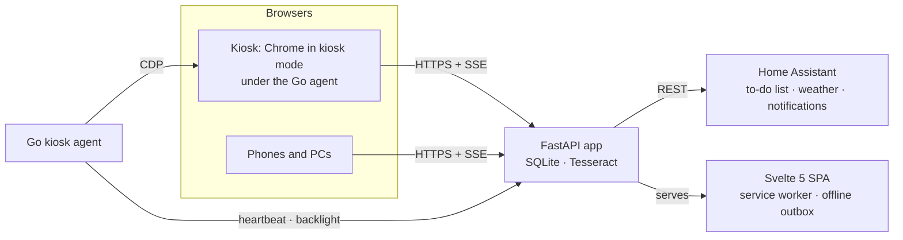

# JXN Kitchen

[](https://www.python.org/)
[](https://fastapi.tiangolo.com/)
[](https://svelte.dev/)
[](kiosk/agent)
[](LICENSE)

A touch-first kitchen companion for a **fully gluten-free kitchen**: recipes, pantry, shopping list, timers, a
spice-blend and a sauce engine, and a bilingual know-how library. One small FastAPI app serves it to a wall-mounted
kiosk and to any phone or PC on the home network, in Hungarian and English.

<p align="center">
  
  
</p>
<p align="center">
  
  
</p>

## Features

- **Recipes** — import from a link (schema.org data, with an SSRF guard on the fetch) or digitise a scanned page with
  Tesseract OCR. Scale servings, cook step by step with timers picked out of the step text, file recipes into folders.
  Every ingredient line is parsed and matched to the catalogue, and every recipe gets a **gluten verdict** that errs on
  the safe side and suggests gluten-free swaps.
- **Pantry and shopping list** — 450+ catalogue tiles; the shopping list syncs both ways with Home Assistant's to-do
  list.
- **Spice blends and sauces** — two engines over hand-curated knowledge tables: build a blend or a sauce and get a
  ledger of what works, what clashes and how to fix it.
- **Know-how** — nineteen sections of kitchen knowledge (temperatures, cuts, methods, storage, appliances, gluten-free
  baking) with interactive infographics.
- **Timers** — any number, labelled, shared by the kiosk, the phones and Home Assistant, with a phone notification when
  one ends.
- **Offline** — a service worker keeps the app, the recipes and their photos; timers keep running and edits queue up,
  replayed in order when the server is back.
- **Kiosk** — a Go agent runs as the Windows shell of a small wall PC: Chrome in kiosk mode under a watchdog,
  backlight on a day/night schedule, self-healing Wi-Fi, and a touch overlay that can save a recipe from any site.
- **Phones** — a mobile layout from 375 px wide, installable as a home-screen app.

## Architecture



| Part | Stack |
|---|---|
| `server/kitchen/` | Python 3.13, FastAPI, SQLite with migrations, Server-Sent Events, httpx, recipe-scrapers, rapidfuzz, Pillow, Tesseract |
| `web/` | Svelte 5, Vite, TypeScript, a service worker with an outbox for offline writes; vitest |
| `catalogue/`, `knowhow/`, `engine/` | Bilingual YAML, validated when the server starts |
| `kiosk/agent/` | Go for `windows/386`: Chrome DevTools Protocol, the WLAN API, Winlogon shell |
| `deploy/` | One Docker image: a Node stage builds and tests the SPA, a slim Python stage serves it |

## Running it

Needs Python 3.13, Node 22, rsync, and Go for the kiosk agent. `scripts/build-web.sh` builds the web app in
`~/.cache/jxn-kitchen/web`, outside the repository.

```bash
python3.13 -m venv ~/.local/share/venvs/jxn-kitchen
~/.local/share/venvs/jxn-kitchen/bin/pip install -e './server[test]'
scripts/build-web.sh
KITCHEN_DATA_DIR=/tmp/kitchen-data KITCHEN_STATIC_DIR=~/.cache/jxn-kitchen/web/dist KITCHEN_SHOPPING_SYNC_SECONDS=0 \
  PYTHONPATH=server ~/.local/share/venvs/jxn-kitchen/bin/uvicorn kitchen.main:app --port 8765
```

Open `http://localhost:8765`, or `http://localhost:8765/?kiosk=1` for the kiosk layout. For demo data,
`scripts/demo-recipes.py` prints four recipes to `POST` to `/api/recipes`.

### Configuration

| Variable | Default | |
|---|---|---|
| `KITCHEN_DATA_DIR` | `/data` | SQLite database and photos |
| `KITCHEN_STATIC_DIR` | `/app/static` | the built web app |
| `HA_URL`, `HA_TOKEN` | — | Home Assistant; without them the weather, the shopping-list sync and notifications stay off |
| `KITCHEN_WEATHER_ENTITY` | `weather.forecast_home` | the weather shown on the home and idle screens |
| `KITCHEN_SHOPPING_SYNC_SECONDS` | `20` | how often the shopping list syncs with Home Assistant; `0` turns it off |
| `KITCHEN_TZ` | `Europe/Budapest` | time zone for the clock and the night schedule |
| `KITCHEN_SCANS_DIR` | — | a folder of scanned pages, imported as draft recipes |
| `KITCHEN_CATALOGUE_DIR` | `/app/catalogue`, else the repository's `catalogue/` | the catalogue; the know-how and engine data sit beside it |

### Tests

```bash
~/.local/share/venvs/jxn-kitchen/bin/python -m pytest      # server and repository checks
scripts/build-web.sh --test-only                            # web unit tests and svelte-check
(cd kiosk/agent && go test ./...)                           # kiosk agent
```

## Deploying

`KITCHEN_HOST=user@server ./deploy.sh` runs the tests, ships the files git tracks, rebuilds the image on the server
with `docker compose build --pull` and waits for `/api/health`. The container runs as a non-root user on
`127.0.0.1:8090` behind a reverse proxy, with its data in `/srv/kitchen/data` and its environment in
`/etc/kitchen/kitchen.env` (see `deploy/kitchen.env.example`). The app has no user accounts, so it belongs on a private
network.

## The kiosk agent

`kiosk/agent` replaces the Windows shell of the kiosk PC (`./build.sh` builds `agent.exe`; `install.ps1` installs or
updates it). It:

- starts Chrome in kiosk mode on the app and restarts it when the page stops answering a DevTools probe, not just when
  the process dies;
- sends a heartbeat to the server and sets the screen brightness from the server's day/night schedule;
- keeps the PC awake;
- heals a dead Wi-Fi link — first by forcing a fresh reconnect, and if the radio stays unassociated for 20 minutes, by
  a rate-limited reboot that waits until nobody is using the screen;
- injects a small overlay into external recipe sites (Home, Back, an on-screen keyboard and **Save recipe**), guarded
  by a per-session secret;
- in a Remote Desktop session starts the normal Explorer desktop instead, for maintenance.

## Credits

Icons: [OpenMoji](https://openmoji.org) (CC BY-SA 4.0) and our own in its style · Fonts: Alfa Slab One and Archivo
(SIL OFL 1.1) · Favicon: Material Symbols "skillet" (Apache-2.0).

## License

The code is MIT — see [LICENSE](LICENSE). The icons, including the built `web/public/sprite.svg`, are CC BY-SA 4.0
(`icons/LICENSE-OpenMoji.md`); the fonts are SIL OFL 1.1 (`web/public/fonts/`).
